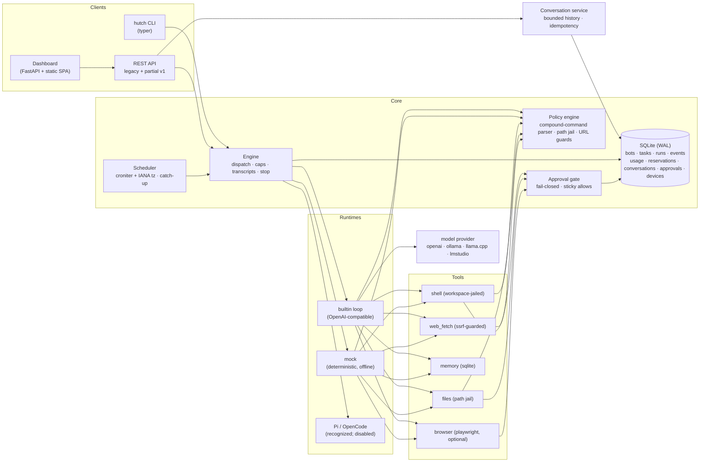

# Architecture

hutch is a local-first multi-bot agent platform: one Python process family that stores everything
in one state directory, drives LLM agents through a policy-gated tool layer, and exposes both a CLI
and a local web dashboard.

## Component map



## State layout

Everything lives under one directory (default `~/.local/state/hutch`, override `HUTCH_STATE_DIR`):

```
hutch.db                      # SQLite (WAL): bots, tasks, runs, events, usage/reservations, conversations, approvals, memory, receipts
bots/<bot>/runs/<run_id>/
  transcript.jsonl              # append-only run transcript (mirror of events)
  workspace/                    # the bot's jailed world for this run
bots/<bot>/browser-profile/     # persistent Chromium profile (logins survive runs)
```

## Key decisions

### D1 — Own the agent loop; keep ungoverned runtimes disabled

The original proposal (see `docs/research/orchestrators.md`) put OpenCode at the core. Research
changed that:

- **OpenCode's server is project-scoped**: N isolated bot workspaces would need N server processes
  on N ports, its Python SDK is alpha, and its HTTP API ships no stability promise.
- **Frameworks (CrewAI/LangGraph/AutoGen)** abstract the agent loop (the easy ~300 lines) and none
  of what actually matters here: scheduling, approvals, budgets, isolation, transcripts. 2026
  post-mortems consistently call them overkill for cron-style dispatch.

Result: `runtime/builtin.py` owns the governed tool loop; `runtime/mock.py` is deterministic and offline.
Legacy `pi` and `opencode` enum values fail closed before process creation. Their old adapters bypassed
Hutch approvals and budgets, so they remain unavailable until sandboxing, permission brokering,
provider reservations and protocol tests are complete.

### D2 — Bots are configs, runs are executions

A **Bot** is a stored config (model, tools, schedule, limits). A **Run** is one execution with its
own workspace directory, transcript, step/token accounting, and terminal status. Tasks are the
queue between scheduler and engine. One active run per bot at a time (single-instance lock);
global concurrency default 2.

### D3 — Scheduling correctness is a feature, not a detail

All timestamps are ISO-8601 UTC-with-offset. Cron math happens in the bot's IANA zone via croniter,
with a round-trip check that drops DST-gap times (spring-forward) and de-duplicates ambiguous times
(fall-back) — Vixie-cron semantics. Each bot records its last dispatched window; on wake the
scheduler counts missed windows and (policy `coalesce`, the default) dispatches one catch-up run
tagged `missed_windows=N`, or (policy `skip`) records a visible skip marker. Both paths are visible
in the dashboard so a silent non-run can never look like success.

### D4 — Policy before execution, transcripts regardless of outcome

Every tool call passes the policy engine (see `docs/safety.md`) *before* subprocess/file/network
execution. Every event — prompts, tool calls, results, approvals, errors — is appended to SQLite
and to `transcript.jsonl` on disk. A run becomes terminal (`succeeded`, `failed`, `stopped`, …) only after execution cleanup is
verified; otherwise `cancelling` or `recovering` remains visible with a reason. Terminal `exit_reason` values include `completed`,
`timeout`, `steps_exceeded`, `token_cap`, `approval_expired`, and `error`.

### D5 — Caps are enforced by the engine, not by model behavior

- `max_steps` — agent turns per run
- `timeout_seconds` — wall clock. `serve`, `daemon`, and `hutch run` execute one owned OS worker process per attempt. Cleanup verifies boot/start identities and keeps a run in `Stopping` or `Recovering` until no owned process remains. `HUTCH_EXECUTOR=thread` is for tests and compatibility; a stuck thread is joined before persistence closes, so it cannot be declared terminal while still running.
- `daily_token_cap` — actual response usage plus pre-call prompt/reply estimates and unresolved reservations;
  admission reserves the next estimate atomically across processes. Currency caps also reserve a price-based estimate;
  provider-side billing can differ, so this is not an exact dollar guarantee.

### D6 — Web dashboard and CLI are the same engine

`hutch serve` runs FastAPI with a background supervisor loop, serving a dependency-free static SPA that polls `/api`. A durable
SQLite lease elects one scheduler/recovery supervisor across dashboard workers and `hutch daemon`; web workers submit work
and wait for state changes. The CLI drives the same `Engine`.
No separate daemon is required for dashboard-driven usage; `hutch daemon` is the headless
equivalent.

### D7 — A database restore transfers history, not execution authority

Schema v14 records offline restore quarantine and process detachment. `hutch state backup`
creates a private standalone SQLite snapshot and manifest. Restore validates copied bytes and
history in a new directory without background workers, then holds submissions/claims and
records old attempts as Needs review. Source processes are never signalled. Device sessions,
standing grants and schedules are revoked/paused; an explicit local operator review permits
new work without resuming old work. Files and credentials require separate preservation.
See [ADR-0015](adr/0015-held-database-restoration.md) and [Operations](operations.md).

## Concurrency model

> **Updated (realignment, slices S2-S3).** Ownership is no longer process memory. A run is *claimed* by one atomic SQL statement
> that also enforces the per-bot rule across processes; the owner heartbeats a lease; every owner write carries a fence;
> expired leases already refuse owner writes and cannot be revived by heartbeat; recovery bumps the fence; status changes only through `Store.transition_run` against the
> table in `lifecycle.py`; schedule occurrences are claimed in the same transaction as the run they create. Stop is an intent in
> the database. Under `serve` and `daemon` each run is its own OS process (`hutch.worker`) in its own session, so a kill is a real
> kill, and a worker outlives a dead supervisor and is adopted by the next one (`HUTCH_EXECUTOR=thread` is an explicit
> compatibility/test mode; `hutch run`, `serve`, and `daemon` use process workers). Event sequence numbers and hash chains are assigned at commit time from the
> database tail, so several processes can safely write one run's transcript. Recovery atomically takes the expired owner and
> increments the fence before process cleanup. Worker and tool records include boot/start identities, and cleanup uses pidfds;
> incomplete cleanup remains nonterminal. Design: `docs/adr/0001-...`, `docs/adr/0003-...`, `docs/adr/0004-...`.
> The measured problems with the old design are in `docs/realignment/baseline.md`.

Each production run has an owned worker process and a supervisor watcher. The worker holds a cancel `Event` and a reference to
the run's approval gate so `stop` unblocks an approval wait immediately. In-process thread execution is only an explicit
compatibility/test mode. The browser owns a distinct persistent profile per bot. Browser actions remain serialized by a process-wide
lock, and live handoff remains open. SQLite access is serialized by an RLock in `Store`, and migration startup is additionally serialized across
processes. Schema v9 stores canonical conversations, user/assistant messages, run links and revocable device sessions; old runs are imported one per legacy
conversation to avoid guessing continuity. Versioned conversation writes and run admission are idempotent and transactional. The
builtin runtime receives a capped snapshot of earlier messages; Studio uses the versioned conversation endpoints. Versioned stop and
approval decisions are also idempotent.

Worker signal listeners and asynchronous process cleanup are owned work: listeners wake on normal
completion as well as Stop, and finalization joins earlier cleanup before its final process check.
The database closes only after the event writer exits. If the writer exceeds the shutdown wait,
closure fails visibly, keeps the connection open and refuses new buffered events; a later close
can complete after the writer unblocks. A completed close is idempotent.

`admission.py` owns one local-inference caller and eight waiters with kernel locks across worker
processes sharing the state directory. Tickets order calls, not entire runs, and never survive
their lock owner's exit as authority. Startup/self-check and generation hold capacity; tools and
human waits do not. Queue position/reason and admitted wait time are persisted. Native Ollama
checks current hardware headroom before generation; estimated fit and resident-allocation credit
are qualified in `docs/models.md`. This is not strict-offline enforcement or control of other
clients of the same model server. `HUTCH_MODEL_SLOTS` no longer widens inference concurrency.

## What is deliberately NOT here (yet)

Vector retrieval, webhook triggers, multi-user roles, bounded agent-to-agent collaboration, artifact versioning, browser handoff,
interactive remote supervision and Windows/macOS support — tracked in `docs/roadmap.md`.
Experimental direct HTTPS pairing has no phone UI and is not a production support claim. The Linux shell has optional, fail-closed bubblewrap
containment; it is not a VM and does not contain every tool or the browser.

The conversation-first shell keeps the bot roster and configuration ownership in one place.
Approvals appear in their transcript and in an explicit cross-bot drawer, using the same card and
v1 decision command. Activity and run history are secondary monitoring surfaces; Fleet adds
search/state filtering at ten bots. [Navigation rationale](realignment/navigation.md) records
compatibility, evidence and the limits of the threshold heuristic.

Schema v11 commits resource invalidations with SQLite mutations through AFTER triggers. Typed
`/api/v1/changes` pages/SSE replay identifiers from a durable epoch/committed-ID chain; gaps
require a bounded snapshot whose resource state and cursor share one read transaction. A
one-second safety poll catches silent cross-process commits. Targeted UI refreshes preserve
drafts/settings rather than routing the page. Approval admission includes its review event;
canonical decision summaries cover a missing worker response. Connection-file changes are
excluded. Schema v12 separately enqueues transcript-file delivery with each event. A locked,
bounded worker verifies prefixes, preserves damaged files, fsyncs before acknowledgement and
retries after restart. File errors remain visible without changing executor completion; all
SQLite connections use FULL WAL synchronization. See
[ADR-0012](adr/0012-resource-outbox-and-reconciliation.md) and restore precautions in operations.
File-delivery design and limits are in [ADR-0013](adr/0013-recoverable-transcript-files.md).

Schema v13 retains immutable action argument/authority snapshots. Owned writes require an
unexpired fence; terminal transition and uncertain receipt sealing commit together. Reconciliation
is a once-only operator statement with reviewed intent hash, evidence and idempotency, preserving
original status and transcript. Chat surfaces these records inline; the paginated Needs you drawer
keeps older/cross-bot uncertainty reachable. Bounded current model guidance supplements a same-
conversation effect guard. Legacy arguments are not inferred. See
[ADR-0014](adr/0014-immutable-action-review.md).

Builtin provider sessions carry per-run route authority separately from model choice. The
primary selection authorizes its receiving service; a configured hop that changes account,
endpoint, protocol or revision requires outward review. Each call revalidates that authority
and refreshes credential-aware clients. Streaming recovery keeps the first uncertain usage
and reserves another attempt before retrying, using the same transactional account ledger.

Owner mutations check both the fence and lease expiry in the write transaction, including the gap
before recovery. Worker events retain their fence through buffering; commit rejects stale events
before projecting replies into canonical history. Recovery and terminal receipts remain uncertain
when a late owner returns; finishing an old action cannot overwrite that outcome.
Provider settlement and unsent-call release use the same ownership boundary. Reservation
identity is immutable, changed duplicate settlements conflict, and uncertain records require
explicit terminal-run reconciliation. All unresolved holds consume the current allowance;
clock rollover cannot establish whether a provider charged the request.
Worker approval admission commits the request and run wait together, draining prior buffered
events through the same ownership check. Failed admission rolls back both without losing
the buffer. Expired execution cannot receive a new approval or standing grant; decisions still
resolve once through compare-and-swap, and full-request rewrites are refused.
