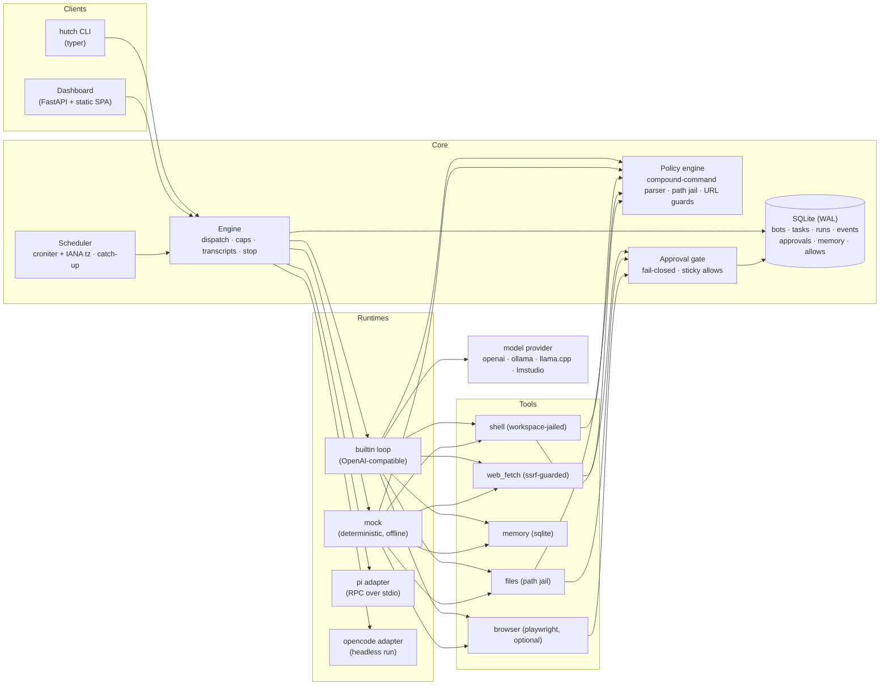

# Architecture

hutch is a local-first multi-bot agent platform: one Python process family that stores everything
in one state directory, drives LLM agents through a policy-gated tool layer, and exposes both a CLI
and a local web dashboard.

## Component map



## State layout

Everything lives under one directory (default `~/.local/state/hutch`, override `HUTCH_STATE_DIR`):

```
hutch.db                      # SQLite (WAL): all entities + events
bots/<bot>/runs/<run_id>/
  transcript.jsonl              # append-only run transcript (mirror of events)
  workspace/                    # the bot's jailed world for this run
bots/<bot>/browser-profile/     # persistent Chromium profile (logins survive runs)
```

## Key decisions

### D1 — Own the agent loop; make runtimes pluggable

The original proposal (see `docs/research/orchestrators.md`) put OpenCode at the core. Research
changed that:

- **OpenCode's server is project-scoped**: N isolated bot workspaces would need N server processes
  on N ports, its Python SDK is alpha, and its HTTP API ships no stability promise.
- **Pi** (earendil-works/pi) is the better external runtime — RPC over stdio, one process per bot,
  documented Python pattern, strong local-model support — so it's a first-class adapter.
- **Frameworks (CrewAI/LangGraph/AutoGen)** abstract the agent loop (the easy ~300 lines) and none
  of what actually matters here: scheduling, approvals, budgets, isolation, transcripts. 2026
  post-mortems consistently call them overkill for cron-style dispatch.

Result: `runtime/builtin.py` is a thin loop over an OpenAI-compatible client; `runtime/pi.py` and
`runtime/opencode.py` delegate to external harnesses when installed; `runtime/mock.py` is a
deterministic offline runtime used by tests, demos, and first-run exploration.

### D2 — Bots are configs, runs are executions

A **Bot** is a stored config (model, tools, schedule, limits). A **Run** is one execution with its
own workspace directory, transcript, step/token accounting, and terminal status. Tasks are the
queue between scheduler and engine. One active run per bot at a time (single-instance lock);
global concurrency default 2.

### D3 — Scheduling correctness is a feature, not a detail

All timestamps are ISO-8601 UTC-with-offset. Cron math happens in the bot's IANA zone via croniter,
with a round-trip check that drops DST-gap times (spring-forward) and de-duplicates ambiguous times
(fall-back) — Vixie-cron semantics. Each bot records its last dispatched window; on wake the
scheduler counts missed windows and (policy `coalesce`, the default) dispatches one catch-up run
tagged `missed_windows=N`, or (policy `skip`) records a visible skip marker. Both paths are visible
in the dashboard so a silent non-run can never look like success.

### D4 — Policy before execution, transcripts regardless of outcome

Every tool call passes the policy engine (see `docs/safety.md`) *before* subprocess/file/network
execution. Every event — prompts, tool calls, results, approvals, errors — is appended to SQLite
and to `transcript.jsonl` on disk. Run outcome is always terminal-state recorded (`succeeded`,
`failed`, `stopped`, …) with `exit_reason` (`completed`, `timeout`, `steps_exceeded`, `token_cap`,
`approval_expired`, `error`, …).

### D5 — Caps are enforced by the engine, not by model behavior

- `max_steps` — agent turns per run
- `timeout_seconds` — wall clock; currently the agent thread is **abandoned** (it keeps running) and the run marked failed. This is a known defect, replaced by owned worker processes in ADR-0001/0004
- `daily_token_cap` — measured usage when the provider reports it, estimate otherwise; the next
  model call aborts when the bot's day-total exceeds the cap

### D6 — Web dashboard and CLI are the same engine

`hutch serve` runs FastAPI with a background tick thread (scheduler + dispatch + approval
expiry), serving a dependency-free static SPA that polls `/api`. The CLI drives the same `Engine`.
No separate daemon is required for dashboard-driven usage; `hutch daemon` is the headless
equivalent.

## Concurrency model

> **Updated (realignment, slice S2).** Ownership is no longer process memory. A run is *claimed* by one atomic SQL statement
> that also enforces the per-bot rule across processes; the owner heartbeats a lease; every owner write carries a fence;
> recovery bumps the fence so a stalled worker cannot write; status changes only through `Store.transition_run` against the
> table in `lifecycle.py`; schedule occurrences are claimed in the same transaction as the run they create. Stop is an intent in
> the database. Workers are still threads in the engine's process; one worker *process* per run (so a kill is a real kill) is
> slice S3 and is specified in `docs/adr/0001-control-plane-and-owned-execution.md`. The measured problems with the old
> design are in `docs/realignment/baseline.md`.

Workers are daemon threads. The engine holds a `_threads` map, a cancel `Event` per run, and a
reference to the run's approval gate so `stop` unblocks an approval wait immediately. The browser
tool takes a global lock (one GUI automation at a time). SQLite access is serialized by an RLock in
`Store`.

## What is deliberately NOT here (yet)

Vector memory/RAG, container sandboxing, webhook triggers, multi-user access, agent-to-agent
collaboration, Windows/macOS support — tracked in `docs/roadmap.md`.
