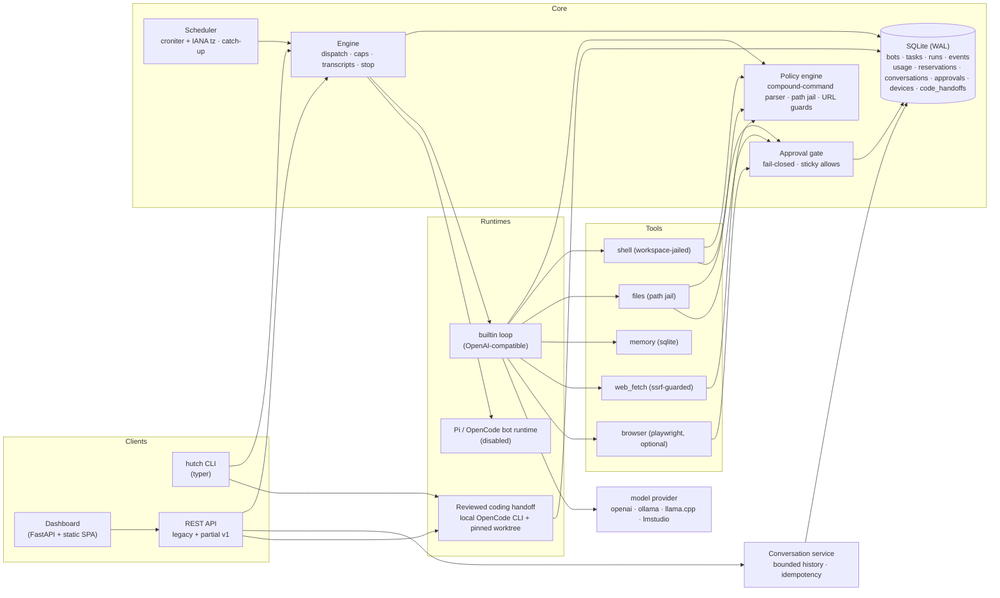

# Architecture

Schema v46 separates reference facts, durable typed chat questions, explicit specialist-result references, task-only selected-fact snapshots, content-free workspace task checkpoints, an owner-approved specialist roster, immutable safe-continuation lineage, owner-reviewed local OpenCode coding handoffs, per-Bot Google Calendar event-creation grants, and separate Outlook Mail send grants from canonical chat messages, workspace files, execution receipts
and provider credential stores. It stores credential-free Google and Outlook Calendar/Mail account references and one selected-calendar, mailbox, or send-only mailbox grant per Bot;
refresh credentials remain in Linux Secret Service. Outlook Calendar, Mail read, and Mail send use separate OAuth callbacks, token namespaces and scopes. Model proposals inherit persisted chat/run scope and execution fencing;
human review binds immutable revision/scope hashes. Explicit sharing creates a bot-wide reference.
Facts are retrieved as bounded JSON tool data through SQLite FTS5, never automatically placed in system
instructions. During a reviewed coordinator handoff only, the owner may explicitly select up to eight current approved facts
from the coordinator Bot or exact chat; immutable snapshots are attached to that task and enter the specialist run as untrusted
context, not specialist memory. Archived/replaced/unreviewed versions are excluded. Retained versions/reviews remain
private persistent data; archive is not erasure. See ADR-0008 and the continuation ledger for actual checks.
Bot settings can export one consistent, bounded SQLite snapshot of that Bot's complete fact history,
review decisions and explicit share records. The downloadable JSON is unencrypted; credentials, transcripts,
action receipts and workspaces remain outside the export.

Bots retain a stable machine address (`name`) for routes, files and old links, with a separate human-facing
`display_name`. Older records receive a readable label derived from their address. Guided creation suggests a
professional label from the owner's stated purpose using a deterministic local heuristic; the owner can edit
both label and address before confirming. The CLI also accepts `--display-name`. This naming step does not call a model,
change permissions or start a run.
When creating a Bot from Studio chat, the owner can also select up to eight earlier user messages from that same conversation.
The exact selection is reviewed and saved as background in the Bot's instructions; assistant messages, other chats and
permissions are not carried over. The saved context may be included in future model calls.
Schema v28 stores the owner's selected workspace coordinator. Bot settings can assign the role, the selected Bot opens as the default Studio chat, and the roster labels it. Schema v41 stores the owner's explicit specialist list, initially empty; promotion removes the new coordinator, and task admission checks membership atomically before writing the task/run. The prior coordinator is not auto-authorized. Schema v29 records a reviewed handoff from a completed coordinator turn to one approved specialist: the original request, coordinator draft, user-edited brief and assumptions, specialist identity/settings snapshot, child conversation/run, current status and latest response remain linked in the parent chat. Schema v32 permits an unchecked-by-default, bounded selection of reviewed coordinator facts for that task's untrusted run context; the snapshot is not added to specialist memory. The specialist's own enabled memory and workspace still apply. A changed specialist route, instruction, permission or workspace fails before its worker starts. Schema v30 records a user-selected successful specialist message attached to a coordinator follow-up, bound to the task and source message in the same parent conversation. A 4,000-character immutable snapshot appears in the transcript/export and a JSON-escaped form enters only that run as explicitly untrusted context. Schema v31 adds an ordered journal of selected committed child-run event markers, bounded to the latest 16 per task in the API projection; it stores no event content, prompts, reasoning, action arguments or tool output. The linked child run remains the authority for its capability snapshot and decision records. Schema v34 permits one owner-confirmed fresh attempt from a failed/stopped built-in task only when no action or child run was recorded, the specialist chat has no later work or pending question, the coordinator chat remains active, and the exact capability snapshot is unchanged. The new attempt gets the reviewed brief/constraints and bounded committed assistant text as untrusted progress; it never replays actions, receipts, selected facts, prior tool results or credentials. `outcome_unknown`, external runtimes and process restoration remain unavailable. This remains one explicit handoff at a time, not an autonomous team planner; parent cancellation and live external-provider verification remain incomplete.

hutch is a local-first multi-bot agent platform: one Python process family that stores everything
in one state directory, drives LLM agents through a policy-gated tool layer, and exposes both a CLI
and a local web dashboard.

## Component map



The code-handoff API validates and records an immutable review; it does not launch an executor process. The owner later starts the
local OpenCode CLI from `hutch code run` in an interactive Linux terminal. That terminal path uses the saved commit and a separate
Git worktree. OpenCode command approvals, account usage and shell effects stay outside Hutch's executor, sandbox and usage ledger.
The Bot's normal Pi/OpenCode runtime value remains disabled. See the [reviewed handoff contract](realignment/contracts.md#reviewed-opencode-coding-handoff-experimental-schema-v39).

## State layout

Everything lives under one directory (default `~/.local/state/hutch`, override `HUTCH_STATE_DIR`):

```
hutch.db                      # SQLite (WAL): bots, tasks, runs, events, usage/reservations, conversations/questions, approvals, memory, receipts, artifact-share grants
bots/<bot>/runs/<run_id>/
  transcript.jsonl              # append-only run transcript (mirror of events)
  artifacts/<version>-<tool>.txt # immutable clipped outputs and write_file snapshots
  workspace/                    # the bot's jailed world for this run
bots/<bot>/browser-profile/     # persistent Chromium profile (logins survive runs)
workspaces/<bot_id>/            # optional private folder shared across one bot's runs/chats
code-worktrees/<handoff-id>/     # retained local coding-task branch; managed outside database backup
```

Large tool outputs and files created with `write_file` are linked to their committed `tool_result`
event by run and event sequence. The event stores the byte size and SHA-256; the typed API lists
these bounded run-scoped artifacts, and a download verifies the bytes again before sending them as
plain text. The chat offers file downloads beside the write result; snapshots are capped at 4 MB
per file and 16 MB per run. Studio shows write-file downloads outside the collapsed tool details.
Each tool can also set a model-visible character limit (12,000 by default). Clipped output stays
as a verified run artifact; the expanded tool row places its download and readable source card
outside the scroll-bounded preview so the full result remains easy to reach on a phone.
The composer menu also pages verified files and saved tool output across runs attached to the
current conversation, so the operator can find an earlier result without leaving the chat. The
query checks both conversation and bot ownership; downloads still resolve to the source run and
verify its recorded size and hash. The owner may explicitly grant another selected conversation a
reference to one verified artifact. That grant is stored in SQLite, appears with source-chat
provenance, and has its own target-bound download URL so revocation blocks later downloads. The
originating chat lists active recipients beside the file and can revoke a grant there; the receiving
chat can also stop its access. The file bytes stay in the source run: the reference neither copies
them into the other workspace nor adds them to that chat's model context. This is not a general
artifact library or implicit bot-to-bot sharing. Schema v18 adds durable invalidations for the source
conversation when a grant is created or revoked, including changes made from another device.
Schema v19 adds a one-use resume record bound to the active `human_needed` event sequence. An old
resume retry returns its original result without setting a flag for a later challenge.
Arbitrary shell-created files are not attached automatically. Bots
default to a fresh workspace per run; operators may select a private Hutch-managed directory
shared only by that bot, or an existing validated user folder.
These choices do not move files. Managed workspaces are separate from SQLite backups and survive
bot deletion. A run with persisted parent lineage always gets its own private 0700 run workspace,
regardless of the bot's managed or host-folder setting; an unexpected workspace symlink fails closed.
Schema v24 captures a credential-free capability snapshot in the same transition that starts each new
root run. Internal child admission copies the parent's immutable snapshot, so editing the bot cannot
silently widen a future child. An opt-in `delegate_task` tool now admits a same-bot child only for a
supervised built-in Strict Offline run. The worker reconstructs execution authority from the saved
snapshot, removes browser and memory tools, and uses a private per-run workspace. The child receives
only its explicit task string, not the parent conversation or workspace contents. Its run remains
attached to the same conversation for operator visibility, while the parent model receives only the
child's final text. Artifacts remain attributed to the child run; no workspace copy or automatic file
transfer occurs. Every child request asks for human approval, even in `auto` mode. Depth, fan-out,
child duration and steps are bounded, usage reserves against the inherited root limit, and Stop
persists cancellation across the lineage. With the default global limit of two, only one child can
run beneath a root at a time; deeper work requires additional configured global slots. See
[`delegation.md`](realignment/delegation.md). External runtimes and parallel public child execution
remain unavailable.

## Key decisions

### D1 — Own the agent loop; keep ungoverned runtimes disabled

The original proposal (see `docs/research/orchestrators.md`) put OpenCode at the core. Research
changed that:

- **OpenCode's server is project-scoped**: N isolated bot workspaces would need N server processes
  on N ports, its Python SDK is alpha, and its HTTP API ships no stability promise.
- **Frameworks (CrewAI/LangGraph/AutoGen)** abstract the agent loop (the easy ~300 lines) and none
  of what actually matters here: scheduling, approvals, budgets, isolation, transcripts. 2026
  post-mortems consistently call them overkill for cron-style dispatch.

Result: `runtime/builtin.py` owns the governed production tool loop. The deterministic execution
scenario under `tests/support/` exists only to exercise the tool and policy pipeline in tests;
it is not installed or selectable by an application user.
Legacy `pi` and `opencode` enum values fail closed before process creation. Their old adapters bypassed
Hutch approvals and budgets, so they remain unavailable until sandboxing, permission brokering,
provider reservations and protocol tests are complete.

### D2 — Bots are configs, runs are executions

A **Bot** is a stored config (model, tools, up to 100 optional recurring tasks, limits). A **Run** is one execution with its
own workspace directory, transcript, step/token accounting, and terminal status. Tasks are the
queue between scheduler and engine. One active run per bot at a time (single-instance lock);
global concurrency default 2.

Each recurring task has a stable, globally reserved ID, name, cron expression, IANA timezone,
catch-up policy, and optional prompt separate from standing bot instructions. Its due window,
last-fire marker and visible skip record are independent from the bot's other tasks. A blank task
prompt preserves legacy behavior by using the bot instructions, then a generic workspace-report
task if the instructions are empty. Prompts are limited to 4,000 characters. Settings, the typed
schedule API and `hutch bot schedules` manage individual tasks. Older `schedule` fields and
`hutch bot update` schedule options remain aliases for the first task. Tasks on one bot share its
tools, workspace, limits and permissions, and that bot still never runs two attempts at once. The
dashboard's Schedules overview lists next occurrences in each task's timezone. A durable workspace
pause affects future schedule admission only; queued/running work and Bot-specific pause settings
remain independent.

### D3 — Scheduling correctness is a feature, not a detail

All timestamps are ISO-8601 UTC-with-offset. Cron math happens in the bot's IANA zone via croniter,
with a round-trip check that drops DST-gap times (spring-forward) and de-duplicates ambiguous times
(fall-back) — Vixie-cron semantics. Each task records its own last dispatched window; on wake the
scheduler counts that task's missed windows and (policy `coalesce`, the default) dispatches one
catch-up run tagged `missed_windows=N`, or (policy `skip`) records a visible skip marker. Both
paths are visible in task settings and the schedule API so a silent non-run can never look like
success. Schema v21 retains schedule identities after removal, preventing an unused or deleted
task ID from being assigned to a different stream later. The workspace-wide pause is rechecked in
the same transaction that claims the occurrence and creates its run, closing the stale due-snapshot
race.

### D4 — Policy before execution, transcripts regardless of outcome

Every tool call passes the policy engine (see `docs/safety.md`) *before* subprocess/file/network
execution. Every event — prompts, tool calls, results, approvals, errors — is appended to SQLite
and to `transcript.jsonl` on disk. A run becomes terminal (`succeeded`, `failed`, `stopped`, …) only after execution cleanup is
verified; otherwise `cancelling` or `recovering` remains visible with a reason. Terminal `exit_reason` values include `completed`,
`timeout`, `steps_exceeded`, `token_cap`, `approval_expired`, and `error`.

### D5 — Caps are enforced by the engine, not by model behavior

- `max_steps` — agent turns per run
- `timeout_seconds` — wall clock. `serve`, `daemon`, and `hutch run` execute one owned OS worker process per attempt. Cleanup verifies boot/start identities and keeps a run in `Stopping` or `Cleaning up` until no owned process remains. Admission also treats unreaped `run_procs` as occupying capacity so a peer cannot start while descendants may still act. `HUTCH_EXECUTOR=thread` is for tests and compatibility; a stuck thread is joined before persistence closes, so it cannot be declared terminal while still running.
- Tool capture is bounded before allocation (`MAX_TOOL_OUTPUT`); the model sees a smaller per-tool view (PF-2) with optional artifacts. Unlimited `tool_limits=0` is rejected.
- `daily_token_cap` — actual response usage plus pre-call prompt/reply estimates and unresolved reservations;
  admission reserves the next estimate atomically across processes. Currency caps also reserve a price-based estimate;
  provider-side billing can differ, so this is not an exact dollar guarantee.

### D6 — Web dashboard and CLI are the same engine

`hutch serve` runs FastAPI with a background supervisor loop, serving a dependency-free static SPA that polls `/api`. A durable
SQLite lease elects one scheduler/recovery supervisor across dashboard workers and `hutch daemon`; web workers submit work
and wait for state changes. The CLI drives the same `Engine`.
No separate daemon is required for dashboard-driven usage; `hutch daemon` is the headless
equivalent.

### D7 — A database restore transfers history, not execution authority

Schema v14 records offline restore quarantine and process detachment. `hutch state backup`
creates a private standalone SQLite snapshot and manifest. Restore validates copied bytes and
history in a new directory without background workers, then holds submissions/claims and
records old attempts as Needs review. Source processes are never signalled. Device sessions,
standing grants and schedules are revoked/paused; an explicit local operator review permits
new work without resuming old work. Files and credentials require separate preservation.
See [ADR-0015](adr/0015-held-database-restoration.md) and [Operations](operations.md).

## Concurrency model

> **Updated (realignment, slices S2-S3).** Ownership is no longer process memory. A run is *claimed* by one atomic SQL statement
> that also enforces the per-bot rule across processes; the owner heartbeats a lease; every owner write carries a fence;
> expired leases already refuse owner writes and cannot be revived by heartbeat; recovery bumps the fence; status changes only through `Store.transition_run` against the
> table in `lifecycle.py`; schedule occurrences are claimed in the same transaction as the run they create. Stop is an intent in
> the database and marks persisted descendants before any cleanup or process signal. Under `serve` and `daemon` each run is its own OS process (`hutch.worker`) in its own session, so a kill is a real
> kill, and a worker outlives a dead supervisor and is adopted by the next one (`HUTCH_EXECUTOR=thread` is an explicit
> compatibility/test mode; `hutch run`, `serve`, and `daemon` use process workers). Event sequence numbers and hash chains are assigned at commit time from the
> database tail, so several processes can safely write one run's transcript. Recovery atomically takes the expired owner and
> increments the fence before process cleanup. Worker and tool records include boot/start identities, and cleanup uses pidfds;
> incomplete cleanup remains nonterminal. Design: `docs/adr/0001-...`, `docs/adr/0003-...`, `docs/adr/0004-...`.
> The measured problems with the old design are in `docs/realignment/baseline.md`.

Each production run has an owned worker process and a supervisor watcher. The worker holds a cancel `Event` and a reference to
the run's approval gate so `stop` unblocks an approval wait immediately. In-process thread execution is only an explicit
compatibility/test mode. The browser owns a distinct persistent profile per bot. A cross-process OS file lease prevents two workers
from opening the same profile; an opted-in local handoff also reserves Hutch's visible-browser lease until that session closes.
Agent typing into conventional sensitive fields is intercepted before input or durable action creation; browser type values are
redacted from event/receipt records. Native HTML form submissions show a bounded destination/method/field-label review and bind
the approval to a page-side digest of current form state, including secret values that never leave the page. A changed form refuses
to submit; selected file uploads and forms without secure digest support fail closed. A visible sensitive field blocks screenshots.
Human password/CAPTCHA/MFA steps pause in the same live profile; Resume checks the page without reloading it. Field detection is heuristic, the Linux desktop handoff is
  experimental; controlled login and real native input are verified in disposable sessions, with no live third-party challenge claim. Paired-phone supervision now supports status/transcript
  viewing, approval review, Stop/Resume, and locally enabled starts through passkeys and an explicit route capability inventory; live
  mobile/network validation remains open. Bounded HTTP human step input is locally verified; physical-phone, live-network and non-HTTP browser egress validation remain open. HTTP(S)/WebSocket browser connections use a locally tested DNS-pinning proxy. SQLite access is serialized by an RLock in `Store`, and migration startup is additionally serialized across
processes. Schema v9 stores canonical conversations, user/assistant messages, run links and revocable device sessions; old runs are imported one per legacy
conversation to avoid guessing continuity. Versioned conversation writes and run admission are idempotent and transactional. The
builtin runtime receives a capped snapshot of earlier messages; Studio uses the versioned conversation endpoints. Versioned stop and
approval decisions are also idempotent. Studio message search accepts a bounded query in the body of `POST /api/v1/search/messages`,
returns excerpts rather than full message rows, excludes archived and imported conversations, and filters by Bot; paired Monitor
sessions may search only with the normal origin and CSRF checks. The legacy GET search remains available to local clients. Schema v26
stores a Bot-authored choice prompt and its options with the assistant message and
hash-chained `choice_requested` event in one fenced transaction. A selected answer atomically records the chosen option IDs, adds a
user message linked to the question, and admits the next conversation run under the normal idempotency key. Questions are separate
from approvals and browser/CAPTCHA handoff: they do not change run authority or permissions. A provider response that combines a
choice prompt with other tool calls is rejected as a batch before any of those calls run.

Worker signal listeners and asynchronous process cleanup are owned work: listeners wake on normal
completion as well as Stop, and finalization joins earlier cleanup before its final process check.
The database closes only after the event writer exits. If the writer exceeds the shutdown wait,
closure fails visibly, keeps the connection open and refuses new buffered events; a later close
can complete after the writer unblocks. A completed close is idempotent.

`admission.py` owns one local-inference caller and eight waiters with kernel locks across worker
processes sharing the state directory. Tickets order calls, not entire runs, and never survive
their lock owner's exit as authority. Startup/self-check and generation hold capacity; tools and
human waits do not. Queue position/reason and admitted wait time are persisted. Native Ollama
checks current hardware headroom before generation; estimated fit and resident-allocation credit
are qualified in `docs/models.md`. This is not strict-offline enforcement or control of other
clients of the same model server. `HUTCH_MODEL_SLOTS` no longer widens inference concurrency.

## Purpose-first Bot creation

When the owner has a validated workspace model default or an eligible source-chat model
route, New Bot presents a one-screen quick path. In an active chat, the latest user
request is already the draft instruction; **Make a bot** binds the exact message the
owner selected. The owner reviews the request and suggested Bot name without having
to describe the same work again. Editing instructions stays optional. From an empty
chat, the owner can describe a new responsibility. Browser-local naming suggests a
professional name and stable address; it makes no model request. Quick creation stores
managed workspace, no tools, no schedule and ask-first actions. Saving is idempotent
and starts no run. If no route is configured, the owner must choose one before
creation; Hutch has no implicit provider fallback.

**Customize** enters the existing full editor for model/inference/workspace, tools,
memory, schedules, usage limits, optional browser handoff, YAML and final review.
Import still fills an unsaved draft and requires the explicit creation action. A
source-chat request remains linked as provenance. Only earlier messages explicitly
selected by the owner become saved context, and context content never changes Bot
authority. This split shortens the common path without removing controls or silently
granting a tool, connection, credential, schedule or background task.

## Review-only Bot-purpose drafting

New Bot setup may submit one optional refinement to the workspace coordinator. Hutch supplies the exact source user message,
the owner's current purpose draft and only earlier user messages the owner selected from that conversation. The request is bounded
and labelled as untrusted data. It runs as a normal conversation attempt, so existing admission, model routing and budget
reservation apply; it is restricted at the run level to the built-in runtime with an empty tool registry. A provider tool call,
prompt truncation or second response ends the attempt without invoking a tool or silently escalating. The coordinator may ask one
concise choice question for a material missing work detail, then return an editable instruction draft. The owner can answer at most
five questions, one at a time; after that the prompt requires a draft. Choice options and free text are supported. The same browser
can restore the unsent answer, bounded history, or review draft for seven days; this is local browser storage, not server-side or
cross-device synchronization. Expired state is discarded. The source, prior answers and selected context are untrusted data, the run
has no tools. The prompt forbids credential or authority questions, and the client rejects a denylisted set of terms; this is not a
complete detector. The result remains a proposal: the owner edits and explicitly applies it. Bot creation remains a separate confirmation, and this flow cannot alter the proposed Bot's model, account,
memory, workspace or permissions. Required response fields and limits are validated, and malformed output stays unapplied.

## What is deliberately NOT here (yet)

Vector retrieval, webhook triggers, multi-user roles, bounded agent-to-agent collaboration, a cross-run artifact library, authenticated PTY/personal-desktop controls and Windows/macOS support — tracked in `docs/roadmap.md`.
Remote phone supervision is optional and remains disabled unless `hutch serve --allow-remote` is explicitly launched. It uses one-use
enrollment, passkey credentials, bounded sessions, a deny-by-default route inventory and per-Bot local Start opt-in. Direct remote
access requires a private interface and trusted HTTPS certificate; a proxy requires exact proxy IP and public-host allowlists. The
recommended Tailscale path forwards Serve to a loopback Hutch listener and still requires Hutch passkey authentication. These boundaries
have automated local and real-Uvicorn HTTPS coverage, but not live tunnel, private-network, iOS/Android, or certificate-renewal
validation. No production remote-support claim exists. Bounded human step control uses an owner-only Linux Unix socket to a private worker-thread queue, ephemeral viewer/generation tokens and an independent expiry/revocation watchdog. Human frames/text are excluded from planner history. HTTP threads fence control but never touch Playwright/native objects. Physical-phone and live-network input remain unverified. The Linux shell has optional,
fail-closed bubblewrap containment; it is not a VM and does not contain every tool or the browser.

The conversation-first shell keeps the bot roster and configuration ownership in one place.
Approvals appear in their transcript and in an explicit cross-bot drawer, using the same card and
v1 decision command. The drawer offers opt-in browser alerts with generic text when the tab is
backgrounded. They omit bot, chat and action details, open the Needs you drawer when selected,
and work only while the Hutch tab stays open; there is no service-worker or push delivery.
Activity and run history are secondary monitoring surfaces; Fleet adds search/state filtering at
ten bots. [Navigation rationale](realignment/navigation.md) records compatibility, evidence and the
limits of the threshold heuristic.

Schema v11 commits resource invalidations with SQLite mutations through AFTER triggers. Typed
`/api/v1/changes` pages/SSE replay identifiers from a durable epoch/committed-ID chain; gaps
require a bounded snapshot whose resource state and cursor share one read transaction. A
one-second safety poll catches silent cross-process commits. Targeted UI refreshes preserve
drafts/settings rather than routing the page. Approval admission includes its review event;
canonical decision summaries cover a missing worker response. Connection-file changes are
excluded. The elected supervisor prunes the content-free invalidation outbox to 50,000 retained
rows every five minutes; older cursors receive `snapshot_required`. Transcript events and user
records are not removed by that policy. Schema v12 introduced recoverable transcript-file delivery. Schema v16 records one durable
delivery intent per committed event batch in the same transaction as canonical events, instead of
running an insert trigger per event. A locked, bounded worker verifies prefixes, preserves damaged files, fsyncs before acknowledgement and
retries after restart. File errors remain visible without changing executor completion; all
SQLite connections use FULL WAL synchronization. See
[ADR-0012](adr/0012-resource-outbox-and-reconciliation.md) and restore precautions in operations.
File-delivery design and limits are in [ADR-0013](adr/0013-recoverable-transcript-files.md).

Schema v13 retains immutable action argument/authority snapshots. Owned writes require an
unexpired fence; terminal transition and uncertain receipt sealing commit together. Reconciliation
is a once-only operator statement with reviewed intent hash, evidence and idempotency, preserving
original status and transcript. Chat surfaces these records inline; the paginated Needs you drawer
keeps older/cross-bot uncertainty reachable. Bounded current model guidance supplements a same-
conversation effect guard. Legacy arguments are not inferred. See
[ADR-0014](adr/0014-immutable-action-review.md).

Builtin provider sessions carry per-run route authority separately from model choice. The
primary selection authorizes its receiving service; a configured hop that changes account,
endpoint, protocol or revision requires outward review. Each call revalidates that authority
and refreshes credential-aware clients. Streaming recovery keeps the first uncertain usage
and reserves another attempt before retrying, using the same transactional account ledger.

Provider protocol claims are published in the versioned `GET /api/v1/compatibility` matrix
([details](realignment/provider-compatibility.md)). Its `supported` state describes a common
request/response contract with recorded fixtures. It is not a live connection or model capability
check: endpoint variants and models can differ in tool use, context, usage and retention. Schema v37
records positive function-tool-call observations only when an owned Bot run with settled or uncertain
usage receives a declared call with valid arguments. `GET /api/v1/model-capabilities` returns that
immutable evidence, bound to a hash of the exact connection/account/protocol/endpoint revision and
model. It is a historical observation, not a future guarantee; no record means unknown. Hutch makes
no extra model probe, and tool-call evidence does not grant action authority.

Each bot stores an inference route mode. `local` filters hosted choices and refuses hosted
per-message overrides, fallback and escalation calls; configured tools keep their own network
policy. `hybrid` retains route review and usage reservations for hosted calls. Experimental
`offline` requires fresh Linux bubblewrap network/PID namespaces that pass a local probe before
configuration or dispatch. Each worker has no host TCP interface, a scrubbed environment, and
read-only empty views over saved connection/key files; a private Unix-socket broker forwards model
requests only to configured numeric loopback endpoints.
Hosted routes, external runtimes, browser and web-fetch tools are refused; shell requires
bubblewrap's private no-network namespace. systemd user scopes enforce resource caps only.
`GET /api/v1/capabilities` reports whether the current host passes. The current Linux development
host passes the local probe and a fake Ollama request completed through the broker inside an
isolated worker. No live local model was available, and Hutch still cannot constrain the separate
model-server process or prove model provenance. See
[ADR-0009](adr/0009-local-inference-and-resource-admission.md).

Owner mutations check both the fence and lease expiry in the write transaction, including the gap
before recovery. Worker events retain their fence through buffering; commit rejects stale events
before projecting replies into canonical history. Recovery and terminal receipts remain uncertain
when a late owner returns; finishing an old action cannot overwrite that outcome.
Provider settlement and unsent-call release use the same ownership boundary. Reservation
identity is immutable, changed duplicate settlements conflict, and uncertain records require
explicit terminal-run reconciliation. All unresolved holds consume the current allowance;
clock rollover cannot establish whether a provider charged the request.
Worker approval admission commits the request and run wait together, draining prior buffered
events through the same ownership check. Failed admission rolls back both without losing
the buffer. Expired execution cannot receive a new approval or standing grant; decisions still
resolve once through compare-and-swap, and full-request rewrites are refused.
