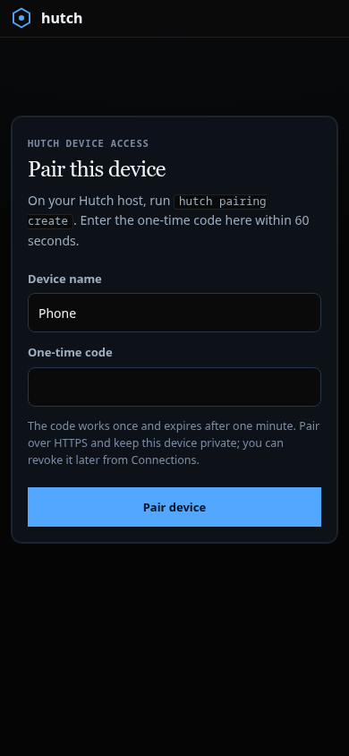
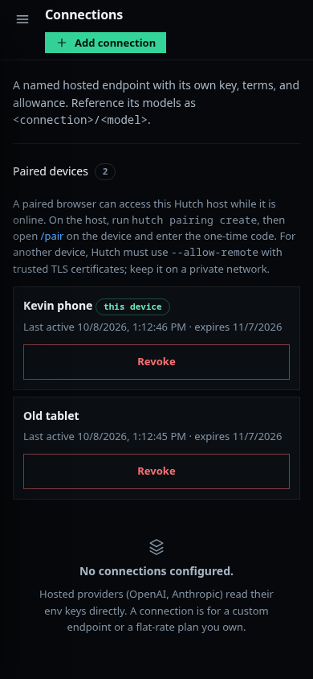

# Device pairing and management visual validation

The real one-time pairing route and the paired-device disclosure were exercised in Chromium against the local fixture service. This
validates browser behavior and responsive layout; it does not validate a phone, TLS certificate deployment, private-network routing, or
remote reliability.

## Reproduce

```bash
cd .worktrees/realign
.venv/bin/python -m pytest -q tests/e2e/test_browser.py::test_real_device_pairing_and_revocation_are_usable_at_all_viewports
```

The test starts Hutch on a temporary loopback port with a disposable state directory, exchanges a real store-issued one-time code,
creates a second real device session, and exercises both revocation paths. No provider call or public listener is used. Browser, viewport,
source hashes, journey outcomes, and screenshots are recorded in [`artifacts/device-pairing/results.json`](artifacts/device-pairing/results.json).
A redacted interaction trace is in [`artifacts/device-pairing/trace.json`](artifacts/device-pairing/trace.json); it excludes codes,
cookies, request bodies, and session tokens.

## Inspected states

The entry form and device manager were exercised at desktop (1440×1000), tablet (900×1024), phone (390×844), and compact phone
(320×740). Invalid-code and paired states were
inspected at phone size. The successful state removes the expired-code instructions and the form; its device session is HttpOnly and
does not appear in `document.cookie`. The Connections disclosure shows the current device and another paired browser at each size.





Browser checks cover code clearing and focus after an error, focus moving to the Open Hutch link after pairing, the disclosure's 44px
phone targets, keyboard activation and focus restoration in the revoke dialog, revoking another session, and revoking the active
session. All tested viewports had zero horizontal overflow and the page-error list was empty. The manager stays collapsed on first load
and remains open after a revocation refresh when the user opened it.

These results are local browser fixtures. They do not establish screen-reader support, a physical-device experience, or remote-network
security and availability; those remain open release gates.

The marketing availability copy now classifies paired-dashboard access as experimental and keeps browser handoff and PTY/desktop control
unavailable. The anonymous website suite passed **12 tests in 14.26s**. Refreshed desktop/tablet/phone source-pinned captures are in
[`artifacts/no-mock-setup/site/`](artifacts/no-mock-setup/site/); the modified first-run and restoration proof captures are retained in
[`artifacts/restoration/`](artifacts/restoration/). They use no operator credentials or private runtime state.
