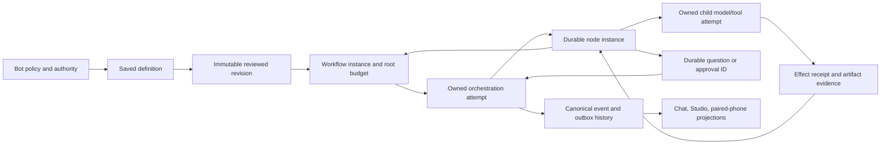

# Dynamic workflows: reference audit, capability gates and design contract

Status: **implemented in verified slices (deterministic path, bounded repair/recheck engine,
honest partial joins and categorized output projections,
disposable multi-module coding repair through tests, published verification and browser inspection,
fixture probes, bounded live negative-evidence campaign, Studio card with parked-run pause/resume,
owner-linked routine scheduling for activated immutable revisions, and current private-preview
marketing copy verified)**.
Chat routing is implemented behind an exact-profile selector gate, but both local candidates
tested failed selector qualification; new-plan Auto, broad affected-branch amendment draining,
live provider workflow runs and several recovery/integration cases remain open. A narrowly scoped
active amendment carry is verified for one unchanged top-level tool-free worker when the plan only
appends later work. Amendment
preview/adoption now reuses only settled top-level pure transforms whose resolved-argument
digest and safe dependencies match the candidate; the API and resumed-run path have regressions.
Terminal-run amendment adoption is explicitly unsupported: the API directs owners to start a
fresh saved run and preserves the terminal result.
Studio amendment controls and paired-phone monitor/review are implemented. No local candidate
passed author or selector qualification. User guide:
[`docs/workflows.md`](../workflows.md).
Evidence: [`artifacts/dynamic-workflows/`](artifacts/dynamic-workflows/) and the ledger entry.
This file separates **verified** facts (read in source or fetched from a pinned revision)
from **unverified** claims, and records the decisions the implementation must satisfy.

## 1. Reference identification

The strongest matching primary reference is Z.ai's ZCode **dynamic workflows**
(`CreateWorkflow` / `AmendWorkflow` / `SaveWorkflow`, the `dynamic-workflows` skill), pinned
at commit `aac4755666d09fdcd70272fcf063c077a639015f` of the public `zai-org/ZCode`
repository. It is a distinct feature from ZCode's older `Workflow` tool (`.workflow.js`),
from Goal Mode, and from ordinary subagents; the spec says so explicitly. ZCode's license is
**Apache-2.0** (root `LICENSE`, "Copyright 2026 Z.AI Co., Ltd"); ideas and code may be
adapted, including commercially, with attribution/NOTICE preservation and no copyleft. No
separate license is stated for the docs.

Inspected first-hand at that revision: `docs/dynamic-workflow.md` (spec),
`docs/dynamic-workflow/launch.md`, `docs/dynamic-workflow/authoring.md`,
`apps/zcode-cli/packages/dynamic-workflow/docs/execution-engine.md` and `concurrency.md`
(via delegated reading with quotes), plus the source tree layout, the test list and the
license. Not inspected: the analyzer/presentation docs' content, the TypeScript sources
line-by-line, the fault-matrix helpers, and any runtime behaviour (nothing was installed or
executed).

### 1.1 What the reference actually does

| Piece | Mechanism (verified in the pinned docs) |
|---|---|
| Authoring | The model writes ordinary TypeScript against a small facade (`agent().ask<T>()`, `files.*`, `git.*`, `world.run`, `report`, `artifact.*`, `phase`, `log`, `hole`), typechecked against one `.d.ts` the compiler and the docs share. |
| Analysis | A static analyzer produces four graphs; sites get stable ids; imprecision widens edges, never rejects; the one hard rule is that a facade call must be a direct call. |
| Identity | Every call is a **site**; every execution is an **instance** (`siteId@ordinal`); the journal keys on `(run_id, site_id, ordinal)` with a unique index. |
| Durability | `dwf_run`/`dwf_actor`/`dwf_node`/`dwf_event`; a node row is written `running` **before** dispatch, carrying an input hash; resume replays the same script byte-for-byte with settled rows answered from the journal. |
| Resume | `completed`/`failed` rows settle from the journal (`cached: true`) with no driver call; `running` rows re-execute live; resume is a crash-recovery primitive, not re-verification. |
| Amend | A **new run** that imports the predecessor's contiguous completed prefix (matched by unique subagent name + input hash), closing the cache at the revision's first workspace write; a live predecessor is stopped (`superseded`) first; usage sums across the lineage. |
| Concurrency | Two bounds — the run's `maxConcurrency` (asks; no upper limit) and a shared per-provider AIMD governor. |
| Approval | `CreateWorkflow`/`AmendWorkflow` declare `alwaysAsk`; the confirmation window appears in every permission mode for a tool call, the hub "Run" click is its own consent, and the TUI/headless surfaces auto-allow. |

### 1.2 Adopt / adapt / reject

| Idea | ZCode mechanism | Decision | Rationale for Hutch |
|---|---|---|---|
| Stable call-site identity + per-instance identity | site ids + `(siteId, ordinal)` unique keys | **Adopt** | Reordered/duplicated items must not alias; a repeated call site is not one invocation. Hutch uses `site_id` + deterministic item keys, escaped so nested keys cannot collide. |
| Journal before dispatch | node row `running` + `input_hash` written at admission | **Adopt** | Crash-safe idempotency in SQLite; a redelivered dispatch must not double-run a node. |
| Input-hash purity guard | `InputHashMismatch` on replay | **Adapt (partial)** | Hutch records the hash of each node's resolved input bundle at admission; drift *cannot* occur today because revisions and input snapshots are immutable and a settled node is never re-executed. The recorded hash is the identity used for step idempotency; a continuation-time comparison is not implemented (and is only meaningful once amendments exist). |
| Journal is the truth | transcript/notifications built from engine records | **Adopt** | Matches Hutch's event/outbox discipline; the displayed graph derives from the committed plan, not model prose. |
| Complete structure before the run | static graph drawn before execution | **Adapt** | Hutch shows planned structure, then marks bounded not-yet-expanded regions; actual instances come from engine records. No claim that static analysis predicts future targets. |
| Explicit artifact publication | `artifact.*` + `report` items, one primary | **Adapt** | Publish through Hutch's existing artifact registry (events + SHA-256 + verified download), never a side channel. |
| Caps fail loudly, nothing truncated | `WorldReadCapExceeded` etc. | **Adopt** | A silently partial view fanned out is worse than a catchable failure. |
| Amend = new run + cache import | prefix match by name+hash, close at first write | **Adapt** | Hutch keeps the revision/plan-diff and reuse-eligibility rules (dependency/input versions, tool/schema/skill/route revisions, current authority). A source change is an amendment, not a byte-identical resume. |
| Per-subagent model | persona model resolved at launch against the catalog | **Adapt** | Hutch binds a **role** + concrete model per node, gated by role qualification; a routing key may choose only among declared, qualified models. |
| Two bounds + provable stall detection | maxConcurrency + AIMD governor; `ScriptStalled`/`ChannelDeadlock` | **Adapt** | Hutch: a per-workflow logical bound plus the existing one-caller/eight-waiter inference admission; a stalled interpreter fails instead of waiting forever. |
| Approval once, no prompts inside a run | confirmation window per tool call | **Reject as-is** | Hutch approval stays bound to actor/run/node/args/resource with expiry, re-validated at effect time; no surface bypasses it, and consequential actions still ask. |
| Model-authored TypeScript program | TS facade + vm cell | **Reject for Hutch** | Would add a second language/runtime and a code-execution sandbox. Node's own docs: "The `node:vm` module is not a security mechanism." Hutch uses a **declarative typed plan** lowered to one canonical IR. |
| Settle-order replay gate | JS promise-ordering reconstruction | **Reject** | Specific to JS microtask semantics; Hutch's interpreter is deterministic by construction. |
| Unbounded provider-transient retries | `Unbounded` budget for workflow children; backoff to 60 s then "probe forever" | **Reject** | Unbounded spend. Hutch bounds attempts, backs off, and surfaces the failure. |
| Indefinite question waits | `escalate` blocks "with no timeout"; the escape hatch is cancellation | **Reject** | A workflow must expire or escalate a pending question; answers are keyed by unique question id and survive restarts. |
| No token/node cap | "There is no budget and no cap: the number is telemetry" | **Reject** | Hutch is built on bounded budgets; the root workflow owns step/model/wall/fan-out/repair limits that children cannot reset. |
| Launch only on explicit request | model never starts a workflow unsolicited | **Adapt** | Hutch keeps explicit request as one door, and adds reviewed Off/Suggest/Auto policy under operator preauthorization — never inferred from task shape or message length alone. |

## 2. Failure-mode evidence (researched 2026-10-11; sources fetched first-hand)

| Source | Verified claim | Design response |
|---|---|---|
| Node.js `vm` docs | "**The `node:vm` module is not a security mechanism. Do not use it to run untrusted code.**" | No generated code execution. Declarative plans only; any future code facade needs a separately contained process. |
| LangGraph interrupts docs | Resume "restarts the entire node from the beginning"; "**Side effects called before `interrupt` must be idempotent**"; index-based interrupt matching breaks on reorder/condition. | Node effects are recorded intents before execution; a conversation resumes at node boundaries; completed nodes are never re-run. |
| [LangGraph issue #9106](https://github.com/langchain-ai/langgraph/issues/9106), report observed 2026-10-11; open at capture | A user reports that resuming one of two parallel nested interrupts re-runs a completed sibling and repeats its side effect. This is an individual upstream report, not a prevalence claim; not yet reproduced in Hutch. | Regression `WF-EFFECT-01`: crash after an externally recorded effect but before node settlement, restart the process, and assert the append-only sink still contains one effect. |
| [LangGraph issue #9075](https://github.com/langchain-ai/langgraph/issues/9075), report observed 2026-10-11; open at capture | A user reports that multiple pending task interrupts are not all exposed for resume. Not yet reproduced in Hutch. | Regression `WF-QUESTIONS-01`: expose every durable pending id through snapshots/restart and answer in both orders, including a partial answer. |
| [LiteLLM issue #40575](https://github.com/BerriAI/litellm/issues/40575), report observed 2026-10-11; open at capture | An adapter-specific report describes a repeated tool call after a tool result. It does not establish behavior across providers or versions; the LiteLLM failure is not reproduced in Hutch. | Regression `WF-PROTOCOL-01` now includes an integrated streamed OpenAI-compatible loop: synthesized IDs pair with results in later requests, the result is consumed, and an identical repeat is blocked after two tool executions (`tests/test_runtime_builtin.py::test_openai_streamed_tool_result_is_consumed_and_repeated_call_stops`). The runtime/provider/streaming selection passed 126 tests. This covers Hutch's OpenAI-compatible path only; the reported LiteLLM adapter behavior and other cross-adapter round-trips remain open. |
| [Cline PR #14643](https://github.com/cline/cline/pull/14643), merged before 2026-10-11 | The fix registers an approval resolver before publishing the review UI, addressing a report that an immediate decision could arrive before registration. | Regression `WF-APPROVAL-01`: immediate decision, publish failure, reconnect, expiry, revocation, and stale answers against Hutch's own durable approval IDs. |
| [Cline issue #11263](https://github.com/cline/cline/issues/11263), closed report observed 2026-10-11 | The report describes adapter/model-specific tool-schema rejection and repeated malformed call text; it is not a claim about all Cline routes and is not independently reproduced here. | Keep positive route evidence, strict protocol parsing, and a bounded loop breaker. Probe outcomes remain route- and revision-scoped. |
| Ollama docs (tool calling, structured outputs, FAQ) | Tool calls are model-generated and may be malformed; `format`/schema enforces shape but "Ollama's Cloud currently does not support structured outputs"; default context 4096; concurrency multiplies context×KV and RAM scales with `OLLAMA_NUM_PARALLEL × OLLAMA_CONTEXT_LENGTH`; 503 on queue overflow. | Structured output is per-route capability with an evidence state; effective context is explicit; Hutch keeps its own admission limit rather than widening server concurrency. |
| vLLM tool-calling docs | Named/`required` tool choice guarantees only a parsable call ("not a high-quality one"); with `auto` and no strict tools, calls are extracted from raw text and "arguments may occasionally be malformed". | Hutch never upgrades `auto` to a claim of validity; the canonical validator remains the boundary. |
| Qwen3-4B-Instruct-2507 model card (Apache-2.0) | 262k native context; the card itself advises reducing to 32768 on OOM; tool usage claimed with benchmarks. Vendor self-report. | A plausible small worker, not a certified planner; role qualification is per route revision and tested task scope. |
| Ollama FAQ on memory | No explicit OOM/overcommit semantics are documented. | Treat memory behaviour as unknown and *measure*; never promise "an 8B fits 4 GB". |
| Playwright trace viewer | Records before/action/after DOM snapshots, network, console, source, attachments; "loads the trace entirely in your browser and does not transmit any data externally". | Accepted evidence format for UI verification. |
| Anthropic, "Building effective agents" | "find the simplest solution possible, and only increasing complexity when needed"; prefer fixed workflows; warn about compounding errors and framework abstraction. | Direct answer stays direct; workflows are opt-in and proportional. |

## 3. Hutch capability / gap matrix (integration baseline: local `main` 6221cc2 + `workflow/dynamic` f616106; 2026-10-11)

| Capability | State today | Evidence |
|---|---|---|
| Run ownership, fencing, recovery | Recovery query ordering and stale attempt replacement are fixed; node/question writes check revision, attempt, fence and live lease; workflow effects have stable identities and replay/reconciliation guards | `workflow.persistence._assert_workflow_owner`, `Store._assert_workflow_action_owner`; `test_stale_or_expired_workflow_owner_cannot_mutate_node_or_question`, `test_recovery_query_uses_cutoff_before_terminal_status_values`, `test_stale_workflow_attempt_cannot_replace_the_current_owner`, `tests/test_workflow_effect_receipts.py` |
| Lossless node-result values | Real transform execution and the run-detail API preserve false, zero, empty arrays, JSON null and empty strings; an omitted result still defaults to an empty object | `tests/test_workflow_api.py::test_run_detail_preserves_scalar_array_null_and_falsy_node_values`; [`artifacts/dynamic-workflows/run-detail-json-values-2026-10-11/validation.json`](artifacts/dynamic-workflows/run-detail-json-values-2026-10-11/validation.json) |
| Local inference admission (1 caller + 8 waiters) | The single local inference slot remains. Workflow steps and owner waits durably park the workflow attempt and release its run slot. A Strict Offline delegated parent now yields logical model/run admission while a child is active, preventing a one-slot deadlock; its waiting worker process remains alive until the child settles, so restartable parked delegation is still open | `admission.inference_slot`; `test_question_waits_and_is_answered_by_its_own_id`, `test_stopping_a_parked_workflow_finishes_after_cleanup_and_cancels_questions`; one-slot delegated process regression in [`delegation-one-slot-2026-10-12/`](artifacts/dynamic-workflows/delegation-one-slot-2026-10-12/) |
| Bounded child delegation | Implemented, narrow | built-in + Strict Offline + process executor; depth ≤ 2, ≤ 3 lifetime children, ≤ 2 active; one global slot can admit a child by sharing the waiting ancestors' logical capacity. The parent process still blocks during the child wait; crash-safe parked continuation is not implemented |
| Saved reusable procedures | Implemented as inactive definitions and immutable revisions; routine links require a separate owner action | `workflow.persistence`; save/import, activation, routine linking and enabling are distinct actions |
| Deterministic multi-step execution | Implemented as a declarative interpreter; deterministic CSV, discovered-document coverage, and scripted multi-module coding repair have acceptance coverage. Map keys are preflighted before any body runs; empty expansion is a verified zero-item success. Selective amendment draining and broader research quality remain open | `workflow.compile`, `workflow.engine`, `workflow.ops`; `test_map_rejects_duplicate_item_keys_before_running_any_body`, `test_empty_map_is_a_complete_zero_item_expansion`, and acceptance tests for CSV, document research, and multi-module repair |
| Model capability gates | Implemented and exercised. Exact execution profiles are bound to durable held-out campaigns. Qwen3 1.7B and 4B Q4_K_M both have negative author and selector evidence; neither qualifies | `workflow/probes.py`, `workflow/qualify.py`, `toolcalling.profiles`; fixture regressions and [`qualification-campaign-2026-10-11.json`](artifacts/dynamic-workflows/qualification-campaign-2026-10-11.json) |
| Approval binding | Implemented | `action_fingerprint`, CAS resolution, re-validation in `begin_action`, 600 s TTL |
| Artifact registry | Implemented | `tool_result` events + SHA-256 + verified download; no publish API outside an event |
| Skills and delegation identity | Implemented on local main and retained in the integration | `skills.py`, `use_skill`, run snapshots, fail-closed activation; `tool_call_index` preserves distinct repeated delegation calls |
| MCP | **Proposed only** (ADR-0017) | no client/server anywhere |
| Chat and Studio workflow controls | Partially implemented | selected-conversation card, planned/discovered steps, durable question answers, saved run, revision/generation/idempotency-checked safe-boundary Pause/Resume, Stop and policy picker; no usable local selector passed its live evidence gate |
| Amendment, workflow schedule connection, paired-phone workflow supervision | **Partial, verified narrow carry**: preview/adoption reuses settled top-level pure transforms only when the resolved-argument digest and dependency results match; it can also retain one unchanged top-level unconditional tool-free worker when an amendment only adds later work and its inputs, dependencies, authority, execution binding and budgets are unchanged. Malformed ownership fences fail closed. Changed/reordered work, tools/skills, maps/conditions and other active child/process work still block. Redacted phone monitor/review are implemented; pause state is monitored but pause/resume remains local-owner-only; activated workflow revisions can be pinned to existing routines with validated inputs | `test_amendment_adopts_while_unchanged_tool_free_top_level_step_finishes` (including malformed-fence refusal), `tests/test_workflow_steps.py::test_active_amendment_carry_waits_for_process_child_cleanup_before_resume`, active amendment/orphan-child blocker regressions; process lifecycle evidence and hashes in [`artifacts/dynamic-workflows/amendment-process-carry-2026-10-11/validation.json`](artifacts/dynamic-workflows/amendment-process-carry-2026-10-11/validation.json); responsive Chromium test `test_workflow_amendment_carry_preview_is_clear_and_responsive`; [`artifacts/workflow-studio/amendment-carry-active-step-2026-10-11/visual-review.md`](artifacts/workflow-studio/amendment-carry-active-step-2026-10-11/visual-review.md) and [`results.json`](artifacts/workflow-studio/amendment-carry-active-step-2026-10-11/results.json); previous transform reuse evidence in [`artifacts/dynamic-workflows/amendment-selective-reuse-2026-10-11/validation.json`](artifacts/dynamic-workflows/amendment-selective-reuse-2026-10-11/validation.json); routine-link API/scheduler/browser regressions and [`artifacts/scheduled-workflow-link-2026-10-11/`](artifacts/scheduled-workflow-link-2026-10-11/); paired phone API/E2E evidence in [`artifacts/workflow-studio/phone/`](artifacts/workflow-studio/phone/); live provider execution remains unverified |
| Marketing claims | Existing “How it helps” journey retained and revised with the routine-link evidence | routine availability, activation/link/enable separation, exact revision pinning and live-provider limit are asserted and captured in the marketing browser test; do not claim a qualified local selector |

## 4. Design contract (approved 2026-10-11: Route 1, declarative plans)

**Identity.** Definition (`workflow_definitions`) → immutable revision (`workflow_revisions`,
plan JSON + hash) → workflow **run/instance** (`workflow_runs`, stable id, owns inputs, node
records, budget ledger, published artifacts) → **orchestration attempt** (an ordinary `runs`
row, `kind='workflow'`; one live at a time; a crashed attempt is continued by a *new*
attempt) → **node instance** (`workflow_nodes`, unique on `(workflow_run_id, site_id,
item_key)`) → **step attempt** (an ordinary `runs` row, `kind='step'`, `parent_run_id` = the
orchestration attempt).

Attempts are never resumed mid-flight (ADR-0003 unchanged). Workflow *instances* continue:
a new orchestration attempt adopts the instance and reuses every settled node record.

**Execution model.** Deterministic/tool nodes execute inside the orchestration process
through the canonical `steps.call_tool` seam (events, receipts, approvals, artifacts).
Agent nodes are step runs executed by the existing worker/claim machinery with a frozen
scoped input bundle, an intersected tool allowlist, optional skill bindings, an explicit
model binding and an output contract.

**Capacity.** `runs.kind` distinguishes `interactive` work from the `workflow`/`step` lane. Interactive runs of
one bot remain mutually exclusive (unchanged). A workflow attempt of a bot may run beside
that bot's interactive work; its steps share the attempt's global slot, bounded by the
workflow's own logical concurrency (default 1, operator-raised under review). Inference
admission is untouched and remains the model-call limiter.

**Isolation.** Workflow nodes always use fresh private run workspaces; delivery is by
artifact publication, never by writing into the bot's shared workspace. This keeps the
existing managed-workspace semantics intact and gives concurrent lanes no shared mutable
files.

**Gate.** Roles: `selector`, `author`, `worker`, `verifier`, `executor`. Qualification
evidence states: `documented`, `advertised`, `probed`, `observed`, `limited`, `stale`,
`unsupported`, `unknown`, bound to the existing `route_revision` identity. Enforcement
points: configuration, plan submission, node admission, resume, amendment, model/backend
change; hidden tools are explained and direct calls rejected.

**Bounds.** Root-level: node instances, model calls, wall time, fan-out per expansion,
repair rounds, replans, and the existing usage reservations. Retries and children cannot
reset allowances. Every wait expires; every question/approval has a unique id.

**Artifacts.** Published only through committed events on the workflow run; verified
download/read-back.

## 5. What landed, and what is actually verified

| Area | State | Evidence |
|---|---|---|
| Plan schema, bounded evaluator, compiler | implemented, verified | `tests/test_workflow_plan.py` (19): identity, reference scope, envelope membership, nesting/cardinality expansion, default limits, fail-closed schema certification, strictness |
| Role capability gate + durable evidence | implemented, verified (mechanism) | `tests/test_workflow_qualify.py` (14), `tests/test_workflow_api.py` qualification routes |
| Durable execution: interpreter, step runs, continuation, lanes | implemented, verified | `tests/test_workflow_engine.py` + `tests/test_workflow_regressions.py`: deterministic run, artifact publication + tamper-detecting read-back, settled-node reuse, workflow lane, question parking, expiry, branch/map/repeat/join identity, stop semantics and cleanup. Automatic continuation is limited to interrupted attempts and canonical event-delivery failures, with two continuations maximum; model/runtime failures settle once instead of spawning replacements. |
| Model steps as real child runs (scripted local HTTP server, thread **and** process executor) | implemented, verified on the wire path | `tests/test_workflow_steps.py` + `tests/test_workflow_regressions.py`: own transcript/workspace/tool calls, declared model binding, frozen contract, output-contract enforcement, zero-call budgets, root charging for both tool-call and final-answer requests, re-admission, and child survival while its workflow parent is parked |
| Submission gates (inputs, envelope-vs-Bot, local-only, role) | implemented, verified | `tests/test_workflow_engine.py`, `tests/test_workflow_api.py` |
| Typed API + CLI | implemented, verified | `tests/test_workflow_api.py` (11) and `tests/test_workflow_cli.py` (4); the acceptance capture also drives the CLI end to end |
| Routing policy Off/Suggest/Auto | implemented, verified (rules) | `tests/test_workflow_routing.py` (9); an automatic start is scope-checked at submission, and the gate is bound to the Bot's endpoint, not just provider+model |
| Chat wiring for Suggest and saved-workflow Auto | implemented, mechanism verified; live local use blocked by qualification | `src/hutch/tools/workflow_route.py` is exposed only to a local-owner turn whose exact active execution profile has selector evidence. It rechecks the current conversation mode and profile at invocation. Suggest emits a review card and cannot start; Auto starts only an activated saved definition through normal scope/role/input checks. `tests/test_workflow_routing.py` (12) covers recommendation, idempotent saved launch and downgrade; `tests/test_runtime_builtin.py` covers the real chat tool loop and withholding from an unqualified model. Both local Qwen3 profiles failed selector qualification (A2); chat Auto for generated plans is unsupported. |
| Model-facing authoring gate | implemented, verified (mechanism) | `tests/test_workflow_routing.py::test_authoring_tool_is_refused_without_probed_evidence` |
| Acceptance: messy CSV → verified report | implemented, **verified end to end with the real CLI**, zero model calls | `tests/test_workflow_csv_acceptance.py` (2) asserts the report's own numbers are consistent; `artifacts/dynamic-workflows/validation.json` records every command, the question id the CLI printed, and the copied artifact re-hashed against the engine's digest |
| Acceptance: multi-module repair → unit tests → inspected result view | implemented, **verified through the real interpreter and process executor with a scripted provider** | `tests/test_workflow_coding_repair_acceptance.py` exercises one bounded repair, root-ledger charging, fresh-attempt continuation, nine writes in the disposable workflow workspace, three `unittest` checks, published artifact read-back and Chromium inspection at 1440/768/360/320 CSS pixels. The full command output, plan, provider fixture, trace, screenshots, source/artifact hashes and review are in [`artifacts/dynamic-workflows/coding-repair/`](artifacts/dynamic-workflows/coding-repair/). The model fixture is not live model quality evidence. |
| Model-authored plan on a live local route | **blocked for tested profiles** | The bounded Ollama 0.40.3 campaign probed exact Qwen3 1.7B and 4B Q4_K_M profiles. Neither passed every held-out author or selector dimension; worker and verifier roles were not probed. See [`qualification-campaign-2026-10-11.json`](artifacts/dynamic-workflows/qualification-campaign-2026-10-11.json). |
| Planner/worker role split on one inference slot | **blocked for tested profiles** | no local candidate qualified for selector authority; the one-request worker path is exercised with scripted responses, not a qualified planner |
| Studio surface (plan preview, graph, inline questions) | implemented, verified for the saved-run card and chat route suggestion | Studio projects immutable plan structure and durable question/result state; the separate chat suggestion card was opened and keyboard-tested at 1440/768/360/320 CSS pixels. Synthetic route-card states are visually tested separately from the scripted local runtime/API journey. See [`artifacts/workflow-studio/`](artifacts/workflow-studio/) and [`artifacts/dynamic-workflows/chat-router/`](artifacts/dynamic-workflows/chat-router/). |
| Amendment / replanning of a live instance | **implemented for live, quiesced runs; terminal adoption unsupported** | Preview shows reuse/invalidation and authority changes; adoption waits for affected work to quiesce, binds the current revision/generation and rejects stale callbacks. Terminal history is preserved and the owner starts a fresh run. See [`workflow-studio/amendment/`](artifacts/workflow-studio/amendment/). |
| MCP facade | **not implemented** | Hutch has no MCP plane (ADR-0017 is proposed only) |

### Role / model-route classification (mission completion criteria)

| Combination | Class | Basis |
|---|---|---|
| Deterministic executor + any plan without model nodes | **verified** | 15 engine tests + the CLI acceptance capture (zero model calls, published + verified artifact) |
| Bounded worker on a documented local route, no tools | **verified on the wire path** | `test_workflow_steps.py` (scripted local HTTP server, real builtin runtime, real admission) |
| Bounded worker on a documented local route, with tools | **verified on the wire path** | same, including the step's own tool call, transcript and workspace |
| Bounded repair worker + file writes, actual tests and browser-inspected output | **verified on the scripted wire/runtime path; live model ability unverified** | `tests/test_workflow_coding_repair_acceptance.py`; the worker returns a bounded replacement, the application writes only declared files, the fixed command runs three tests, and artifact bytes are re-read and hashed. Chromium 153/Playwright 1.63 inspected the rendered fixture at 1440/768/360/320. See [`coding-repair/visual-review.md`](artifacts/dynamic-workflows/coding-repair/visual-review.md). |
| Bounded worker whose output contract cannot be met | **verified (fails honestly)** | `test_workflow_steps.py::test_agent_step_output_contract_is_enforced_and_fails_honestly` |
| Worker on an unknown provider | **blocked** | `test_workflow_qualify.py::test_unresolvable_route_is_blocked_with_a_reason` |
| Worker with tools on a route with negative tool evidence | **blocked** | `qualify.assess` returns `blocked`; no test exercises a real negative-evidence route yet |
| Verifier on a different route | **implemented-but-unverified** | independence is computed, but no live multi-route verification run exists |
| Verifier on the producer's route | **blocked from independent certification** | `qualify.assess` marks `independent=False`; same-route review can remain advisory but cannot certify |
| Author / selector without probed evidence | **blocked** | `test_workflow_routing.py::test_authoring_tool_is_refused_without_probed_evidence`, `test_workflow_qualify.py` |
| Author / selector with positive held-out evidence | **implemented-but-unverified** | Profile-bound qualification and admission paths are tested. The bounded real campaign produced negative author/selector evidence for both exact Qwen3 profiles; no tested profile received production author or selector authority. |
| Qwen3 1.7B/4B Q4_K_M author or selector | **blocked by negative evidence for these exact profiles** | Both profiles failed held-out role qualification; do not generalize this result to other checkpoints. Worker/verifier quality remains unprobed. |
| Other local model worker/verifier profiles | **implemented-but-unverified** | No exact-profile worker/verifier qualification result is retained. |
| Any role on a hosted route | **implemented-but-unverified; data-egress decision required** | hosted routes work through ordinary per-run route authority; `network: local_model_only` refuses them outright |
| Pi / OpenCode as a workflow executor | **unsupported** | external runtimes are disabled before process start; a workflow attempt requires the built-in runtime |
| Code facade / generated scripts | **unsupported by design** | declarative plans only; Node's own docs say `vm` is not a security mechanism |
| Vision/audio-specific workflow nodes or media inspection | **unsupported** | `NodeKind` is a closed literal set; `tests/test_workflow_plan.py::test_unsupported_media_node_kinds_are_rejected` proves `vision` and `audio` fail compilation. A path or thumbnail is not inspection evidence. Artifact checks verify bytes, size and digest only. |
| MCP facade | **unsupported** | Hutch has no MCP plane (ADR-0017 proposed only) |

### Residual uncertainty
* The two tested local checkpoints are retained in private storage, but neither passed author or
  selector qualification. No claim is made about their worker/verifier competence or other model
  checkpoints; a qualified planner coordinating a smaller worker remains unverified.
* The workflow lane changes the per-Bot single-instance rule deliberately (interactive work
  and one workflow may overlap). A deterministic engine soak does not establish live inference
  reliability; no tested planner profile currently qualifies for that claim.
* A model-authored plan that is valid and well-bounded can still be a poor decomposition;
  compilation establishes structure, not judgement. That is why authoring is gated on probed
  evidence and why a person starts the reviewed plan.

## 6. Completion checkpoint and acceptance ledger

The user's completion plan is the acceptance source. These IDs keep evidence stable across
commits; a status of **implemented** does not mean **verified**. The reported upstream issues
above are individual, versioned failure hypotheses. They are not statements about how often a
product fails, and the Hutch regressions must establish Hutch's own behavior.

### Ownership and state boundary at integration

The A1 fixes fence workflow mutations to the active attempt/generation, park waits outside
orchestration capacity, persist stable effect receipts across a crash window, and gate workflow
progress on canonical event commits. Failed writer batches remain queued without a false commit
acknowledgement, and a full event queue refuses new records. Enqueue and commit-ack failures stop
the current workflow attempt so recovery can continue from durable node/effect records. A completed
effect receipt can be reused across recovery when the bot, tool, arguments and workflow identity
match; changed operation arguments remain a conflict. This event-failure path is fixture-tested,
including a real file write and injected non-lock database errors. Repeated commit failures now use
exponential backoff from 50 ms to a two-second cap; the regression checks four increasing delays,
eventual single persistence, and the event hash chain. A disposable SQLite `max_page_count` limit
also produces a real `SQLITE_FULL` commit failure; after pressure pages are freed, the retained event
commits once and the chain verifies. This is controlled page-capacity pressure, not a physical
disk-full or filesystem outage; process-restart recovery of buffered in-memory events remains
unverified.

| ID | Acceptance boundary | Baseline state and evidence pointer |
|---|---|---|
| A0 | Merge local main and workflow work; reconcile schema histories and recover from interrupted migration | Verified in commit `488200f`; main v51, workflow v51/v52, rollback, backup and retry: `tests/test_migration.py` (32 passed with CSV acceptance). |
| A1 | Fence recovery, questions, nodes and callbacks; prevent duplicate effects; charge every request; park waits; fair capacity; truthful Stop and event delivery | Partial. Recovery selection, node/question owner checks, stable effect receipts, uncertain-action reconciliation, durable wait parking, child survival during parking, parked Stop cleanup, and scalar/array/null/falsy projections are covered. Stop fences the attempt and descendants before transitions: the queued-step regression stops unclaimed work without dispatch, rejects a late child admission, and preserves a nonterminal orchestration status until cleanup. At `max_live=1`, a workflow step now shares the occupying attempt slot instead of starving in the queue, while unrelated work still counts the parent reservation. The same regression keeps the chat queued at one slot, then lets it claim when a second global slot is available, preserving the separate interactive lane. Runtime outcome and source hashes are in [`capacity-one-slot-2026-10-11/validation.json`](artifacts/dynamic-workflows/capacity-one-slot-2026-10-11/validation.json). Root-wide request/token reservations (including uncached local context self-checks), request-start recovery and process-executor paths are covered. The dispatcher also keeps local Ollama inference to one active run until a higher request configuration is verified; Strict Offline delegated children now also work with `max_concurrent=1`: an active child shares the logical run and local-model reservation of its waiting ancestors, while unrelated runs remain blocked. The parent now saves its exact call-boundary checkpoint in a fenced `waiting_child` state, closes its owned process before child admission, and requeues only after the child tree settles; Stop preserves the parent wait until cleanup is verified. `tests/test_delegated_wait.py` covers durable fencing, stale-owner rejection, cleanup ordering, stopped-parent drain and one-slot admission; `tests/test_delegation.py::test_strict_offline_delegation_runs_as_child_after_explicit_approval` covers immediate review, wake, child execution and parent continuation in a real Strict Offline process. The run/API and paired-phone projection is captured in [`delegation-wait-20261011/`](artifacts/delegation-wait-20261011/). Live-model result quality remains unverified. `tests/test_workflow_steps.py::test_first_success_join_selects_first_acceptable_result_and_drains_discarded_child` asserts the local one-slot path while the same test proves two bounded nonlocal candidates can race and the loser drains. Workflow events now wait for canonical commit; failed enqueue/commit acknowledgements abort the attempt, while the writer requeues database failures without a false acknowledgement or silent drop and exponentially backs off repeated failures. `tests/test_store_events.py::test_repeated_storage_failures_back_off_without_acknowledging_events` injects four consecutive non-lock errors, checks 50/100/200/400 ms minimum intervals, then verifies exactly one stored event, a valid hash chain and zero drops. The combined `tests/test_workflow_engine.py` and `tests/test_store_events.py` selection passed 62 tests in 27.90s; validation details and source hashes are in [`event-storage-retry-2026-10-11/validation.json`](artifacts/dynamic-workflows/event-storage-retry-2026-10-11/validation.json). The complementary `tests/test_store_events.py::test_sqlite_full_event_write_is_retained_until_capacity_returns` uses a disposable 4 MiB pressure row and SQLite `max_page_count` to trigger a real `SQLITE_FULL`; it confirms `flush_events` does not acknowledge the event, then frees pages and verifies one persisted event, a valid chain and zero drops. The same 63-test selection passed in 29.95s; output and source hashes are in [`sqlite-full-recovery-2026-10-11/validation.json`](artifacts/dynamic-workflows/sqlite-full-recovery-2026-10-11/validation.json). Accepted-event restart recovery is now verified by schema v60's durable SQLite outbox: `tests/test_store_events.py::test_queued_event_survives_process_restart_before_canonical_commit` kills a subprocess after append acknowledgment and before canonical commit; `test_two_stores_recovering_the_same_outbox_entry_commit_it_once` proves a competing Store recovers the identical entry without duplicating its hash-chain row. The migration test preserves historical events and checks idempotent event keys. `tests/test_store_events.py` plus `tests/test_migration.py` passed 59 tests, including the existing >1,000 events/s throughput gate; exact commands and hashes are in [`event-outbox-restart-2026-10-11/validation.json`](artifacts/dynamic-workflows/event-outbox-restart-2026-10-11/validation.json). Physical host/filesystem failure before SQLite can commit remains unverified. Stop against a live workflow model step is now exercised through the real process executor and scripted local HTTP server: both the step child and orchestration attempt reach `stopped`, and the test requires all owned process records to be closed before the workflow is terminal. Its runtime, exact commands, source hashes and limits are recorded in [`stop-active-step-2026-10-11/validation.json`](artifacts/workflow-studio/stop-active-step-2026-10-11/validation.json). Regressions: `tests/test_workflow_steps.py::test_stopping_workflow_cancels_active_step_and_drains_its_process`, `test_canonical_event_rejection_fails_the_attempt_then_recovers`, `test_workflow_waits_for_canonical_event_commit_before_continuing`, `test_event_failure_after_effect_reuses_receipt_on_recovery` (real `write_file` plus independent completion log), `test_non_lock_database_failure_requeues_event_batch_without_acknowledging_it`, `test_recovery_query_uses_cutoff_before_terminal_status_values`, `test_stale_workflow_attempt_cannot_replace_the_current_owner`, `test_stale_or_expired_workflow_owner_cannot_mutate_node_or_question`, `test_question_waits_and_is_answered_by_its_own_id`, `test_stopping_a_parked_workflow_finishes_after_cleanup_and_cancels_questions`, `tests/test_workflow_regressions.py::test_stopping_workflow_stops_queued_step_and_blocks_late_admission`, the effect-receipt tests in `tests/test_workflow_effect_receipts.py`, `tests/test_workflow_usage_budget.py`, `test_run_detail_preserves_scalar_array_null_and_falsy_node_values`, and `test_agent_step_runs_under_the_process_executor`. Automatic continuation is limited to interrupted attempts and canonical event-delivery failures, with at most two crash/outbox recoveries; ordinary model/runtime failures settle once, while child/question wakeups do not consume the recovery allowance. The model-unavailable and bounded-recovery regressions pass in the 192-test focused set. The pause-recovery API fixture now records the same `exit_reason=interrupted` marker as the engine. Both crash windows around effect-receipt commit now have real subprocess fault injection. After the external effect is fsynced but before the receipt commits, recovery projects outcome_unknown and a continuation refuses another dispatch until reconciliation; a post-restart `confirmed_done` record followed by a fresh execution context still cannot dispatch the same identity because the missing tool result cannot be inferred. After the receipt commits but before node settlement, recovery reuses the saved result. In both cases the independent append-only sink remains at one entry. `tests/test_workflow_effect_receipts.py::test_process_crash_around_effect_receipt_never_repeats_the_sink_effect` covers both windows and the post-restart review. Production storage-failure stress and human reconciliation UI coverage remain open. Queued-step Stop state, late-admission refusal, exact commands and hashes are recorded in [`stop-queued-step-2026-10-11/validation.json`](artifacts/workflow-studio/stop-queued-step-2026-10-11/validation.json). |
| A2 | Exact capability identity, tested scope, negative evidence, bounded disposable probes, no acknowledgement-made qualification | Probe enforcement is fixture-tested and exercised against two real local checkpoints. Both Qwen3 profiles failed author and selector qualification; the durable campaign record includes profile hashes, digests, failed-case reasons, response hashes, token counts, per-request latency and memory snapshots. No author/selector role was granted. `tests/test_workflow_probes.py`, `tests/test_workflow_qualify.py`, `tests/test_migration.py`; campaign: [`qualification-campaign-2026-10-11.json`](artifacts/dynamic-workflows/qualification-campaign-2026-10-11.json). |
| A3 | Strict dynamic plan validation, repair adoption and recheck, explicit join policies, honest result categories, amendment preview/adoption and reuse rules | Partial. Repair targets are compile-checked, a worker's closed-schema replacement is adopted, checks rerun in distinct durable rounds, no-progress output fails, and recovery reuses settled repair children while reconstructing adopted scope. Advisory review reads the validator-wrapped `output` object and remains non-certifying. `all_settled` can preserve named failed/skipped targets while returning successful values; unrelated failures still stop the workflow. `first_success` is verified for bounded contiguous groups of independent, top-level, tool-free worker agents: the supervisor validates the completed output, persists the winner under the current revision/attempt/fence, cancels other child runs with a stable idempotency key, and holds continuation until loser/process drain. Compilation rejects dependent, conditional, nested, effectful, non-agent, over-parallel and under-budget candidates; later nodes and outputs must consume the join result, not an individual candidate. Local Ollama runs remain single-slot; other configured routes use the declared concurrency bound. Process-restart, all-fail, output-contract rejection and loser-drain coverage is in `tests/test_workflow_steps.py::test_first_success_join_selects_first_acceptable_result_and_drains_discarded_child`, `test_first_success_restart_reuses_winner_and_retries_loser_cancellation`, and `test_first_success_join_fails_honestly_when_every_candidate_fails`. The combined focused workflow, recovery, fairness and effect-receipt selection passed 113 tests in 64.65s; the exact command, environment and source hashes are retained in [`first-success-2026-10-11/validation.json`](artifacts/dynamic-workflows/first-success-2026-10-11/validation.json). Terminal output groups are separately persisted and exact passing independent refs alone confer `verified`; partial maps/joins remain partial. A read-only amendment preview now uses expected revision/current attempt ID, returns field/site diffs, separately reports the parked attempt lease and child/process-tree quiescence, refreshes authority and refuses budget widening. Only settled pure transforms are offered for reuse, and only when every upstream result is also reusable; effect/evidence-sensitive and control/container results are invalidated conservatively. A separate idempotent adoption API handles parked runs after child work and owned processes settle. It requires a revision/generation match, cancels pending questions only by explicit request, archives the prior graph/questions/result snapshot under schema v58, retains only preview-approved transforms, and continues through the supervisor under the new revision. The owner-local Studio now has a declarative plan/input editor, inspectable server preview, authority/budget/quiescence and reuse sections, explicit question cancellation, and an adopt action. The browser journey verifies the previous question is archived and a new durable question appears under the amended revision at 1440/768/360/320 CSS pixels. Evidence: `tests/test_workflow_api.py::test_amendment_preview_shows_dependency_invalidation_and_safe_reuse_without_mutation`, `test_amendment_preview_fences_stale_revision_and_generation_and_invalidates_changed_inputs`, `test_amendment_preview_invalidates_reordered_map_inputs_without_reusing_item_results`, `test_amendment_preview_refreshes_authority_and_refuses_budget_widening`, `test_amendment_preview_includes_pending_question_id_and_requires_quiescence`, `test_amendment_preview_does_not_reuse_results_derived_from_effects_or_evidence`, `test_amendment_adoption_archives_and_cancels_old_question_then_continues`, `test_amendment_adoption_refuses_active_child_without_cancelling_question`, `test_v58_amendment_history_preserves_revision_links_and_is_idempotent`, and `test_interrupted_schema_56_to_current_migrations_roll_back_and_retry`, `tests/e2e/test_browser.py::test_workflow_amendment_preview_adoption_is_explicit_and_responsive`. An integrated regression (`test_active_amendment_waits_for_safe_pause_then_adopts_from_fresh_preview`) confirms that an active preview is read-only, adoption during a node is rejected without changing revision/history, and a fresh preview after owner Pause reports quiescence and reuses a settled pure transform before the adopted revision continues. A run-wide pause lets active work settle at a node boundary before adoption; selective draining of only affected branches and safe reuse beyond pure transforms remain open. The exact environment, test outcome and source hashes are recorded in [`amendment-safe-pause-2026-10-11/validation.json`](artifacts/workflow-studio/amendment-safe-pause-2026-10-11/validation.json); the opened responsive amendment and active-pause views are linked above. Terminal-run amendment adoption is intentionally unsupported: the API returns a 409 explaining that a fresh run should be started from the saved workflow; `test_terminal_workflow_amendment_refusal_is_explicit_and_preserves_result` confirms the revision, generation, result and amendment history remain unchanged; source hashes and exact test results are in [`terminal-amendment-2026-10-11/validation.json`](artifacts/workflow-studio/terminal-amendment-2026-10-11/validation.json). Existing engine evidence: `tests/test_workflow_engine.py::test_map_rejects_duplicate_item_keys_before_running_any_body` verifies all stable item keys are validated before map body execution, and `test_empty_map_is_a_complete_zero_item_expansion` verifies the empty result contract; `tests/test_workflow_plan.py::test_repair_target_is_validated_and_single_check_targets_remain_compatible`, `test_first_success_join_accepts_bounded_independent_agents_and_rejects_effects`, `test_join_rejects_duplicate_targets`; `tests/test_workflow_engine.py::test_repair_adopts_output_and_rechecks_each_durable_round`, `test_repair_recovery_reuses_settled_output_and_reconstructs_adopted_scope`, `test_repair_with_no_progress_fails_without_another_round`, `test_advisory_review_reads_the_validated_step_output`, `test_output_projection_separates_verified_and_partial_from_node_counts`, `test_later_failed_verification_revokes_an_earlier_output_claim`, `test_a_later_pass_does_not_erase_a_continued_failed_criterion`, `test_uncertain_child_is_projected_as_uncertain_output`, `test_all_settled_join_preserves_failed_and_skipped_targets`, and `test_all_required_join_rejects_a_skipped_target_explicitly`. The deterministic messy-CSV acceptance now publishes a Markdown report and an accessible category SVG. It checks row consistency, observed categories, two independent artifact SHA-256 read-backs and a durable human check with zero model requests; the clean two-row variant fails the larger audit's minimum honestly. `tests/test_workflow_ops.py` covers deterministic ordering, XML escaping, accessible title/description and rejection of invalid/oversized chart input. The browser acceptance downloads the SVG through the verified artifact API, renders it in Chromium and retains an opened screenshot/trace and visual review under [`expense-chart/`](artifacts/dynamic-workflows/expense-chart/). The same work fixed human verification persistence: a `verify` human check now has a distinct durable ask-node, and the command-once regression confirms the human node settles its own answer without rerunning the command. The combined focused chart, CSV, human-review and browser set passed 17 tests in 5.87s. Document-research coverage now has an end-to-end scripted local-HTTP acceptance slice: bounded file discovery supplies stable path records, each discovered source is read and sent to a schema-constrained worker, verbatim quotes are checked against the source, and a deliberately invalid response is retained as an exact partial omission in the published artifact. Evidence: `tests/test_workflow_document_research_acceptance.py::test_discovered_document_research_publishes_exact_coverage_and_omissions`, `tests/test_workflow_ops.py::test_document_coverage_requires_complete_discovery_and_verbatim_source_evidence`, and `tests/test_bounded_file_read.py::test_list_files_exposes_stable_bounded_paths_and_marks_metadata_omissions`; the combined workflow/plan/runtime set passed 125 tests in 62.72s. The test output, captured source and plan hashes, and published partial artifact are retained in [`document-research/results.json`](artifacts/dynamic-workflows/document-research/results.json) and [`document-research/coverage-partial.json`](artifacts/dynamic-workflows/document-research/coverage-partial.json). The scripted provider proves engine/admission/schema/coverage wiring, not live model quality or factual correctness; exact quotes establish source traceability only. The scripted multi-module coding repair with real tests and UI inspection is now verified as an engine/runtime acceptance path; live model quality remains unverified. Selective affected-branch amendment draining and reuse beyond settled pure transforms remain open. Scripted local routes verify engine behavior, not live model quality; generated workflow code remains unsupported. |
| A4 | New assistants default to Suggest; server-persisted conversation policy; rules plus eligible model-turn recommendations; explicit reviewed Auto | Policy storage and conversation-menu control are verified. The chat tool is offered only after exact-profile selector admission and rechecks policy/profile at invocation; Suggest is review-only, while Auto can start a saved workflow within scope. The routing/runtime set passed 74 tests and the expanded workflow API, conversation, routing and runtime set passed 113, including Auto launch in the same scripted chat/tool turn. Both local Qwen3 profiles fail selector qualification, so no tested local profile can use chat routing; no compulsory classifier is added. |
| A5 | Compact accessible chat card, Studio inspector, durable Needs you IDs, local-owner-only mutations, paired-phone monitor/review surface | Studio saved-run card is verified for planned/discovered sections, durable question IDs, keyboard answers, Stop and per-chat policy. Pause can be requested for a running attempt or a parked wait and carries current revision/generation plus idempotency. It holds before the next node without cancelling the current node or owned children; Resume appears only after the attempt parks and the owned tree is quiet. Answers remain durable while paused, and Stop clears pause state. The API refuses stale revisions/generations. Dynamic-plan submissions now validate and persist `conversation_id` for the same assistant, keeping API-created work in the correct Studio card. A real API/engine/browser path collects two independent top-level questions together; either answer order is tested across a Store/Engine reopen, with dependent work held until both resolve. Bounded-map regressions expose one pending ask per item up to map concurrency and collect two independent asks within one item; both answer orders survive a Store/Engine reopen, while a dependent ask remains held until its prerequisite answer arrives. The browser journey uses the discovered-item path. Each ask has a durable node opened before question publication; the question and waiting-node state commit atomically, answer settlement persists the answer result on that node, and Stop cancels its pending node and question together. Paired-phone **Needs you** lists both IDs and retains the unanswered question after a partial answer. Studio shows a pending count, projects the mapped ask instances while waiting, labels a partial answer “Answer received” until the node settles, and focuses the remaining answer field after the first submit. The answer transaction also updates the durable wait reason from two answers to one, then to “continuation pending” (or an explicit paused/resume reason). After both answers, the discovered list includes the two ask instances, map and transform. Opened captures at 1440/768/360/320 show 0px horizontal overflow and 44px phone answer targets; the long second ID wraps and is reached through the card's internal scroll. Evidence and hashes are in [`multiple-questions-2026-10-11/`](artifacts/workflow-studio/multiple-questions-2026-10-11/) with review notes in `visual-review.md`. Bounded maps collect independent asks within each item and across up to the declared unresolved-item concurrency; dependent asks wait for prerequisite answers, and asks inside branches/repeats remain serial. Mixed **Needs you** queue browser coverage now verifies one separate action approval plus one workflow question in both decision orders: after the first decision the other ID stays pending and visible, and after the second both are resolved independently. Each card shows its durable ID; the 390/320 captures, traces, source hashes and order-specific results are in [`mixed-review-2026-10-11/`](artifacts/workflow-studio/mixed-review-2026-10-11/). A separate paired-phone browser journey now exercises two simultaneous action approvals in both decision orders: after the first choice, the other durable approval ID remains pending and visible; after the second, both actions resolve independently. Opened 390/320 captures, traces, source hashes and order-specific results are in [`multiple-approvals-2026-10-11/`](artifacts/workflow-studio/multiple-approvals-2026-10-11/). The Allow once and Deny controls in owner chat and paired-phone cards reference both the requested action and durable approval ID through `aria-describedby`; browser assertions verify the referenced descriptions. This confirms the DOM description wiring, not operating-system screen-reader output. More than two simultaneous approvals and actual browser zoom remain open. Pause journeys cover active-node Pause through settlement, parked Pause, answer while paused, Resume and downstream completion; focus moves to the replacement action, slug-based titles are human-readable, and the drain state explains what remains active. Opened captures, trace, bounds, source hashes and visual review are in [`pause-resume-2026-10-11/`](artifacts/workflow-studio/pause-resume-2026-10-11/). The owner-only boundary is tested against paired-phone credentials; phones can see **Pause requested** and **Paused**, but cannot pause or resume. Existing route-suggestion, amendment and phone visual/API evidence remains in [`route-card-a11y-2026-10-11/`](artifacts/workflow-studio/route-card-a11y-2026-10-11/), [`amendment/`](artifacts/workflow-studio/amendment/) and [`phone/`](artifacts/workflow-studio/phone/). The supplied ZCode image is a composition reference only. |
| A6 | Preserve the existing “How it helps” journey; evidence-backed workflow explanation, availability and FAQ | The website explains exact-profile qualification and reports both local failures; Auto only starts a matching activated saved method, and it cannot create a plan. The routine editor can link an activated workflow, pin its revision and checked inputs, and keep enabling the schedule separate. The private-preview card is now 99 words and retains the chat, question, pause/stop, verification, exact-profile qualification and routine-link boundaries; detailed one-off Run now scheduling and live-provider limits stay in Availability and the FAQ. The live Chromium journey asserts the card, availability claims, FAQs and CTA at 1440/768/360/320 with no page errors, external requests, provider calls or horizontal overflow. Refreshed screenshots, trace, source hashes and 9 artifact hashes are in [`marketing-verification-2026-10-11/`](artifacts/dynamic-workflows/marketing-verification-2026-10-11/); the opened visual review scores 9.1/10. This verifies copy and layout only, not public availability, a qualified local selector or live provider execution. |
| A7 | Ollama 0.40.3, private storage/process, Qwen3 1.7b and 4b Q4_K_M candidate probes within the user-authorized request/time/token/download/storage bounds | Completed within caps: checksum-verified Ollama 0.40.3 and both exact Q4_K_M downloads; 16 inference requests, 2,808 accounted tokens, one CPU resident model, 4,096 context, less than 6 GiB model downloads and less than 15 GiB private storage. Both candidates failed author and selector qualification. Retained evidence: [`qualification-campaign-2026-10-11.json`](artifacts/dynamic-workflows/qualification-campaign-2026-10-11.json). |
| A8 | Focused and broad runtime checks, browser/app/site visual captures at 320/360/768/1440, interaction/accessibility and soak evidence; classify exercised role combinations | Partial. The complete non-browser suite passed 2,137 tests on commit `9f2810b`; the focused workflow/runtime/API/event/claim set passed 192 tests on `b398e601`. The full non-browser suite at `f1562329` completed with 2,186 passed and 2 baseline/environment failures; outputs and baseline rechecks are in [`offline-suite-2026-10-11/`](artifacts/dynamic-workflows/offline-suite-2026-10-11/). After adding the event-writer backoff and SQLite `SQLITE_FULL` regressions, the same non-browser suite at `730f5474` completed with 2,188 passed and 2 failures in 613.40s. The failure names are unchanged: `test_connection_models_known_from_bots_appear_with_their_state` and `test_loopback_broker_refuses_a_request_after_close_starts`; both were reproduced on the baseline and are unrelated to workflow storage. Exact log and source hashes are in [`offline-suite-store-backoff-2026-10-12/validation.json`](artifacts/dynamic-workflows/offline-suite-store-backoff-2026-10-12/validation.json). After the one-slot delegation and legacy pre-v60 fixture fixes, a fresh full non-browser run at `984a9f0a` completed with 2,201 passed and one failure in 648.85s. The previous delegation timeout and migration-fixture failure are gone; the only remaining failure is `test_connection_models_known_from_bots_appear_with_their_state`, again reporting an unavailable OpenCode model list. It reproduced alone (1 failed in 4.22s) and matches the previously reproduced baseline behavior at `6221cc25`; no workflow change is implicated. The long-temp-path AF_UNIX failure did not recur with the short `/var/tmp/hutch-full-offline-final` base. The before/after run outputs, failure recheck and source hashes are in [`offline-suite-one-slot-2026-10-12/`](artifacts/dynamic-workflows/offline-suite-one-slot-2026-10-12/). A fresh 600-second deterministic thread-executor soak was run after the map preflight change at `b3e937d6`: 60/60 verified saved workflows, one active run maximum, zero model/network requests, parent maximum RSS 951,396 KiB and child maximum RSS 122,228 KiB. Source hashes and all run records are in [`workflow-soak-recheck-2026-10-11/`](artifacts/workflow-studio/workflow-soak-recheck-2026-10-11/). The final full browser run, using the updated Studio focus and tablet layout, completed with 181 passed, 25 failed and 8 teardown errors in 19m42s. The Studio policy journey no longer appears among failures; the route card and specialist-question journeys also pass. A final focused run passed all three together (Chromium 153 / Playwright 1.63, 22.23s). The Studio view was captured and opened at 1440/768/360/320; all measured widths have zero horizontal overflow, tablet and phone action targets are 44px, and the Studio fixture had no page errors or provider calls. The broad log, exact failure inventory, source/artifact hashes, trace and visual review are in [`broad-e2e-after-b398-2026-10-11/`](artifacts/dynamic-workflows/broad-e2e-after-b398-2026-10-11/). The final run repeats the same 25 failures in non-workflow app areas seen before the UI fix, with no new failures; those cases are classified as baseline and their individual causes remain unresolved. The same 8 live-fixture teardown timeouts also recur. Broad browser validation is still not green. The separate marketing copy/captures and route/question accessibility captures remain reviewed at 320/360/768/1440. A real-browser TCP-cut regression now preserves a pending question, its answer draft and focus during a failed refresh, then restores the draft/focus and completes keyboard submission after reconnect; Chromium 153 / Playwright 1.63, 1 passed in 5.68s, with zero provider calls or page errors. The reconnect, Studio policy and route-suggestion focused set passed 3 tests in 19.95s. Screenshots, trace, source hashes and result are in [`workflow-reconnect-2026-10-11/`](artifacts/workflow-studio/workflow-reconnect-2026-10-11/). The multiple-question browser run also passed at 1440/768/360/320 CSS pixels with 0px horizontal overflow, 44px phone answer controls, focus handoff after a partial answer and no page errors; opened captures and a human scorecard are in [`multiple-questions-2026-10-11/`](artifacts/workflow-studio/multiple-questions-2026-10-11/). The delegated-wait view is also verified at 1440/768/360/320, including paired review at 320, one waiting plus one queued count, keyboard focus, and zero console/network errors. The same browser capture now checks WCAG text-spacing overrides, system forced colors (21:1 waiting-label contrast), reduced-motion timing (`--dur-fast: 0ms`), and 44px owner / 48px paired Stop targets. The text-spacing check exposed an amber-on-white forced-colors defect, now fixed. Opened captures, trace, source/artifact hashes and the scorecard are in [`delegation-wait-20261011/`](artifacts/delegation-wait-20261011/). Actual browser-chrome zoom remains unverified. Slow-network behavior beyond this forced connection cut, positive live author/selector qualification and worker/verifier quality remain unverified; section 5 classifies each exercised role combination. |

### Route-card accessibility retest (2026-10-12)

The real Chromium route-card journey now also applies WCAG text-spacing overrides and forced-colors emulation at 320×740. It passed in 4.86s with no page errors, failed requests, external requests or horizontal overflow; the focused review action remains 44px high and scrolls above the composer. The text-spacing card requires scrolling to expose the action in the initial state, so this evidence confirms reachability, not an all-at-once fit. Opened captures, source/artifact hashes and the exact measurements are in [`chat-router/visual-review.md`](artifacts/dynamic-workflows/chat-router/visual-review.md). This is route-card Chromium coverage only; actual browser zoom, operating-system screen-reader behavior and app-wide forced-colors/text-spacing remain unverified.

### Integration verification after paired-phone supervision (2026-10-11)

Question creation now commits the durable pending row and the workflow's waiting projection in
one transaction. The owning attempt then parks and releases its run slot. The deterministic CSV
acceptance test checks the status as soon as the durable question is visible. Runtime policy
lookup treats a run with an unpersisted legacy conversation ID as having no conversation override
and falls back to the Bot setting; policy API reads and writes still require a durable conversation.

The first non-browser broad run collected 2,136 tests: 2,127 passed and 9 failed. Four regressions were
fixed and passed targeted checks: missing-conversation policy fallback, atomic question/wait
publication, amendment comparison text caught by the emoji audit, and an undefined recommendation
text token. The snapshot test fixture was corrected to mark its provider request started before it
expects an uncertain reservation; tests/test_state_snapshot.py then passed all 10 tests. Three
offline-worker tests failed with explicit ENOSPC under the already-full shared `/tmp` tmpfs, and a
process-executor case failed before dispatch. `OfflineBrokerSet` had forced its private socket
directory into `/tmp`, ignoring the configured temporary root. The temporary-root fix removes
that override while retaining the 0700 private directory; the configured-root regression and all
of `tests/test_offline_mode.py` then passed (37 tests) with `TMPDIR=/var/tmp`. The separately
failing delegated-offline test also passed (1 test). An earlier complete non-browser rerun in a disposable worktree at commit `9f2810b` passed
**2,137 tests in 603.70 seconds** using Python 3.13.15 and pytest 9.1.1. A newer full
non-browser run at `f1562329` completed with **2,186 passed and 2 failed in 640.23 seconds**.
Both failures were reproduced with the baseline source at `6221cc25`: an external model-catalog
request/test-fixture failure, and an AF_UNIX path-length failure from the long shared `TMPDIR`;
the socket test passes with a short temporary root. Complete outputs, commands, baseline
comparisons, and hashes are retained in
[`offline-suite-2026-10-11/`](artifacts/dynamic-workflows/offline-suite-2026-10-11/). The earlier
complete `pytest -q` invocation was interrupted at 33% after `/tmp` was full and is not counted as
a completed suite. The ten-minute engine soak is covered in the A8 status above; broad browser E2E
remains non-green.

The amendment browser journey passed against a real SQLite store and supervisor at 1440, 768, 360
and 320 CSS pixels. Opened screenshots show the candidate diff, the full pending-question
cancellation label above the fixed footer, and the post-adoption state. Each viewport had zero
horizontal overflow, a 44px adoption target, no page errors or failed requests, and zero provider
calls. See
[amendment-postfix visual review](artifacts/workflow-studio/amendment-postfix-2026-10-11/visual-review.md)
for the opened views and artifact hashes.

The selector recommendation card was re-rendered at the same four sizes with a
synthetic event fixture. Its computed text color resolved to the shared base-content
token, the long title wrapped at 320px, the 44px Review & run action remained visible,
and keyboard review still started no workflow. This is presentation evidence only;
it does not upgrade selector qualification. See
[route-card visual review](artifacts/workflow-studio/route-card-postfix-2026-10-11/visual-review.md).

The follow-up visual audit found that the floating jump control was appended inside the
scrolled transcript, so its absolute position moved with old content and covered the
workflow-card status. It now sits in a reserved flow row above the composer. The real
local Studio fixture was reopened at 1440/768/360/320, then at 320 with WCAG text-spacing
overrides and forced-colors emulation. The review target remains at least 44px and above
the composer, the jump action returns the feed to its maximum scroll, there is no
horizontal overflow, page error, failed/external request or workflow start. Screenshots,
trace, exact bounds, computed forced colors and source hashes are in
[`route-card-a11y-2026-10-11/`](artifacts/workflow-studio/route-card-a11y-2026-10-11/).
Playwright headless `Control+Equal` did not change `innerWidth` or device pixel ratio;
actual browser-chrome zoom remains unverified. Visible CUA attempts on 2026-10-11 and
2026-10-12 failed before browser initialization because `/tmp` had no free space (ENOSPC).
No existing files or unrelated processes were removed to make room.

### Safe-boundary pause, resume, and conversation binding (2026-10-11)

Schema v59 adds durable `workflow_runs.pause_requested`. The owner can request Pause during a
running attempt or a parked wait. The pause flag is checked transactionally with node creation,
so the currently admitted node and already-owned child work can settle while the interpreter
holds before opening the next node. The card stays **Pause requested** until the attempt releases
its lease and the complete child/process tree is verified quiet; only then does it show **Paused**
and offer Resume. If the owner attempt disappears during the request, recovery admits one fenced
parking attempt that checks the flag before interpreting any node. A paused wait stays parked even
after its children settle. Answers remain accepted by durable question ID, and Resume wakes the
supervisor to continue from durable state. Stop clears pause intent and cancels owned work.

Pause and Resume require idempotency plus the current revision and attempt generation; stale state
is rejected. `tests/test_workflow_api.py::test_active_work_pause_waits_for_current_node_before_holding_the_next`
and `test_recovery_parks_a_lost_active_attempt_when_pause_is_requested` cover active settlement
and recovery. The full focused workflow API, migration and paired-phone authorization selection
passed **68 tests**, including safe pause/resume, v59 interrupted-upgrade rollback/retry, answer
while paused, Stop-over-pause, and owner-only mutation checks. The API now also validates and
persists `conversation_id` for dynamic-plan submissions; the regression
`test_dynamic_plan_submission_is_bound_to_its_conversation` verifies same-assistant association,
rejects cross-assistant binding and rejects a missing conversation.

Five real-browser journeys passed for the parked-question Studio flow, active-node Pause, paired
phone workflow review, amendment adoption and the marketing site. The active-pause journey captures
Running, Pause requested and Paused at 1440/768/360/320, checks zero horizontal overflow and 44px
phone controls, then resumes the exact run to success. The card humanizes slug-based plan names and
explains that the current work must settle. Paired-phone browser/API fixtures project both **Pause
requested** while owned work remains and **Paused** after it settles, expose monitoring/review only,
and show no owner Pause/Resume controls. The website's existing “How it helps” flow, private-preview status,
availability row and FAQ retain the verified product limitations.

The marketing visual pass now also covers the 320px workflow card under WCAG
text-spacing overrides and browser-emulated forced colors. Keyboard Tab/Shift+Tab
reaches the FAQ action with visible focus; this exposed a 40px compact-phone
target, which was raised to 44px and rechecked. Opened before/after focus captures,
measured bounds, zero-overflow results and hashes are in
[`marketing/`](artifacts/dynamic-workflows/marketing/). Actual browser zoom,
operating-system contrast settings and screen-reader output remain unverified.

Opened Studio screenshots, Playwright traces, bounds, source/artifact hashes and visual notes are
in [`pause-resume-2026-10-11/`](artifacts/workflow-studio/pause-resume-2026-10-11/); the active-run
set is separately indexed by `active-pause-results.json`. Opened website captures and hashes are in
[`marketing/`](artifacts/dynamic-workflows/marketing/). Both site and app browser checks reported no
page errors or provider calls. Actual browser-chrome zoom and slow-network handling beyond one forced
TCP cut remain unverified; the full browser suite has recorded results but is still not green. A
600-second deterministic thread-executor soak is recorded in A8; it does not verify live inference,
the process executor, or broader concurrent provider behavior.

The reconnect journey used a real local SQLite workflow, the supervisor and a TCP proxy that severed
the browser connection. While offline, the pending question card and focused draft remained usable;
a forced refresh after reconnect preserved both, and Tab/Enter submitted the answer. The captured
views show the retry status and the restored draft. That dated journey covered one pending question;
the independent-question journey below adds simultaneous top-level questions and a Store/Engine
restart. Approval ordering, process restart during reconnect, and approval publication races remain
open. Evidence, hashes and trace: [`workflow-reconnect-2026-10-11/`](artifacts/workflow-studio/workflow-reconnect-2026-10-11/).

### Independent workflow questions (2026-10-11)

The interpreter now collects independent top-level `ask` nodes in one pass. It commits each
question under its own durable ID and parks once; later non-ask work and asks depending on a
deferred node remain held. After one answer, the other question stays pending through a fresh
Store/Engine connection. Both answer orders complete the same workflow, and the downstream
transform runs only after both values are present. A paired-phone projection exposes both IDs in
**Needs you**, and answering one leaves the other listed. The Chromium journey now uses a bounded map with concurrency two and one ask per item, through the real
workflow engine, Store, typed API and Studio; no model provider is called. The engine tests also cover
independent top-level asks and both answer orders across a Store/Engine reopen. Captures at 1440/768/360/320
show both discovered item questions through the card's internal scroll, 0px horizontal overflow, and 44px
phone answer buttons. Submitting the first answer moves focus to the remaining answer field. The expanded
focused selection passed 116 tests in 59.59s; the map browser journey passed in 5.76s with no page errors. Screenshots,
trace, source hashes, artifact hashes and visual scorecard are in
[`multiple-questions-2026-10-11/`](artifacts/workflow-studio/multiple-questions-2026-10-11/).
This closes Hutch's tested top-level, bounded-map item and same-item independent-question enumeration cases
against the LangGraph #9075 failure hypothesis. Browser coverage still uses one ask per map item; branch/repeat
paths and simultaneous question/approval ordering are not covered.

The request-budget slice passed its broad compatibility set on 2026-10-11: 237 passed in
102.91 s across usage-budget, step, engine, regression, plan, routing, API, CLI, reservation,
built-in runtime, provider authority, local admission and migration tests. The run used the
worktree's Python 3.13 environment and a private `TMPDIR` because the shared `/tmp` tmpfs had
previously filled; no files from other processes were removed.

### Baseline environment and measured path

On 2026-10-11, the selected core/workflow set ran with 179 passes and one environment failure;
the remaining tests in that run passed after setting pytest's temporary directory on the root
filesystem. The single failure was strict-offline process setup reporting `ENOSPC` in the
shared `/tmp` tmpfs, which was already at 100% before and after the run. I left other processes'
temporary files alone. This does not establish that strict-offline behavior is broken or passing;
it remains unverified until that host resource is available.

The deterministic messy-CSV workflow completed its full test path in **0.53 s** (pytest call
duration, local fixture, zero model requests); the clean-export companion took **0.41 s**. These
are a narrow pre-hardening baseline for those exact fixtures, not a production throughput claim.

### Routine link, Run now, and responsive review (2026-10-11)

The existing routine editor now links an activated saved workflow through an explicit owner
action. The routine pins one immutable revision and checked inputs; enabling remains separate.
Scheduled admission atomically rechecks the active pin, routine state and expected occurrence
marker before writing the occurrence and first workflow attempt. Idempotent Run now uses the same
pin and leaves the next occurrence unchanged. This uses the existing schedule supervisor and
workflow interpreter; it does not add a second execution path.

The focused API/engine/scheduler/durability selection passed **93 tests**. The owner editor,
existing multi-routine management and marketing journeys then passed **3 focused Chromium tests**
(browser 153.0.8010.12 / Playwright 1.63.0) with no page errors, external requests or provider
calls. The app link journey used keyboard selection and captured 1440/768/360/320 CSS-pixel views;
all document widths matched their viewport and the Save task target was at least 44px high. The
multi-routine form can extend beyond one phone viewport and remains page-scrollable; its test checks
horizontal reflow, while the link journey verifies the save action after scrolling. I opened the
app action views and website workflow/availability views at desktop, tablet, phone and compact-phone
widths. The long method name and revision wrap, the separate enable action remains clear, and the
shorter availability row reduces mobile text density without hiding qualification or host limits.
Screenshots, traces, bounds and hashes are in
[scheduled-workflow-link evidence](artifacts/scheduled-workflow-link-2026-10-11/) and
[marketing evidence](artifacts/dynamic-workflows/marketing/). The integration remains deterministic-
fixture evidence: live provider workflow execution and browser-chrome zoom are unverified.

### Fresh-process effect replay (2026-10-11)

The parameterized subprocess regression exits the owner at both sides of the receipt boundary.
In the first case, the effect is fsynced and the receipt commits, then the process exits before
node settlement; a new Store/Engine recovers the expired owner and reuses the receipt's result.
In the second, the effect is fsynced and the process exits before the receipt commits; recovery
marks the attempt outcome_unknown, and the continuation refuses to call the effect again until
the uncertain action is reconciled. After reopening the SQLite state, the test records
`confirmed_done` against the fsynced sink evidence, creates a fresh execution context, and
confirms that the durable workflow identity still refuses dispatch. Reconciliation records what
the operator observed; it does not synthesize a missing tool result. An independent append-only
sink remains at one entry in both cases.

The combined effect-receipt, multiprocess claim and pause-recovery selection passed **34 tests**
in 18.74 seconds. The owner lease is expired explicitly after process exit so the recovery path
is deterministic. This exercises owner-process replacement and a fresh SQLite connection, but
not power loss, a full daemon restart, actual database storage failure, or completing human
reconciliation after restart. Those broader checks remain open. The regression is
[test_process_crash_around_effect_receipt_never_repeats_the_sink_effect](../../tests/test_workflow_effect_receipts.py).

## 7. Ongoing Hutch regressions mapped to external reports

These are dated maintainer/user reports and one merged fix, not measurements of prevalence or
claims about every release. I checked the primary GitHub pages on 2026-10-11 and kept reported
versions separate from Hutch's own tests.

| Source, version and report date | What was reported; upstream status on 2026-10-11 | Hutch response and regression evidence |
|---|---|---|
| [ZCode dynamic-workflows](https://github.com/zai-org/ZCode/tree/aac4755666d09fdcd70272fcf063c077a639015f), pinned commit `aac4755`, checked 2026-10-11 | Useful typed contracts, stable identities and compiler-derived views; documents at this revision conflict on model and permission descriptions. This is a design reference, not a failure report. | Reuse typed declarative plans and derived graph projections; reject ambiguous permissions and unsupported generated code. Covered by `tests/test_workflow_plan.py`, `tests/test_workflow_api.py`, and the compiler/runtime cases listed under A3. |
| [LangGraph #9106](https://github.com/langchain-ai/langgraph/issues/9106), opened 2026-09-29; issue reports `langgraph==1.2.10`, with comments/reproductions on 1.2.12 and current-main source 1.2.13 | The reporter describes a nested parallel interrupt resume that re-enters a completed sibling: final state looks correct while an external side effect repeats. The issue remained open; [candidate PR #9113](https://github.com/langchain-ai/langgraph/pull/9113) was described in the thread as closed/unmerged behind the assignment gate. | Hutch uses a durable effect identity and reuses a completed receipt; uncertain effects require reconciliation. `tests/test_workflow_effect_receipts.py::test_completed_effect_result_replays_without_a_second_dispatch` and `test_uncertain_effect_requires_reconciliation_before_retry` check an independent append-only sink. The subprocess regression `tests/test_workflow_effect_receipts.py::test_process_crash_around_effect_receipt_never_repeats_the_sink_effect` covers both post-effect/pre-receipt and post-receipt/pre-settlement crashes. The new Store/Engine either refuses a retry as outcome_unknown or reuses the completed receipt, and an fsynced independent sink remains at one append. This is a narrow Hutch regression, not a reproduction of LangGraph's nested scheduler. Completing human reconciliation after restart, broader process-restart coverage and storage-failure stress remain open. |
| [LangGraph #9075](https://github.com/langchain-ai/langgraph/issues/9075), opened 2026-09-25; report environment `langgraph==1.2.12`, Python 3.13 | The Functional API report says several parallel `@task` interrupts are persisted but only one ID is exposed by `invoke`/`get_state`. As of 2026-10-11 the issue was open; a contributor reported a scoped fork fix on Oct 8, with no PR or branch linked. | Hutch initially parked at the first ask. It now collects independent top-level workflow asks into one wait, and the Studio plus paired-phone projection enumerate each durable ID. Regression `tests/test_workflow_engine.py::test_independent_questions_are_all_exposed_and_answerable_in_both_orders_after_restart` exercises both answer orders across a Store/Engine reopen; `tests/test_remote_pairing.py::test_phone_workflow_monitor_and_review_permissions_use_redacted_projections` confirms the phone queue retains the other ID after a partial answer; `tests/e2e/test_browser.py::test_workflow_studio_lists_and_resolves_every_pending_question` verifies Studio scrolling, focus handoff and 1440/768/360/320px layouts. The 116-test selection and visual evidence are in [`multiple-questions-2026-10-11/`](artifacts/workflow-studio/multiple-questions-2026-10-11/). A bounded-map regression now verifies one pending ask per item up to declared concurrency, durable waiting ask nodes, both answer orders after Store/Engine reopen, cancellation on Stop, and the browser journey across 1440/768/360/320 (`tests/test_workflow_engine.py::test_bounded_map_exposes_one_question_per_item_up_to_concurrency_after_restart`, `test_stopping_a_parked_workflow_finishes_after_cleanup_and_cancels_questions`). The browser also verifies the pending node projection, “Answer received” partial-answer status, and all four terminal discovered instances after completion. The interpreter visits map items sequentially and does not claim parallel dispatch. The engine regression verifies multiple independent asks within one item and that a dependent ask appears only after its prerequisite is answered; the browser journey still exercises one ask per item. Branch/repeat paths and simultaneous question/approval ordering remain unverified; this is a narrow Hutch response, not a reproduction of LangGraph's parallel scheduler. |
| [LiteLLM #40575](https://github.com/BerriAI/litellm/issues/40575), opened 2026-09-10; report uses LiteLLM 1.101.0 with Qwen3.8:27b and Ollama | The reporter says a tool result through LiteLLM's native `ollama/` route leads to another call instead of a final answer; direct Ollama and the same server through OpenAI-compatible `/v1` are reported as controls. The issue and linked fix proposal #40611 were open on 2026-10-11. The suspected `tool_name` cause is explicitly unconfirmed; a maintainer comment points to a different `/api/generate` transformation and `ollama_chat` workaround. | The new `tests/test_runtime_builtin.py::test_openai_streamed_tool_result_is_consumed_and_repeated_call_stops` exercises Hutch's OpenAI-compatible streamed runtime: it verifies synthesized call IDs, matching tool results in the next requests, result consumption and refusal of the third identical execution. The runtime/provider/streaming selection passed 126 tests; source hashes and environment are in [`openai-tool-loop-2026-10-12/validation.json`](artifacts/dynamic-workflows/openai-tool-loop-2026-10-12/validation.json). This does not reproduce the LiteLLM adapter report; other provider-specific protocol round-trips remain open. |
| [Cline PR #14643](https://github.com/cline/cline/pull/14643), proposed 2026-09-29 and merged 2026-10-01 | The change registers the approval resolver before publishing UI state, and denies/records an approval if publication fails. The PR says related issue #14065 remained open because the reporter's symptoms were not confirmed as this race; a stalled provider stream was another explanation. | Hutch commits an approval request and wait atomically before the gate returns, and resolves decisions with compare-and-swap. `tests/test_approval_cas.py::test_gate_request_and_wait_are_observed_atomically_before_gate_returns`, `test_two_resolutions_exactly_one_wins_and_the_loser_changes_nothing`, and `tests/e2e/test_browser.py::test_paired_phone_recovers_approval_after_lost_response_with_same_key` cover the local boundary. A dedicated UI-publication-failure and workflow-specific immediate-answer case remains open. |
