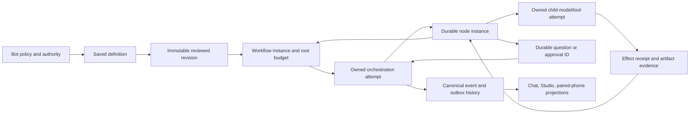

# Dynamic workflows: reference audit, capability gates and design contract

Status: **implemented in verified slices (deterministic path, bounded repair/recheck engine,
honest partial joins and categorized output projections,
fixture probes, bounded live negative-evidence campaign, Studio card, and current private-preview
marketing copy verified)**.
Chat routing is implemented behind an exact-profile selector gate, but both local candidates
tested failed selector qualification; new-plan Auto, live-work amendment draining, terminal-run
amendment, routine-to-workflow scheduling and several recovery and integration cases remain open.
Studio amendment controls and paired-phone monitor/review are implemented. No local candidate
passed author or selector qualification. User guide:
[`docs/workflows.md`](../workflows.md).
Evidence: [`artifacts/dynamic-workflows/`](artifacts/dynamic-workflows/) and the ledger entry.
This file separates **verified** facts (read in source or fetched from a pinned revision)
from **unverified** claims, and records the decisions the implementation must satisfy.

## 1. Reference identification

The strongest matching primary reference is Z.ai's ZCode **dynamic workflows**
(`CreateWorkflow` / `AmendWorkflow` / `SaveWorkflow`, the `dynamic-workflows` skill), pinned
at commit `aac4755666d09fdcd70272fcf063c077a639015f` of the public `zai-org/ZCode`
repository. It is a distinct feature from ZCode's older `Workflow` tool (`.workflow.js`),
from Goal Mode, and from ordinary subagents; the spec says so explicitly. ZCode's license is
**Apache-2.0** (root `LICENSE`, "Copyright 2026 Z.AI Co., Ltd"); ideas and code may be
adapted, including commercially, with attribution/NOTICE preservation and no copyleft. No
separate license is stated for the docs.

Inspected first-hand at that revision: `docs/dynamic-workflow.md` (spec),
`docs/dynamic-workflow/launch.md`, `docs/dynamic-workflow/authoring.md`,
`apps/zcode-cli/packages/dynamic-workflow/docs/execution-engine.md` and `concurrency.md`
(via delegated reading with quotes), plus the source tree layout, the test list and the
license. Not inspected: the analyzer/presentation docs' content, the TypeScript sources
line-by-line, the fault-matrix helpers, and any runtime behaviour (nothing was installed or
executed).

### 1.1 What the reference actually does

| Piece | Mechanism (verified in the pinned docs) |
|---|---|
| Authoring | The model writes ordinary TypeScript against a small facade (`agent().ask<T>()`, `files.*`, `git.*`, `world.run`, `report`, `artifact.*`, `phase`, `log`, `hole`), typechecked against one `.d.ts` the compiler and the docs share. |
| Analysis | A static analyzer produces four graphs; sites get stable ids; imprecision widens edges, never rejects; the one hard rule is that a facade call must be a direct call. |
| Identity | Every call is a **site**; every execution is an **instance** (`siteId@ordinal`); the journal keys on `(run_id, site_id, ordinal)` with a unique index. |
| Durability | `dwf_run`/`dwf_actor`/`dwf_node`/`dwf_event`; a node row is written `running` **before** dispatch, carrying an input hash; resume replays the same script byte-for-byte with settled rows answered from the journal. |
| Resume | `completed`/`failed` rows settle from the journal (`cached: true`) with no driver call; `running` rows re-execute live; resume is a crash-recovery primitive, not re-verification. |
| Amend | A **new run** that imports the predecessor's contiguous completed prefix (matched by unique subagent name + input hash), closing the cache at the revision's first workspace write; a live predecessor is stopped (`superseded`) first; usage sums across the lineage. |
| Concurrency | Two bounds — the run's `maxConcurrency` (asks; no upper limit) and a shared per-provider AIMD governor. |
| Approval | `CreateWorkflow`/`AmendWorkflow` declare `alwaysAsk`; the confirmation window appears in every permission mode for a tool call, the hub "Run" click is its own consent, and the TUI/headless surfaces auto-allow. |

### 1.2 Adopt / adapt / reject

| Idea | ZCode mechanism | Decision | Rationale for Hutch |
|---|---|---|---|
| Stable call-site identity + per-instance identity | site ids + `(siteId, ordinal)` unique keys | **Adopt** | Reordered/duplicated items must not alias; a repeated call site is not one invocation. Hutch uses `site_id` + deterministic item keys, escaped so nested keys cannot collide. |
| Journal before dispatch | node row `running` + `input_hash` written at admission | **Adopt** | Crash-safe idempotency in SQLite; a redelivered dispatch must not double-run a node. |
| Input-hash purity guard | `InputHashMismatch` on replay | **Adapt (partial)** | Hutch records the hash of each node's resolved input bundle at admission; drift *cannot* occur today because revisions and input snapshots are immutable and a settled node is never re-executed. The recorded hash is the identity used for step idempotency; a continuation-time comparison is not implemented (and is only meaningful once amendments exist). |
| Journal is the truth | transcript/notifications built from engine records | **Adopt** | Matches Hutch's event/outbox discipline; the displayed graph derives from the committed plan, not model prose. |
| Complete structure before the run | static graph drawn before execution | **Adapt** | Hutch shows planned structure, then marks bounded not-yet-expanded regions; actual instances come from engine records. No claim that static analysis predicts future targets. |
| Explicit artifact publication | `artifact.*` + `report` items, one primary | **Adapt** | Publish through Hutch's existing artifact registry (events + SHA-256 + verified download), never a side channel. |
| Caps fail loudly, nothing truncated | `WorldReadCapExceeded` etc. | **Adopt** | A silently partial view fanned out is worse than a catchable failure. |
| Amend = new run + cache import | prefix match by name+hash, close at first write | **Adapt** | Hutch keeps the revision/plan-diff and reuse-eligibility rules (dependency/input versions, tool/schema/skill/route revisions, current authority). A source change is an amendment, not a byte-identical resume. |
| Per-subagent model | persona model resolved at launch against the catalog | **Adapt** | Hutch binds a **role** + concrete model per node, gated by role qualification; a routing key may choose only among declared, qualified models. |
| Two bounds + provable stall detection | maxConcurrency + AIMD governor; `ScriptStalled`/`ChannelDeadlock` | **Adapt** | Hutch: a per-workflow logical bound plus the existing one-caller/eight-waiter inference admission; a stalled interpreter fails instead of waiting forever. |
| Approval once, no prompts inside a run | confirmation window per tool call | **Reject as-is** | Hutch approval stays bound to actor/run/node/args/resource with expiry, re-validated at effect time; no surface bypasses it, and consequential actions still ask. |
| Model-authored TypeScript program | TS facade + vm cell | **Reject for Hutch** | Would add a second language/runtime and a code-execution sandbox. Node's own docs: "The `node:vm` module is not a security mechanism." Hutch uses a **declarative typed plan** lowered to one canonical IR. |
| Settle-order replay gate | JS promise-ordering reconstruction | **Reject** | Specific to JS microtask semantics; Hutch's interpreter is deterministic by construction. |
| Unbounded provider-transient retries | `Unbounded` budget for workflow children; backoff to 60 s then "probe forever" | **Reject** | Unbounded spend. Hutch bounds attempts, backs off, and surfaces the failure. |
| Indefinite question waits | `escalate` blocks "with no timeout"; the escape hatch is cancellation | **Reject** | A workflow must expire or escalate a pending question; answers are keyed by unique question id and survive restarts. |
| No token/node cap | "There is no budget and no cap: the number is telemetry" | **Reject** | Hutch is built on bounded budgets; the root workflow owns step/model/wall/fan-out/repair limits that children cannot reset. |
| Launch only on explicit request | model never starts a workflow unsolicited | **Adapt** | Hutch keeps explicit request as one door, and adds reviewed Off/Suggest/Auto policy under operator preauthorization — never inferred from task shape or message length alone. |

## 2. Failure-mode evidence (researched 2026-10-11; sources fetched first-hand)

| Source | Verified claim | Design response |
|---|---|---|
| Node.js `vm` docs | "**The `node:vm` module is not a security mechanism. Do not use it to run untrusted code.**" | No generated code execution. Declarative plans only; any future code facade needs a separately contained process. |
| LangGraph interrupts docs | Resume "restarts the entire node from the beginning"; "**Side effects called before `interrupt` must be idempotent**"; index-based interrupt matching breaks on reorder/condition. | Node effects are recorded intents before execution; a conversation resumes at node boundaries; completed nodes are never re-run. |
| [LangGraph issue #9106](https://github.com/langchain-ai/langgraph/issues/9106), report observed 2026-10-11; open at capture | A user reports that resuming one of two parallel nested interrupts re-runs a completed sibling and repeats its side effect. This is an individual upstream report, not a prevalence claim; not yet reproduced in Hutch. | Regression `WF-EFFECT-01`: crash after an externally recorded effect but before node settlement, restart the process, and assert the append-only sink still contains one effect. |
| [LangGraph issue #9075](https://github.com/langchain-ai/langgraph/issues/9075), report observed 2026-10-11; open at capture | A user reports that multiple pending task interrupts are not all exposed for resume. Not yet reproduced in Hutch. | Regression `WF-QUESTIONS-01`: expose every durable pending id through snapshots/restart and answer in both orders, including a partial answer. |
| [LiteLLM issue #40575](https://github.com/BerriAI/litellm/issues/40575), report observed 2026-10-11; open at capture | An adapter-specific report describes a repeated tool call after a tool result. It does not establish behavior across providers or versions; not yet reproduced in Hutch. | Regression `WF-PROTOCOL-01`: test each supported protocol's call/result IDs, stream assembly, result consumption, and repeated-call stopping. |
| [Cline PR #14643](https://github.com/cline/cline/pull/14643), merged before 2026-10-11 | The fix registers an approval resolver before publishing the review UI, addressing a report that an immediate decision could arrive before registration. | Regression `WF-APPROVAL-01`: immediate decision, publish failure, reconnect, expiry, revocation, and stale answers against Hutch's own durable approval IDs. |
| [Cline issue #11263](https://github.com/cline/cline/issues/11263), closed report observed 2026-10-11 | The report describes adapter/model-specific tool-schema rejection and repeated malformed call text; it is not a claim about all Cline routes and is not independently reproduced here. | Keep positive route evidence, strict protocol parsing, and a bounded loop breaker. Probe outcomes remain route- and revision-scoped. |
| Ollama docs (tool calling, structured outputs, FAQ) | Tool calls are model-generated and may be malformed; `format`/schema enforces shape but "Ollama's Cloud currently does not support structured outputs"; default context 4096; concurrency multiplies context×KV and RAM scales with `OLLAMA_NUM_PARALLEL × OLLAMA_CONTEXT_LENGTH`; 503 on queue overflow. | Structured output is per-route capability with an evidence state; effective context is explicit; Hutch keeps its own admission limit rather than widening server concurrency. |
| vLLM tool-calling docs | Named/`required` tool choice guarantees only a parsable call ("not a high-quality one"); with `auto` and no strict tools, calls are extracted from raw text and "arguments may occasionally be malformed". | Hutch never upgrades `auto` to a claim of validity; the canonical validator remains the boundary. |
| Qwen3-4B-Instruct-2507 model card (Apache-2.0) | 262k native context; the card itself advises reducing to 32768 on OOM; tool usage claimed with benchmarks. Vendor self-report. | A plausible small worker, not a certified planner; role qualification is per route revision and tested task scope. |
| Ollama FAQ on memory | No explicit OOM/overcommit semantics are documented. | Treat memory behaviour as unknown and *measure*; never promise "an 8B fits 4 GB". |
| Playwright trace viewer | Records before/action/after DOM snapshots, network, console, source, attachments; "loads the trace entirely in your browser and does not transmit any data externally". | Accepted evidence format for UI verification. |
| Anthropic, "Building effective agents" | "find the simplest solution possible, and only increasing complexity when needed"; prefer fixed workflows; warn about compounding errors and framework abstraction. | Direct answer stays direct; workflows are opt-in and proportional. |

## 3. Hutch capability / gap matrix (integration baseline: local `main` 6221cc2 + `workflow/dynamic` f616106; 2026-10-11)

| Capability | State today | Evidence |
|---|---|---|
| Run ownership, fencing, recovery | Recovery query ordering and stale attempt replacement are fixed; node/question writes check revision, attempt, fence and live lease; workflow effects have stable identities and replay/reconciliation guards | `workflow.persistence._assert_workflow_owner`, `Store._assert_workflow_action_owner`; `test_stale_or_expired_workflow_owner_cannot_mutate_node_or_question`, `test_recovery_query_uses_cutoff_before_terminal_status_values`, `test_stale_workflow_attempt_cannot_replace_the_current_owner`, `tests/test_workflow_effect_receipts.py` |
| Local inference admission (1 caller + 8 waiters) | Existing single inference slot remains; human/child waits park the workflow and release run capacity, then resume through a new attempt | `admission.inference_slot`; `test_question_waits_and_is_answered_by_its_own_id`, `test_stopping_a_parked_workflow_finishes_after_cleanup_and_cancels_questions` |
| Bounded child delegation | Implemented, narrow | built-in + Strict Offline + process executor; depth ≤ 2, ≤ 3 lifetime children, ≤ 2 active; waits for one child |
| Saved reusable procedures | Implemented as inactive definitions and immutable revisions | `workflow.persistence`; save/import are separate from run and schedule actions |
| Deterministic multi-step execution | Implemented as a declarative interpreter; expansion, joins, repair adoption, and result projection need hardening | `workflow.compile`, `workflow.engine`, `workflow.ops`; tests are synthetic except the deterministic CSV path |
| Model capability gates | Implemented and exercised. Exact execution profiles are bound to durable held-out campaigns. Qwen3 1.7B and 4B Q4_K_M both have negative author and selector evidence; neither qualifies | `workflow/probes.py`, `workflow/qualify.py`, `toolcalling.profiles`; fixture regressions and [`qualification-campaign-2026-10-11.json`](artifacts/dynamic-workflows/qualification-campaign-2026-10-11.json) |
| Approval binding | Implemented | `action_fingerprint`, CAS resolution, re-validation in `begin_action`, 600 s TTL |
| Artifact registry | Implemented | `tool_result` events + SHA-256 + verified download; no publish API outside an event |
| Skills and delegation identity | Implemented on local main and retained in the integration | `skills.py`, `use_skill`, run snapshots, fail-closed activation; `tool_call_index` preserves distinct repeated delegation calls |
| MCP | **Proposed only** (ADR-0017) | no client/server anywhere |
| Chat and Studio workflow controls | Partially implemented | selected-conversation card, planned/discovered step sections, durable question answer, saved run and revision-checked Stop; policy picker; no chat-turn recommendation or Auto launch yet |
| Amendment, workflow schedule connection, paired-phone workflow supervision | Amendment preview/adoption and redacted phone monitor/review are implemented; schedule connection remains absent | amendment API/Studio and `tests/test_workflow_api.py`; paired phone API/E2E evidence in [`artifacts/workflow-studio/phone/`](artifacts/workflow-studio/phone/); no reviewed routine-to-workflow binding |
| Marketing claims | Existing “How it helps” journey only | preserve that journey; do not claim live qualification or unattended workflow support until evidence lands |

## 4. Design contract (approved 2026-10-11: Route 1, declarative plans)

**Identity.** Definition (`workflow_definitions`) → immutable revision (`workflow_revisions`,
plan JSON + hash) → workflow **run/instance** (`workflow_runs`, stable id, owns inputs, node
records, budget ledger, published artifacts) → **orchestration attempt** (an ordinary `runs`
row, `kind='workflow'`; one live at a time; a crashed attempt is continued by a *new*
attempt) → **node instance** (`workflow_nodes`, unique on `(workflow_run_id, site_id,
item_key)`) → **step attempt** (an ordinary `runs` row, `kind='step'`, `parent_run_id` = the
orchestration attempt).

Attempts are never resumed mid-flight (ADR-0003 unchanged). Workflow *instances* continue:
a new orchestration attempt adopts the instance and reuses every settled node record.

**Execution model.** Deterministic/tool nodes execute inside the orchestration process
through the canonical `steps.call_tool` seam (events, receipts, approvals, artifacts).
Agent nodes are step runs executed by the existing worker/claim machinery with a frozen
scoped input bundle, an intersected tool allowlist, optional skill bindings, an explicit
model binding and an output contract.

**Capacity.** `runs.kind` distinguishes `interactive` work from the `workflow`/`step` lane. Interactive runs of
one bot remain mutually exclusive (unchanged). A workflow attempt of a bot may run beside
that bot's interactive work; its steps share the attempt's global slot, bounded by the
workflow's own logical concurrency (default 1, operator-raised under review). Inference
admission is untouched and remains the model-call limiter.

**Isolation.** Workflow nodes always use fresh private run workspaces; delivery is by
artifact publication, never by writing into the bot's shared workspace. This keeps the
existing managed-workspace semantics intact and gives concurrent lanes no shared mutable
files.

**Gate.** Roles: `selector`, `author`, `worker`, `verifier`, `executor`. Qualification
evidence states: `documented`, `advertised`, `probed`, `observed`, `limited`, `stale`,
`unsupported`, `unknown`, bound to the existing `route_revision` identity. Enforcement
points: configuration, plan submission, node admission, resume, amendment, model/backend
change; hidden tools are explained and direct calls rejected.

**Bounds.** Root-level: node instances, model calls, wall time, fan-out per expansion,
repair rounds, replans, and the existing usage reservations. Retries and children cannot
reset allowances. Every wait expires; every question/approval has a unique id.

**Artifacts.** Published only through committed events on the workflow run; verified
download/read-back.

## 5. What landed, and what is actually verified

| Area | State | Evidence |
|---|---|---|
| Plan schema, bounded evaluator, compiler | implemented, verified | `tests/test_workflow_plan.py` (19): identity, reference scope, envelope membership, nesting/cardinality expansion, default limits, fail-closed schema certification, strictness |
| Role capability gate + durable evidence | implemented, verified (mechanism) | `tests/test_workflow_qualify.py` (14), `tests/test_workflow_api.py` qualification routes |
| Durable execution: interpreter, step runs, continuation, lanes | implemented, verified | `tests/test_workflow_engine.py` + `tests/test_workflow_regressions.py`: deterministic run, artifact publication + tamper-detecting read-back, settled-node reuse, workflow lane, question parking, expiry, branch/map/repeat/join identity, stop semantics and cleanup |
| Model steps as real child runs (scripted local HTTP server, thread **and** process executor) | implemented, verified on the wire path | `tests/test_workflow_steps.py` + `tests/test_workflow_regressions.py`: own transcript/workspace/tool calls, declared model binding, frozen contract, output-contract enforcement, zero-call budgets, root charging for both tool-call and final-answer requests, re-admission, and child survival while its workflow parent is parked |
| Submission gates (inputs, envelope-vs-Bot, local-only, role) | implemented, verified | `tests/test_workflow_engine.py`, `tests/test_workflow_api.py` |
| Typed API + CLI | implemented, verified | `tests/test_workflow_api.py` (11) and `tests/test_workflow_cli.py` (4); the acceptance capture also drives the CLI end to end |
| Routing policy Off/Suggest/Auto | implemented, verified (rules) | `tests/test_workflow_routing.py` (9); an automatic start is scope-checked at submission, and the gate is bound to the Bot's endpoint, not just provider+model |
| Chat wiring for Suggest and saved-workflow Auto | implemented, mechanism verified; live local use blocked by qualification | `src/hutch/tools/workflow_route.py` is exposed only to a local-owner turn whose exact active execution profile has selector evidence. It rechecks the current conversation mode and profile at invocation. Suggest emits a review card and cannot start; Auto starts only an activated saved definition through normal scope/role/input checks. `tests/test_workflow_routing.py` (12) covers recommendation, idempotent saved launch and downgrade; `tests/test_runtime_builtin.py` covers the real chat tool loop and withholding from an unqualified model. Both local Qwen3 profiles failed selector qualification (A2); chat Auto for generated plans is unsupported. |
| Model-facing authoring gate | implemented, verified (mechanism) | `tests/test_workflow_routing.py::test_authoring_tool_is_refused_without_probed_evidence` |
| Acceptance: messy CSV → verified report | implemented, **verified end to end with the real CLI**, zero model calls | `tests/test_workflow_csv_acceptance.py` (2) asserts the report's own numbers are consistent; `artifacts/dynamic-workflows/validation.json` records every command, the question id the CLI printed, and the copied artifact re-hashed against the engine's digest |
| Model-authored plan on a live local route | **not verified** | no local model server on this host; the gate and refusal paths are tested, and a scripted local HTTP server exercises the step path, but a passing probe was never recorded for a real checkpoint |
| Planner/worker role split on one inference slot | **not verified live** | depends on the row above; admission is unchanged and shared |
| Studio surface (plan preview, graph, inline questions) | implemented, verified for the saved-run card and chat route suggestion | Studio projects immutable plan structure and durable question/result state; the separate chat suggestion card was opened and keyboard-tested at 1440/768/360/320 CSS pixels. Synthetic route-card states are visually tested separately from the scripted local runtime/API journey. See [`artifacts/workflow-studio/`](artifacts/workflow-studio/) and [`artifacts/dynamic-workflows/chat-router/`](artifacts/dynamic-workflows/chat-router/). |
| Amendment / replanning of a live instance | **partially implemented** | a new attempt continues an instance and reuses settled nodes; a plan *revision* diff + adoption of a changed revision is not implemented |
| MCP facade | **not implemented** | Hutch has no MCP plane (ADR-0017 is proposed only) |

### Role / model-route classification (mission completion criteria)

| Combination | Class | Basis |
|---|---|---|
| Deterministic executor + any plan without model nodes | **verified** | 15 engine tests + the CLI acceptance capture (zero model calls, published + verified artifact) |
| Bounded worker on a documented local route, no tools | **verified on the wire path** | `test_workflow_steps.py` (scripted local HTTP server, real builtin runtime, real admission) |
| Bounded worker on a documented local route, with tools | **verified on the wire path** | same, including the step's own tool call, transcript and workspace |
| Bounded worker whose output contract cannot be met | **verified (fails honestly)** | `test_workflow_steps.py::test_agent_step_output_contract_is_enforced_and_fails_honestly` |
| Worker on an unknown provider | **blocked** | `test_workflow_qualify.py::test_unresolvable_route_is_blocked_with_a_reason` |
| Worker with tools on a route with negative tool evidence | **blocked** | `qualify.assess` returns `blocked`; no test exercises a real negative-evidence route yet |
| Verifier on a different route | **implemented** | independence computed; no live multi-route run |
| Verifier on the producer's route | **advisory only** | `qualify.assess` marks `independent=False`; `agent_review` can never certify |
| Author / selector without probed evidence | **blocked** | `test_workflow_routing.py::test_authoring_tool_is_refused_without_probed_evidence`, `test_workflow_qualify.py` |
| Author / selector with probed evidence | **implemented-but-unverified** | the record path is tested; no real probe was ever run against a checkpoint |
| Any role on a live local model | **blocked on this host** | no local model server, no GPU; downloads need authorization |
| Any role on a hosted route | **implemented, unverified, and a data-egress decision** | hosted routes work through the ordinary per-run route authority; `network: local_model_only` refuses them outright |
| Pi / OpenCode as a workflow executor | **unsupported** | external runtimes are disabled before process start; a workflow attempt requires the built-in runtime |
| Code facade / generated scripts | **unsupported by design** | declarative plans only; Node's own docs say `vm` is not a security mechanism |
| MCP facade | **unsupported** | Hutch has no MCP plane (ADR-0017 proposed only) |

### Residual uncertainty
* No live local checkpoint was available, so "a qualified local planner coordinates a smaller
  local worker" is implemented-but-unverified. Nothing here claims model planning competence.
* The workflow lane changes the per-Bot single-instance rule deliberately (interactive work
  and one workflow may overlap); the capacity tests cover the cap and branch rules, but a
  long soak with a real model server is still needed before calling it proven under load.
* A model-authored plan that is valid and well-bounded can still be a poor decomposition;
  compilation establishes structure, not judgement. That is why authoring is gated on probed
  evidence and why a person starts the reviewed plan.

## 6. Completion checkpoint and acceptance ledger

The user's completion plan is the acceptance source. These IDs keep evidence stable across
commits; a status of **implemented** does not mean **verified**. The reported upstream issues
above are individual, versioned failure hypotheses. They are not statements about how often a
product fails, and the Hutch regressions must establish Hutch's own behavior.

### Ownership and state boundary at integration

The A1 fixes fence workflow mutations to the active attempt/generation, park waits outside
orchestration capacity, persist stable effect receipts across a crash window, and gate workflow
progress on canonical event commits. Failed writer batches remain queued without a false commit
acknowledgement, and a full event queue refuses new records. Enqueue and commit-ack failures stop
the current workflow attempt so recovery can continue from durable node/effect records. A completed
effect receipt can be reused across recovery when the bot, tool, arguments and workflow identity
match; changed operation arguments remain a conflict. This event-failure path is fixture-tested,
including a real file write and an injected non-lock database error; a production storage-failure
campaign remains unrun.

| ID | Acceptance boundary | Baseline state and evidence pointer |
|---|---|---|
| A0 | Merge local main and workflow work; reconcile schema histories and recover from interrupted migration | Verified in commit `488200f`; main v51, workflow v51/v52, rollback, backup and retry: `tests/test_migration.py` (32 passed with CSV acceptance). |
| A1 | Fence recovery, questions, nodes and callbacks; prevent duplicate effects; charge every request; park waits; fair capacity; truthful Stop and event delivery | Partial. Recovery selection, node/question owner checks, stable effect receipts, uncertain-action reconciliation, durable wait parking, child survival during parking, parked Stop cleanup, scalar/array/null/falsy projections, root-wide request/token reservations (including uncached local context self-checks), request-start recovery and process-executor paths are covered. Workflow events now wait for canonical commit; failed enqueue/commit acknowledgements abort the attempt, while the writer requeues database failures without a false acknowledgement or silent drop. Regressions: `test_canonical_event_rejection_fails_the_attempt_then_recovers`, `test_workflow_waits_for_canonical_event_commit_before_continuing`, `test_event_failure_after_effect_reuses_receipt_on_recovery` (real `write_file` plus independent completion log), `test_non_lock_database_failure_requeues_event_batch_without_acknowledging_it`, `test_recovery_query_uses_cutoff_before_terminal_status_values`, `test_stale_workflow_attempt_cannot_replace_the_current_owner`, `test_stale_or_expired_workflow_owner_cannot_mutate_node_or_question`, `test_question_waits_and_is_answered_by_its_own_id`, `test_stopping_a_parked_workflow_finishes_after_cleanup_and_cancels_questions`, the three tests in `tests/test_workflow_effect_receipts.py`, `tests/test_workflow_usage_budget.py`, `test_run_detail_preserves_scalar_array_null_and_falsy_node_values`, and `test_agent_step_runs_under_the_process_executor`. A production storage-failure campaign remains unrun. |
| A2 | Exact capability identity, tested scope, negative evidence, bounded disposable probes, no acknowledgement-made qualification | Probe enforcement is fixture-tested and exercised against two real local checkpoints. Both Qwen3 profiles failed author and selector qualification; the durable campaign record includes profile hashes, digests, failed-case reasons, response hashes, token counts, per-request latency and memory snapshots. No author/selector role was granted. `tests/test_workflow_probes.py`, `tests/test_workflow_qualify.py`, `tests/test_migration.py`; campaign: [`qualification-campaign-2026-10-11.json`](artifacts/dynamic-workflows/qualification-campaign-2026-10-11.json). |
| A3 | Strict dynamic plan validation, repair adoption and recheck, explicit join policies, honest result categories, amendment preview/adoption and reuse rules | Partial. Repair targets are compile-checked, a worker's closed-schema replacement is adopted, checks rerun in distinct durable rounds, no-progress output fails, and recovery reuses settled repair children while reconstructing adopted scope. Advisory review reads the validator-wrapped `output` object and remains non-certifying. `all_settled` can preserve named failed/skipped targets while returning successful values; unrelated failures still stop the workflow. `first_success` is rejected because sequential execution cannot promise first completion or safely cancel/drain losing work. Terminal output groups are separately persisted and exact passing independent refs alone confer `verified`; partial maps/joins remain partial. A read-only amendment preview now uses expected revision/current attempt ID, returns field/site diffs, separately reports the parked attempt lease and child/process-tree quiescence, refreshes authority and refuses budget widening. Only settled pure transforms are offered for reuse, and only when every upstream result is also reusable; effect/evidence-sensitive and control/container results are invalidated conservatively. A separate idempotent adoption API handles parked runs after child work and owned processes settle. It requires a revision/generation match, cancels pending questions only by explicit request, archives the prior graph/questions/result snapshot under schema v58, retains only preview-approved transforms, and continues through the supervisor under the new revision. The owner-local Studio now has a declarative plan/input editor, inspectable server preview, authority/budget/quiescence and reuse sections, explicit question cancellation, and an adopt action. The browser journey verifies the previous question is archived and a new durable question appears under the amended revision at 1440/768/360/320 CSS pixels. Evidence: `tests/test_workflow_api.py::test_amendment_preview_shows_dependency_invalidation_and_safe_reuse_without_mutation`, `test_amendment_preview_fences_stale_revision_and_generation_and_invalidates_changed_inputs`, `test_amendment_preview_refreshes_authority_and_refuses_budget_widening`, `test_amendment_preview_includes_pending_question_id_and_requires_quiescence`, `test_amendment_preview_does_not_reuse_results_derived_from_effects_or_evidence`, `test_amendment_adoption_archives_and_cancels_old_question_then_continues`, `test_amendment_adoption_refuses_active_child_without_cancelling_question`, `test_v58_amendment_history_preserves_revision_links_and_is_idempotent`, and `test_interrupted_schema_56_to_58_migrations_roll_back_and_retry`, `tests/e2e/test_browser.py::test_workflow_amendment_preview_adoption_is_explicit_and_responsive`. Live-work draining, terminal-run adoption and reuse beyond pure transforms remain open. Existing engine evidence: `tests/test_workflow_plan.py::test_repair_target_is_validated_and_single_check_targets_remain_compatible`, `test_first_success_join_requires_a_cancellation_capable_scheduler`, `test_join_rejects_duplicate_targets`; `tests/test_workflow_engine.py::test_repair_adopts_output_and_rechecks_each_durable_round`, `test_repair_recovery_reuses_settled_output_and_reconstructs_adopted_scope`, `test_repair_with_no_progress_fails_without_another_round`, `test_advisory_review_reads_the_validated_step_output`, `test_output_projection_separates_verified_and_partial_from_node_counts`, `test_later_failed_verification_revokes_an_earlier_output_claim`, `test_a_later_pass_does_not_erase_a_continued_failed_criterion`, `test_uncertain_child_is_projected_as_uncertain_output`, `test_all_settled_join_preserves_failed_and_skipped_targets`, and `test_all_required_join_rejects_a_skipped_target_explicitly`. Scripted local routes verify engine behavior, not live model quality; generated code remains unsupported. |
| A4 | New assistants default to Suggest; server-persisted conversation policy; rules plus eligible model-turn recommendations; explicit reviewed Auto | Policy storage and conversation-menu control are verified. The chat tool is offered only after exact-profile selector admission and rechecks policy/profile at invocation; Suggest is review-only, while Auto can start a saved workflow within scope. The routing/runtime set passed 74 tests and the expanded workflow API, conversation, routing and runtime set passed 113, including Auto launch in the same scripted chat/tool turn. Both local Qwen3 profiles fail selector qualification, so no tested local profile can use chat routing; no compulsory classifier is added. |
| A5 | Compact accessible chat card, Studio inspector, durable Needs you IDs, local-owner-only mutations, paired-phone monitor/review surface | Studio saved-run card is verified for planned/discovered sections, durable question ID, keyboard answer, Stop and per-chat policy. The route suggestion browser fixture passes at 1440/768/360/320; long method names wrap, the 44px review action remains visible, Enter opens the review dialog, Cancel restores focus, and no run starts. A 320px preserved-scroll capture exposed the “Jump to latest” button covering card text; the button now occupies a reserved row between the scroll pane and composer. The real local fixture verifies the review target remains above the composer under text-spacing overrides and forced colors, keyboard focus remains on the review action, and Jump to latest returns the feed to its maximum scroll position. See [`route-card-a11y-2026-10-11/`](artifacts/workflow-studio/route-card-a11y-2026-10-11/) for opened captures, trace, source hashes and review. Synthetic event fixture evidence remains separate from the real scripted model/API tool-loop tests. The parked-run amendment editor passed a browser journey with revision preview, explicit pending-question cancellation, archived history, fresh question identity, keyboard adoption and touch targets of at least 44px; editor and preview views were opened at 1440/768/360/320. Paired-phone monitoring, question answer and Stop pass through the real SQLite, supervisor, API and browser path. `monitor` can inspect a redacted planned/discovered step view; `review` exposes every pending durable question ID and is required for answer/Stop. Inputs, results, artifacts, ledgers and expansion keys are omitted; monitor-only UI makes no review requests. The 390/320 browser captures show zero horizontal overflow, no page errors and 44px minimum targets. Route/API and browser evidence plus source hashes are in [`artifacts/workflow-studio/phone/`](artifacts/workflow-studio/phone/); desktop and amendment evidence remains in [`artifacts/workflow-studio/`](artifacts/workflow-studio/) and [`artifacts/workflow-studio/amendment/`](artifacts/workflow-studio/amendment/). The supplied ZCode image is a composition reference only. |
| A6 | Preserve the existing “How it helps” journey; evidence-backed workflow explanation, availability and FAQ | The website explains the exact-profile selector gate, reports that both tested local profiles failed, and states that Auto only starts an activated saved method; new-plan Auto and routine links remain unavailable. The marketing test asserts those claims plus the FAQ/CTA and captures 1440/768/360/320 with no page errors, external requests or horizontal overflow. Refreshed images and hashes are in [`marketing/`](artifacts/dynamic-workflows/marketing/); visual review: [`marketing/visual-review.md`](artifacts/dynamic-workflows/marketing/visual-review.md). This verifies copy and layout only, not public availability or a qualified local selector. |
| A7 | Ollama 0.40.3, private storage/process, Qwen3 1.7b and 4b Q4_K_M candidate probes within the user-authorized request/time/token/download/storage bounds | Completed within caps: checksum-verified Ollama 0.40.3 and both exact Q4_K_M downloads; 16 inference requests, 2,808 accounted tokens, one CPU resident model, 4,096 context, less than 6 GiB model downloads and less than 15 GiB private storage. Both candidates failed author and selector qualification. Retained evidence: [`qualification-campaign-2026-10-11.json`](artifacts/dynamic-workflows/qualification-campaign-2026-10-11.json). |
| A8 | Focused and broad runtime checks, browser/app/site visual captures at 320/360/768/1440, interaction/accessibility and soak evidence; classify exercised role combinations | Partial. The complete non-browser suite passes 2,137 tests on commit `9f2810b` in an isolated validation worktree; exact command, Python/pytest versions, tree and source hashes, duration, and output log are retained under [`broad-non-browser-2026-10-11/`](artifacts/dynamic-workflows/broad-non-browser-2026-10-11/). Studio and website browser journeys are captured at 320/360/768/1440 and visually opened. Paired-phone monitor/review has a separate real API/browser journey and opened captures at 390 and 320; route permissions, redaction, CSRF/idempotency, 44px targets, zero 320px horizontal overflow and no page errors are recorded. The workflow suggestion card now passes 320px WCAG text-spacing overrides and forced-colors emulation with a separated jump control, visible review target, keyboard focus and no workflow start; screenshots were opened. A complete E2E suite, actual browser-chrome zoom, slow/offline reconnect, ten-minute soak and complete role classification remain. No author/selector pairing is verified. |

### Integration verification after paired-phone supervision (2026-10-11)

Question creation now commits the durable pending row and the workflow's waiting projection in
one transaction. The owning attempt then parks and releases its run slot. The deterministic CSV
acceptance test checks the status as soon as the durable question is visible. Runtime policy
lookup treats a run with an unpersisted legacy conversation ID as having no conversation override
and falls back to the Bot setting; policy API reads and writes still require a durable conversation.

The first non-browser broad run collected 2,136 tests: 2,127 passed and 9 failed. Four regressions were
fixed and passed targeted checks: missing-conversation policy fallback, atomic question/wait
publication, amendment comparison text caught by the emoji audit, and an undefined recommendation
text token. The snapshot test fixture was corrected to mark its provider request started before it
expects an uncertain reservation; tests/test_state_snapshot.py then passed all 10 tests. Three
offline-worker tests failed with explicit ENOSPC under the already-full shared `/tmp` tmpfs, and a
process-executor case failed before dispatch. `OfflineBrokerSet` had forced its private socket
directory into `/tmp`, ignoring the configured temporary root. The temporary-root fix removes
that override while retaining the 0700 private directory; the configured-root regression and all
of `tests/test_offline_mode.py` then passed (37 tests) with `TMPDIR=/var/tmp`. The separately
failing delegated-offline test also passed (1 test). A complete non-browser rerun in a disposable
worktree at commit `9f2810b` passed **2,137 tests in 603.70 seconds** using Python 3.13.15 and
pytest 9.1.1. The earlier complete `pytest -q` invocation was interrupted at 33% after `/tmp` was
full and is not counted as a completed suite. The passing non-browser output and hashes are
retained in [`broad-non-browser-2026-10-11/`](artifacts/dynamic-workflows/broad-non-browser-2026-10-11/);
the complete E2E suite and ten-minute soak remain open.

The amendment browser journey passed against a real SQLite store and supervisor at 1440, 768, 360
and 320 CSS pixels. Opened screenshots show the candidate diff, the full pending-question
cancellation label above the fixed footer, and the post-adoption state. Each viewport had zero
horizontal overflow, a 44px adoption target, no page errors or failed requests, and zero provider
calls. See
[amendment-postfix visual review](artifacts/workflow-studio/amendment-postfix-2026-10-11/visual-review.md)
for the opened views and artifact hashes.

The selector recommendation card was re-rendered at the same four sizes with a
synthetic event fixture. Its computed text color resolved to the shared base-content
token, the long title wrapped at 320px, the 44px Review & run action remained visible,
and keyboard review still started no workflow. This is presentation evidence only;
it does not upgrade selector qualification. See
[route-card visual review](artifacts/workflow-studio/route-card-postfix-2026-10-11/visual-review.md).

The follow-up visual audit found that the floating jump control was appended inside the
scrolled transcript, so its absolute position moved with old content and covered the
workflow-card status. It now sits in a reserved flow row above the composer. The real
local Studio fixture was reopened at 1440/768/360/320, then at 320 with WCAG text-spacing
overrides and forced-colors emulation. The review target remains at least 44px and above
the composer, the jump action returns the feed to its maximum scroll, there is no
horizontal overflow, page error, failed/external request or workflow start. Screenshots,
trace, exact bounds, computed forced colors and source hashes are in
[`route-card-a11y-2026-10-11/`](artifacts/workflow-studio/route-card-a11y-2026-10-11/).
Playwright headless `Control+Equal` did not change `innerWidth` or device pixel ratio;
actual browser-chrome zoom remains unverified.

The request-budget slice passed its broad compatibility set on 2026-10-11: 237 passed in
102.91 s across usage-budget, step, engine, regression, plan, routing, API, CLI, reservation,
built-in runtime, provider authority, local admission and migration tests. The run used the
worktree's Python 3.13 environment and a private `TMPDIR` because the shared `/tmp` tmpfs had
previously filled; no files from other processes were removed.

### Baseline environment and measured path

On 2026-10-11, the selected core/workflow set ran with 179 passes and one environment failure;
the remaining tests in that run passed after setting pytest's temporary directory on the root
filesystem. The single failure was strict-offline process setup reporting `ENOSPC` in the
shared `/tmp` tmpfs, which was already at 100% before and after the run. I left other processes'
temporary files alone. This does not establish that strict-offline behavior is broken or passing;
it remains unverified until that host resource is available.

The deterministic messy-CSV workflow completed its full test path in **0.53 s** (pytest call
duration, local fixture, zero model requests); the clean-export companion took **0.41 s**. These
are a narrow pre-hardening baseline for those exact fixtures, not a production throughput claim.

## 7. Ongoing Hutch regressions mapped to external reports

| Failure hypothesis | Hutch test contract | Status at this checkpoint |
|---|---|---|
| A completed parallel effect may run again after process replacement ([LangGraph #9106](https://github.com/langchain-ai/langgraph/issues/9106)) | Assert exactly one append in an independent sink after crash-after-effect, restart, and recovery; compare stable effect identity across attempts | Implemented and reproduced in Hutch's crash-after-receipt fixture: `test_completed_effect_result_replays_without_a_second_dispatch`; uncertain outcome gate: `test_uncertain_effect_requires_reconciliation_before_retry` |
| A snapshot may omit one of several pending decisions ([LangGraph #9075](https://github.com/langchain-ai/langgraph/issues/9075)) | List each durable question/approval by ID across partial answers, both answer orders, reconnect and restart | Not yet implemented |
| An adapter may issue the same tool call again after consuming a result ([LiteLLM #40575](https://github.com/BerriAI/litellm/issues/40575)) | Exercise every supported protocol's streaming, call/result ID pairing, result consumption, retry and hard stop | Not yet implemented |
| A fast approval may beat UI registration ([Cline PR #14643](https://github.com/cline/cline/pull/14643)) | Register authority before publication; cover immediate answer, publication failure, expiry, reconnect, revocation and stale response | Existing ordinary approval CAS is present; workflow-specific cases not yet implemented |
