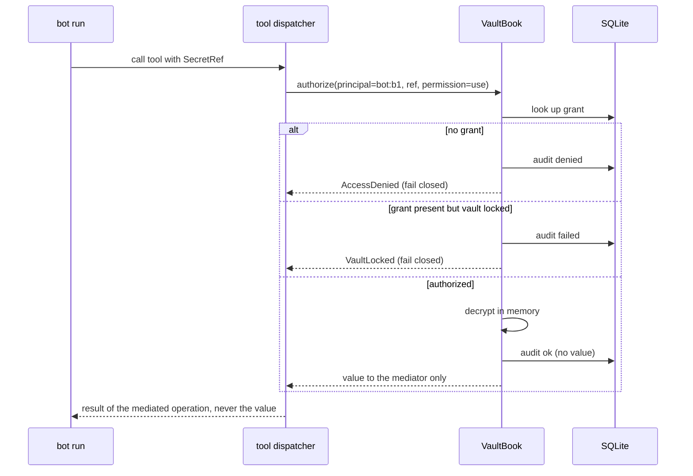
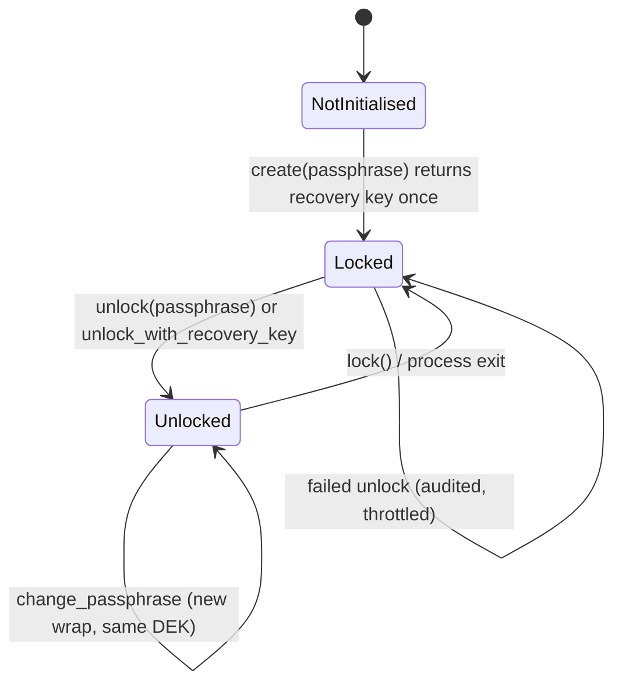

# Architecture: vault, secret references and agent-safe credential access

Status: design of record for the implemented core. Sections marked **[later]** are planned and are
not implemented yet; they are named so nobody mistakes a diagram for shipped behaviour.

---

## 1. Four separate concerns

Hutch keeps these apart deliberately. Collapsing any two of them is the usual cause of a vault
that cannot be rotated, recovered, or reasoned about.

| Concern | Question | Hutch mechanism |
|---|---|---|
| **Identity** | Who is asking? | `owner`, `paired device`, `bot:<id>`, `connector:<id>`. Runs already carry `bot_id`; the dashboard middleware already distinguishes owner from paired sessions. |
| **Authentication** | How did they prove it? | Owner token/cookie; WebAuthn passkey session for remote devices. Unchanged by this programme. |
| **Authorization** | What may they do? | Deny-by-default grants per `(secret, principal, permission)`. New. |
| **Secret management** | Where is the value, and how is it protected? | Envelope-encrypted rows in the existing SQLite database, unlocked by a passphrase-derived key. New. |

A successful sign-in grants **no** vault access. A bot's existence grants **no** vault access. The
only path to a value is an explicit grant plus an unlocked vault plus an audited call.

## 2. Trust boundaries

```
+------------------------------- machine --------------------------------+
|                                                                        |
|  human (owner)                                                         |
|    | types passphrase / approves                                       |
|    v                                                                   |
|  dashboard (browser)  --HTTP-->  Hutch ASGI (security.py)              |
|                                     |                                  |
|                                     v                                  |
|                               VaultBook  ---- grants, audit            |
|                                     |                                  |
|                          +----------+-----------+                      |
|                          |                      |                      |
|                   SQLite (ciphertext)     in-process DEK               |
|                          ^                      ^                      |
|                          |                      |                      |
|                    backup files           model context  (never)       |
|                                                                        |
|  bot run --> tool call --> shell/file tool --> OS user's whole FS      |
|                    |                                                   |
|                    +--> mediated credential use (later) --> egress     |
+------------------------------------------------------------------------+
```

Components that may see plaintext:

- The **owner**, at the moment they type or explicitly reveal a value.
- **`VaultBook` while unlocked**, in the Hutch process.
- A **mediating integration** at the instant it uses a value (a refresh-token exchange, an
  Authorization header) — it receives a value, never a transcript of it.

Components that must never see plaintext:

- The **model** (prompts, tool results, compaction summaries).
- **Transcripts, event log, run documents, tool records.**
- **Browser storage**, URLs, page state that persists.
- **Logs and crash reports.**

Components that cannot be protected by this design and are documented as such:

- Any process running as the same OS user while the vault is unlocked.
- The OS account itself if compromised.
- A backup taken while the vault is unlocked *by a process that then writes plaintext* — Hutch never
  does this; exports are explicit and separately handled.

## 3. Key hierarchy

```
recovery key (32 random bytes, shown once)
        \
         \  HKDF-SHA256                  passphrase (typed by the owner)
          \    |                                 |
           v   v                                 v
        KEK_recovery                        KEK_pass  <-- scrypt(N=2^17, r=8, p=1, 16-byte salt)
              \                                /
               \  AES-256-GCM wrap (AAD: vault id | version | kind)
                \                            /
                 +-------> DEK (32 random bytes) <------+
                                |
                                | AES-256-GCM (AAD: secret id | version | scope | category)
                                v
                       per-secret ciphertext rows
```

Rules that are enforced in code, not by convention:

- The passphrase is **never** used as a key. It derives a KEK.
- The KEK is **never** used to encrypt secrets. It only wraps the DEK.
- Each wrap has its own random salt and nonce. Two wraps of the same DEK are unrelated ciphertexts.
- Every ciphertext is bound to its identity by AAD. Moving a row to another secret, or replaying an
  old version under a new version number, fails authentication.
- A new passphrase creates a **new wrap** of the same DEK. Existing secret ciphertexts are not
  rewritten, so a passphrase change is a single small atomic write and cannot corrupt data.
- Changing the DEK (full rotation) re-encrypts every secret version; it is a distinct, explicit
  operation, not something a passphrase change does silently.

Why scrypt and not Argon2id: see `research.md` §2.5 and `decisions.md` D1. The KDF identifier and
its parameters are stored **per wrap**, so a future Argon2id wrap can coexist with existing scrypt
wraps and migrate on the next passphrase change.

### What each attacker gets

| Attacker has | Gets |
|---|---|
| A copy of the database file or a backup | AES-GCM ciphertext, salts, nonces, metadata (names, categories, scopes), audit rows. No values. |
| The database **and** the passphrase | Everything. This is the intended trust anchor. |
| The database and the recovery key | Everything. The recovery key is equivalent to the passphrase. |
| A process running as the same OS user, vault locked | No values. |
| A process running as the same OS user, vault unlocked | Everything, because the DEK is in that process's memory. Stated plainly; not claimed otherwise. |
| Root / kernel | Everything, including the passphrase as typed. |

## 4. SecretRef contract

A reference never contains a value and never contains a name that reveals one.

```
secret://<provider>/<alias>/<secret-id>[#v<version>]

provider := "hutch"                  (only implemented provider today)
alias    := [a-z][a-z0-9-]{0,31}      reserved: "local"
secret-id:= "sec_" [0-9a-f]{24}
version  := positive integer, optional
```

Validation (`refs.py`) rejects: unknown schemes, unknown providers, uppercase or path-like ids,
`..` segments, ids longer than the grammar, version `0`, embedded credentials, and any string
containing `@` or `/` beyond the fixed separators. Anything that fails is refused, never coerced.

A ref is **not** an authorization. Holding `secret://hutch/local/sec_ab12…` grants nothing; it
identifies the object whose grant is then checked.

References are safe to place in configuration, logs, audit rows, API responses and UI. Values are
not.

## 5. Permissions

| Permission | Meaning | Default |
|---|---|---|
| `metadata` | See that a secret exists, its name, category, scope, timestamps | granted to owner |
| `use` | Have Hutch apply the value at a mediated boundary without returning it | granted per bot explicitly |
| `reveal` | Receive the plaintext value | **never** implicitly; requires an explicit grant and is audited |
| `rotate` | Replace the value, creating a new version | owner only by default |
| `delete` | Soft-delete the secret | owner only by default |

Principals: `owner`, `bot:<id>`, `workspace` (the singleton), `connector:<id>`, `skill:<name>`.
`owner` is implicit for `metadata`, `rotate` and `delete`; it is **not** implicit for `reveal` only
in the sense that a reveal must still be an explicit, audited action — the owner always has the
capability, but the action is recorded.

## 6. Data flow: storing a secret

```mermaid
sequenceDiagram
    actor Owner
    participant UI as Dashboard
    participant API as Hutch API
    participant V as VaultBook
    participant DB as SQLite

    Owner->>UI: type value into a write-only field
    UI->>API: POST value over the same origin (CSRF-checked)
    API->>V: put_secret(scope, category, name, value)
    V->>V: refuse if locked / vault missing
    V->>V: version += 1, AAD = id|version|scope|category
    V->>V: AES-256-GCM(DEK, nonce, value, AAD)
    V->>DB: BEGIN IMMEDIATE; insert secret + version + audit
    DB-->>V: committed
    V-->>API: metadata only (no value)
    API-->>UI: metadata only
    UI->>UI: clear the input
```

The value never appears in the response, in an event, or in a log line.

## 7. Data flow: an agent uses a secret

Implemented now: authorization, audit and the refusal path. Mediated egress is **[later]**.



The rule: **a tool that returns a value to the model is not a mediated use.** Until egress or a
connector performs the operation itself, `use` and `reveal` are the same act and must be labelled
as such. This is enforced by making `resolve_for_use` return a `UsableSecret` that a mediator must
consume, and by auditing the call with the principal and destination.

## 8. Data flow: unlock and lock



Unlock state is per process and per `VaultBook`. Two Hutch processes each unlock independently.
Nothing writes the DEK, the KEK or the passphrase to disk.

Throttling: failed unlocks are recorded and the next attempt is refused with a growing delay. This
does not defend against an offline attacker with the database — scrypt does that — it defends an
exposed dashboard against online guessing.

## 9. Failure modes and the required behaviour

| Condition | Required behaviour |
|---|---|
| No vault created | Every value operation raises `VaultNotInitialized`; nothing falls back to a file or an environment variable |
| Wrong passphrase | No state change; audited as `denied`; throttled |
| Missing DEK wrap | `VaultCorrupt`; never silently re-initialise over existing rows |
| AEAD tag mismatch | `VaultCorrupt`; the row is not returned, decrypted, or guessed at |
| Vault locked, metadata requested | Metadata may be read; values may not |
| Disk full / permission denied | The transaction rolls back; no partial secret; the error names the cause without the value |
| Secret deleted while a consumer holds a ref | Resolution fails with `SecretNotFound`; no stale cache serves a deleted value |
| Grant revoked | The next operation fails; no long-lived in-memory grant |

## 10. Storage layout

All tables live in the existing Hutch database and are created by one migration
(`vault/schema.py: migrate`).

```
vault_meta        (singleton) vault id, KDF policy, created_at, current key version
vault_key_wraps   version, kind ('passphrase'|'recovery'), kdf, params, nonce, wrapped DEK
vault_secrets     id, scope, category, name, description, current_version, timestamps, deleted_at
vault_secret_versions  secret_id, version, nonce, ciphertext, key_version, created_at
vault_grants      secret_id, principal_kind, principal_id, permission, granted_at
vault_audit       append-only: at, actor_kind, actor_id, action, secret_id, scope, outcome, reason
vault_unlock_failures  throttle window per vault
```

`vault_audit` has `BEFORE UPDATE` and `BEFORE DELETE` triggers that abort. Audit rows contain no
values and no free-form text: `reason` is a bounded code chosen by Hutch, so an error message
carrying a secret cannot reach the table.

## 11. Deliberate non-goals for this checkpoint

- Multi-user accounts and tenancy.
- External providers (1Password, Bitwarden, HashiCorp Vault). The `SecretRef` provider field and a
  resolver interface are the seams they will use; no adapter is claimed until one is validated
  against a real service.
- Credential-aware egress proxy.
- Browser-side encryption or WebCrypto. Hutch's dashboard is server-rendered; adding client-side
  crypto would change the threat model without protecting against the attacker that matters
  (compromised app process), and is not claimed.
